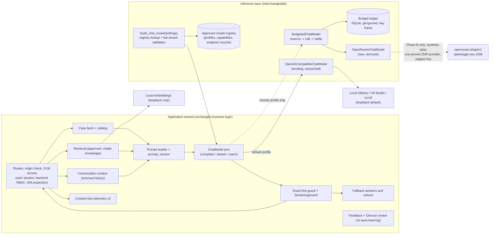

# AI Assistant Phase A2 — Governance and Implementation Plan (WP3 model adapter, WP4 lifetime budget guard)

Status: **PROPOSED — PLANNING ONLY. A2 IS NOT AUTHORISED.** Nothing in this plan is built,
accepted or enabled. Every decision, amendment, setting, file and threshold below is
**PROPOSED** until the repository owner (Shane) records an explicit decision. WP3 and WP4 need
the owner's explicit authorisation of OD-1 to OD-9 (section 14) before implementation starts.

Revision history:

- **Rev 0 (2026-10-26):** initial plan.
- **Rev 1 (2026-10-26):** review remediation R1–R6 applied (owner directive "Phase A2 plan
  remediation and final readiness review"). Sections 1, 4, 5.4, 6, 7, 8, 9, 10, 11, 12, 13, 14
  and 15 were corrected in place; section 16 records each correction and section 17 gives the
  final readiness. Where Rev 0 and Rev 1 differ, only the Rev 1 text remains in this file.

| Item | Value |
|---|---|
| Date | 2026-10-26 |
| Type | Read-only planning (no implementation, no OpenRouter API request of any kind) |
| Repository | `C:\Users\shane\Desktop\FYP\data-dividends-zero-touch-clm` |
| Latest `origin/main` (re-fetched for Rev 1) | `769c14939491de47ea5438923cf9ac5548e60bd6` = PR #115 squash merge (A1); unchanged since Rev 0 |
| Source revision read | Worktree `assistant-phase-a1-20261026` at `18fc6cd`; `git diff 18fc6cd origin/main` is empty, so its tree is identical to `origin/main` |
| Report location | Main checkout, untracked, on local `main` (`1d03986`, behind `origin/main` by one commit; not pulled or switched). No tracked file, branch, worktree or Git state was changed |
| Change classes consulted | `DOCS_ONLY`, `EXTERNAL_PROVIDER` (`scripts/dev_context.py`) |
| Planned A2 classes | `EXTERNAL_PROVIDER`, `AUTH_RBAC_SECURITY`, `PERSISTENCE` (local SQLite only), `ARCHITECTURE_REFACTOR`, `CI_TOOLING` (scanner hardening and an offline CLI), `DOCS_ONLY` |
| Spend / remote activity | US$0.00. Rev 0: no request to any OpenRouter host. Rev 1: public documentation, pricing and blog pages on `openrouter.ai` and the OpenAI harmony guide were read (unauthenticated page reads, as the directive permits); no OpenRouter API endpoint, inference endpoint or account endpoint was called |
| Credential | `OPENROUTER_API_KEY` was not read, printed, copied, validated or checked for presence |

Evidence labels:

- **VERIFIED** — read in current source/tests/docs at `769c149`; read directly in official
  OpenRouter/OpenAI documentation on 2026-10-26 (Rev 1); or recorded as VERIFIED in the
  same-day investigation report (`.ai-pipeline/reports/AI_ASSISTANT_OPENROUTER_120B_INVESTIGATION_20261026.md`).
- **CORROBORATED** — consistent web-search summaries citing official pages, not opened directly.
- **CONFLICT** — sources disagree; the plan relies on neither side.
- **UNVERIFIED / UNKNOWN** — no adequate evidence; designs treat it as worst case.
- **INFERRED** — follows from verified evidence by reasoning.
- **PROPOSED** — a recommendation; not built, not accepted.

---

## 1. Executive recommendation

1. **Proceed with A2 as one publication delivered by two bounded Stage 1 assignments**
   (A2-WP3: adapter, profile and secret-scanner hardening; A2-WP4: ledger and cost enforcement),
   one integrated acceptance, one independent Quality Gate and owner merge. A2 stays **dormant
   by construction**: the remote profile refuses to compose unless four independent conditions
   hold (section 5.4), two of which cannot be met in A2 at all. The presence of
   `OPENROUTER_API_KEY` changes nothing.
2. **Governance numbering:** D-090 and ADR-012 Amendment 2 belong to PR #114 (explanations).
   A2 uses **D-091** and **ADR-012 Amendment 3**, both PROPOSED. Two scans of every local and
   remote-tracking branch (Rev 0 and Rev 1, both 2026-10-26) found no use of either.
3. **Architecture (unchanged in Rev 1):** keep `ChatModel` (`apps/assistant/ai_assistant/llm.py:73-81`)
   as the only application-facing port; a code-defined approved model registry with explicit
   capabilities; a separate `OpenRouterChatModel` (the existing adapter is untouched, so the
   default request stays byte-identical); one composition factory; a `BudgetedChatModel`
   decorator. Prompts, retrieval, conversation context, the exact-line guard, fallbacks, RBAC and
   feedback stay where they are.
4. **Budget (corrected in Rev 1):** a ledger in the **cumulative usage frame of one API key**,
   anchored on the key's opening usage, with a provider-anchored baseline and high-water mark so
   reconciliation never loses or double-counts an amount (section 8.3). Reservations use a
   **labelled bound**, not a proven one: content tokens are bounded mathematically, prices and
   output ceilings by documented provider limits, template overhead by an engineering assumption
   that Phase B must verify (section 8.2). The provider-side non-resetting key limit remains an
   independent financial protection.
5. **Spending controls (verified in Rev 1):** guardrail budgets reset daily/weekly/monthly;
   API-key limits can be non-resetting; lifetime workspace budgets exist only on the
   **Enterprise** plan and are not assumed; prepaid credits can still go slightly negative; the
   Standard-plan purchase fee is 5.5% with a US$0.80 minimum and prices exclude taxes. Whether
   "US$10" means the payment-method charge or the inference credits remains an **owner decision
   for Phase B** (section 8.1).
6. **Provider pinning (Rev 1):** exactly one approved, pinned provider per experimental
   configuration; the documented chat-completion response does **not** identify the serving
   provider, so serving-provider verification needs generation metadata, a separately
   authorised Phase B capability. In A2 every remote call is `unverified`; mismatches are
   quarantined (section 6.7).
7. **Secret scanning (Rev 1):** scanner hardening is **mandatory A2 scope** (SC-1 to SC-8). The
   current scanner misses credential assignments to `OPENROUTER_API_KEY` and flags harmless
   documentation placeholders (it flagged two in Rev 0 of this report; reworded in Rev 1).
8. **Integration (Rev 1):** new A2 modules can be built now in a separate worktree; shared files
   are changed or merged only after the ten-step latest-main gate (section 12). If PR #114 is
   accepted, evaluation must score model-selected lines separately from server-added required
   lines before any Phase B comparison.
9. **Readiness:** WP3 is ready for owner implementation approval; WP4 is ready with conditions
   (OD-5, OD-6); no issue identified makes the offline, dormant A2 implementation unsafe. Phase B
   remains **BLOCKED** (sections 15 and 17).

---

## 2. Current architecture and dependencies (VERIFIED at `769c149`)

### 2.1 Model integration

| Concern | Current implementation | Evidence |
|---|---|---|
| Application port | `ChatModel` protocol: `name`, `complete(messages)`, `stream(messages)`, `warm(messages)` | `llm.py:73-81` |
| Only adapter | `OpenAICompatibleChatModel`; `POST {base}/chat/completions`; Bearer-scheme `Authorization` header from the configured credential; no redirects | `llm.py:84-128` |
| Request body | Exactly `model`, `messages`, `temperature`, `max_tokens`, `stream` | `llm.py:108-117` |
| Non-stream | `trust_env` default (honours proxy env); one choice; non-empty content; `cut_short` from `finish_reason == "length"`; usage ignored | `llm.py:119-125`, `:142-161` |
| Stream | Raw SSE, 64 KiB/frame, 1 MiB/response, whole-request deadline, `Accept-Encoding: identity`; `finish_reason` ∈ {`None`, `stop`, `length`} else failure; **stops at the first `finish_reason`**, so OpenRouter's usage chunk is never read | `llm.py:163-281`, `:259-268` |
| Answer types | `ModelAnswer(text, cut_short)`, `Piece(text, cut_short)`; no usage, finish reason or generation id | `llm.py:58-70` |
| Warm-up | Only to literal loopback URLs, `trust_env=False`, `max_tokens=1` | `llm.py:15-47`, `:283-298`; `main.py:434-453` |
| Settings | `env_prefix="AI_ASSISTANT_"`, `env_file=".env"`, `extra="ignore"`: **`OPENROUTER_API_KEY` is ignored today** (F-A2-1) | `config.py:10`, `:18-26` |
| Composition | `create_app(settings, *, chat_model=...)` builds one adapter from settings when none is injected | `main.py:232-272` |
| Use sites | `/chat` is a synchronous route (thread pool, so calls can be concurrent); `/chat/stream` is async with `aclosing` and records cancellation | `main.py:407-429`, `:455-523`, `:559-582` |
| Fallback notices | `FALLBACK_NOTICE`, `POLICY_NOTICE`, `CUT_SHORT_NOTICE` | `main.py:147-149` |
| Health | Exposes `llm_enabled` and the model name | `main.py:538-545` |

### 2.2 A1 surfaces that A2 extends

| Surface | Current state | Evidence |
|---|---|---|
| Telemetry | Off by default; `METRICS_VERSION = 1`; strict allow-list record (`AnswerMetrics`); `FallbackReason` has no budget code; no `usage`, `budget`, `profile`, `finish_reason` or `empty_content` field (left for A2) | `telemetry.py:35`, `:40-47`, `:146-208` |
| Prompt identity | `prompt_version()` hashes the prompt builder source, rules and page terms — **not** `guardrails.py` | `telemetry.py:214-226` |
| Harness settings | `AiAssistantSettings.model_construct(...)`: **validators do not run** | `assistant_eval/runner.py:72-75` |
| Harness model seam | `local_model()` refuses non-loopback URLs and proxies; the harness cannot evaluate a remote model | `assistant_eval/models.py:188-219` |
| Snapshot identity | Catalog line ids are hashes of the line text; gold files are bound to the snapshot SHA-256 | `assistant_eval/snapshot.py:36-41`; `assistant_eval/gold.py:98`, `:161` |
| Gold labels | 84/84 stubs, no lock (owner-owned, A-6) | A1 re-QG `AI_ASSISTANT_PHASE_A1_QUALITY_GATE_R1.md`, checklist row 15 |
| Test isolation | `conftest.py` disables `.env` and the model before composition | `apps/assistant/tests/conftest.py` |
| A1 QG notes for A2 | N-2: harness/adapter clients honour real proxies (`trust_env`); L4: importing `ai_assistant.main` composes the module-level app from env/`.env` | A1 re-QG section 5; first QG L4 |

### 2.3 Repository facts that shape A2

| Fact | Consequence | Evidence |
|---|---|---|
| `apps/assistant/data/` is git-ignored; data paths resolve relative to the package | Ledger at `apps/assistant/data/budget/ledger.sqlite3` is never tracked | `.gitignore:54-55`; `knowledge/factory.py:11-15` |
| `check_project_state.py` accepts only a fixed provider set and rejects extras | A-8 resolved: record the dormant remote profile in prose (`ARCHITECTURE.md`), not as a `PROJECT_STATE.md` provider, unless a separate `CI_TOOLING` assignment changes the checker | `scripts/check_project_state.py:32-64`, `:247-255` |
| `check_secrets.py` scans tracked **and non-ignored untracked** files; ignored files such as `.env` are excluded | Scanner changes affect untracked task documents too; `.env` is never read | `scripts/check_secrets.py:82-90` |
| `check_secrets.py` has no OpenRouter rule; `sensitive-assignment` needs a word boundary before `api_key`, so credential assignments to `OPENROUTER_API_KEY` or `AI_ASSISTANT_LLM_API_KEY` are **not** matched (INFERRED from the regex) | Mandatory scanner hardening (SC-1 to SC-8, OD-8) | `scripts/check_secrets.py:49-79` |
| `bearer-authorization` treats a documentation placeholder such as an angle-bracket key name followed by Markdown punctuation as a finding | Running the scanner's own `scan_file` on Rev 0 of this report returned two `bearer-authorization` findings (lines 83 and 402, both placeholders, no secret); reworded in Rev 1 | `scripts/check_secrets.py:66-70`, `:92-135` |
| Hosted CI and `pre_pr_check.py` do not run assistant tests | Stage 2 assistant evidence must be attached explicitly | Investigation G8 |
| Pinned dependencies: `httpx==0.28.1`, `pydantic-settings==2.15.0`; no tokenizer | A2 adds no dependency; token bounds use UTF-8 bytes | `apps/assistant/pyproject.toml` |

### 2.4 Dependency direction (unchanged by A2)

```text
frontend panel -> assistant routes (main.py) -> CLM backend (GET only, user session)
                                    |-> context/facts -> prompts -> ChatModel port -> adapter -> model endpoint
                                    |-> retrieval -> local SQLite/ChromaDB (+ loopback embeddings)
                                    |-> guardrails (exact-line catalog, StreamingGuard) -> response
                                    |-> telemetry sink (off by default)
assistant_eval (dev-only) -> create_app seams      (ai_assistant never imports assistant_eval)
```

---

## 3. Decision and ADR collision assessment

### 3.1 Identifier inventory

| Identifier | Holder | Location | State |
|---|---|---|---|
| D-083 | Feedback, enhancement requests, single-reviewer POC mode | `main` | PROPOSED (code on `main` since PR #108) |
| D-084 / ADR-012 Amendment 1 | Answer records, request lifecycle, document upload | `main` (PR #110) | PROPOSED; PR #113 builds D1/D2 ahead of acceptance and edits the Amendment 1 text |
| D-085 to D-089 | Ownership decisions | `main` (PR #111) | candidate |
| **D-090** | Explanations, topic steering, required lines | PR #114 branch `feat/ai-assistant-explanations` (`a49db57`) | PROPOSED. Collision: the A1 planner on `main` (A-4, section 10) also named D-090 for A2 |
| **ADR-012 Amendment 2** | Explanations (D-090) | PR #114 branch | PROPOSED. Collision: the A1 planner also named Amendment 2 for A2 |
| D-091 | none | — | **Free** — proposed for A2 |
| ADR-012 Amendment 3 | none | — | **Free** — proposed for A2 |

### 3.2 Scan method and limits

- `git grep` over every `refs/heads` and `refs/remotes` branch (after `git fetch origin`) for
  `D-091`, `D-092`…`D-099` and `Amendment 3` in `docs/`, `.ai-pipeline/` and `apps/`:
  **0 hits** in Rev 0 and again in Rev 1. `D-090`/`Amendment 2` appear in `docs/decisions/`
  only on PR #114's branch (and in the A1 planner on `main`).
- PR states at Rev 1: #113 head `200e279`, #114 head `a49db57`, both Draft and `CONFLICTING`
  with `main`, unchanged since Rev 0.
- Not covered: uncommitted files in other worktrees and teammates' unpushed branches.
- Numbering moves at integration (PR #114's commit `e14fc25` was drafted as "D-085"; `main`
  records a D-084 → D-085 renumbering note). **Rule (PROPOSED):** the first PR to merge keeps a
  number; A2 re-checks D-091 and Amendment 3 at Stage 2 and renumbers with a note if taken.

### 3.3 Collision recommendations

1. Do not reuse D-090 or Amendment 2; they stay with PR #114. A2 records **D-091 (PROPOSED)**
   and **ADR-012 Amendment 3 (PROPOSED)**.
2. In the A2 docs step, add a dated correction to `AI_ASSISTANT_PHASE_A_PLAN.md` (A-4 and
   section 10): "renumbered to D-091 / Amendment 3 because PR #114 uses D-090 / Amendment 2".
3. Amendment 3 must not depend on Amendments 1 or 2 being accepted: it addresses the ADR's
   external-endpoint revisit condition and data boundary, not sections A or C.
4. Teammate hazard (for the PR #113 owner, not changed here): PR #113's branch predates PR #111,
   and its `DECISION_LOG.md` edit sits next to the D-084/D-085 boundary; a merge must keep
   D-085 to D-089.

---

## 4. Proposed D-091 and ADR-012 Amendment 3 (draft text, PROPOSED)

These drafts are inserted into `docs/decisions/` only by the A2 docs step after owner
authorisation. They are not written now. Sub-decision labels X1–X9 are used to avoid
confusion with the review findings R1–R6 (section 16).

### 4.1 Draft D-091

> **D-091 - proposed AI Assistant dormant external inference profile and lifetime budget guard (PROPOSED)**
>
> Status: PROPOSED by the project team on 2026-10-26. Not accepted. It amends ADR-012
> (Amendment 3). Each of X1 to X9 needs the repository owner's explicit acceptance before merge.
>
> **What A2 does not do.** A2 does not enable remote inference. It does not approve sending
> customer, sponsor or case data to any external provider. It does not approve any API
> spending. It does not approve user-configurable or user-visible model selection. It does not
> authorise a shared or hosted inference deployment. It does not change the CLM AI Assistant's
> responsibilities or use cases. It does not relax the exact-line output guard. Any future
> remote activation requires separate owner decisions (Phase B) and the applicable sponsor
> governance (Q-013) for anything beyond synthetic data.
>
> | # | Decision | Recommendation |
> |---|---|---|
> | X1 | Dormant remote profile | The `openrouter_gpt_oss_120b` profile exists in code but refuses composition unless four independent conditions hold: an injected transport (A2), an approved endpoint record in the registry (none in A2), the interlock value `D-091`, and an initialised healthy ledger. |
> | X2 | Approved model registry | Code-defined profiles with explicit capabilities and per-endpoint records (provider slug, listed prices, output ceilings, documented guarantees). Settings only select a profile, one approved endpoint, and values inside the profile's bounds. Base URL, model id, data boundary and fixed privacy/routing flags are not configurable. |
> | X3 | Credential source | `OPENROUTER_API_KEY` is read from the process environment only, lazily, after every non-secret check, only for the remote profile, and never sent to any other destination. `AI_ASSISTANT_LLM_API_KEY` stays the local credential. |
> | X4 | Fixed remote request policy | Exactly one pinned provider (`provider.only`), `allow_fallbacks=false`, `require_parameters=true`, `data_collection="deny"`, `zdr=true`, `max_price` = the endpoint's listed prices, `reasoning.exclude=true`; no attribution headers, `user` or session identifiers, plugins, tools or files. |
> | X5 | Lifetime budget ledger | Local SQLite ledger (git-ignored, single instance) in the cumulative usage frame of one API key, anchored on the key's opening usage; labelled worst-case reservation; settlement from provider `usage.cost`; conservative settlement on uncertainty; accounting breaker; fail closed on missing/corrupt ledger; offline operator CLI. The cap never resets by date and a fresh ledger never resets previous spending. |
> | X6 | Provider verification | Every remote call is recorded `unverified` until a separately authorised Phase B capability verifies the serving provider from generation metadata; mismatching evidence quarantines the call and opens the breaker. |
> | X7 | Telemetry v2 | Content-free `profile`, requested provider, verification flag, `usage`, `budget`, `finish_reason`, `empty_content` and provider error class fields; still off by default. |
> | X8 | Multi-instance limit | Each ledger enforces only its own key and instance. A global cap across teammates is enforced only by provider-side controls (per-key non-resetting limits, account credits), partitioned statically. |
> | X9 | Secret scanning | The repository scanner detects credential assignments to the assistant's credential names and OpenRouter-shaped keys, with documented safe placeholders. |
>
> Unchanged: the exact-line catalog and `StreamingGuard` as the only route to displayed model
> text; deterministic fallbacks and notices; GET-only CLM access with the user's session;
> loopback-only embeddings and warm-up; no tools; no automatic learning from feedback.
> Authority: `PROJECT_DEFINED_PROVISIONAL`. Classification of the remote profile: `DORMANT`
> (mock-transport tests only). Not sponsor policy; no CLM backend write, provider status or
> Live claim follows.

### 4.2 Draft ADR-012 Amendment 3

> **Amendment 3 - external-model architecture revisit: dormant external inference profile and budget guard (PROPOSED, D-091)**
>
> Status: PROPOSED on 2026-10-26. Not accepted. It records how the revisit condition "any
> non-local embedding or model endpoint" is handled for one dormant model endpoint and does not
> satisfy that condition for activation.
>
> Context. ADR-012 assumed a local model. Phase A2 adds code for one external inference profile
> (OpenRouter, `openai/gpt-oss-120b`) that is dormant, plus a lifetime budget guard.
>
> Decision. (1) The `ChatModel` port is unchanged; providers are selected from a code-defined
> registry through one factory; business logic does not branch on providers. (2) The remote
> profile would receive exactly the messages the local model receives; no data minimisation,
> prompt, retrieval or catalog change is part of this amendment. (3) The remote profile cannot
> run until a Phase B decision and a reviewed change open its locks. (4) Embeddings stay
> loopback-only; warm-up never targets a remote URL. (5) Sections A and C are unchanged,
> including the exact-line catalog. (6) No user model selection and no shared deployment.
>
> Revisit before Phase B: data classification and disclosure scope (O1, O2/Q-013), the pinned
> endpoint and same-day ZDR evidence, serving-provider verification, budget semantics, whether a
> broker is acceptable, evaluation acceptance thresholds. Revisit before any production or
> team-wide use: hosted deployment, shared budget, key distribution, retention of remote-run
> records.
>
> Consequences. A new external trust boundary exists in code; a new local persistence owner
> (the budget ledger, a separate aggregate from the knowledge store whose schema v5 is reserved
> by D-084); a new offline operator script; stricter secret scanning. Rollback: remove the
> profile entry; the default profile has no ledger and no new file.

### 4.3 Approval map for enabling remote inference

| Decision | Approver | Needed before |
|---|---|---|
| OD-1 to OD-9 (section 14) | Owner | A2 implementation |
| D-091 X1–X9 and ADR-012 Amendment 3 acceptance | Owner (with independent architecture review in the A2 QG) | A2 merge |
| O1: may synthetic case data go to OpenRouter and one upstream provider? Which provider/region? | Owner | Phase B |
| O2 / Q-013: any non-synthetic or sponsor data; whether a broker is acceptable at all; DPIA/vendor assessment; jurisdictions | **Sponsor (Delta Capita)** and owner | Any non-synthetic use (out of POC scope) |
| O3: meaning of "US$10" (payment-method charge or inference credits); taxes and fees; who holds the account and key; auto top-up off | Owner | Phase B |
| O4: caps per layer, the key's opening usage, batch allocation | Owner | Phase B |
| O5: ADR-012 revisit outcome for an external model endpoint (evaluation scope) | Owner + architecture review | Phase B |
| Phase B serving-provider verification capability (authenticated generation-metadata reads) and reading the public ZDR endpoint list | Owner (separate authorisation) | Phase B |
| Approved endpoint record (provider, listed prices, output ceilings, documented guarantees, ZDR evidence date) | Owner, via a reviewed change | Phase B |
| Account configuration: ZDR enforcement, data-collection deny, prompt logging off, guardrail allow-lists, key limit with no reset, auto top-up off | Owner (configured by the owner, never by an agent) | Phase B |
| Gold labels frozen (A-6); thresholds (O8); local baseline E1 (A-7/O7) | Owner/team | Phase B comparisons |
| Status of D-083/D-084/D-090 for the evaluated revision | Owner | Freezing the evaluation baseline |
| Whether the sponsor must be informed of synthetic-only external evaluation | Owner (not assumed either way) | Phase B |

---

## 5. Model-agnostic target architecture (PROPOSED)

### 5.1 Diagram



### 5.2 Responsibility split

| Owned by the application (never by a provider adapter) | Owned by the inference layer |
|---|---|
| Use cases UC-01…UC-14, roles, permissions, CLM case access (backend-authoritative) | Translating a provider-neutral request into one provider's wire format |
| Prompt building, page terms, history trimming, question truncation | Transport, TLS, timeouts, byte bounds, redirect/proxy policy |
| Retrieval and approved knowledge, permission filtering | Decoding streams and bodies into `Piece`/`ModelAnswer` + normalised usage |
| Exact-line guard, required-line logic (if D-090 accepted), fallbacks, notices | Classifying provider errors into closed codes |
| Budget policy (cap, reservation rule, breaker), telemetry, evaluation, feedback governance | Declaring capabilities and refusing unsupported parameters |

### 5.3 Interfaces (illustrative; names PROPOSED)

```python
# ai_assistant/llm.py — additive only (existing constructors stay valid)
@dataclass(frozen=True)
class ModelUsage:
    prompt_tokens: int | None
    completion_tokens: int | None
    reasoning_tokens: int | None
    cached_tokens: int | None
    cost_usd: Decimal | None          # provider-reported credits (USD-denominated); None if absent/malformed
    generation_ref: str | None        # response "id", pattern-validated; ledger only, never telemetry
    reported_provider: str | None     # advisory only: an undocumented response field, if present

@dataclass(frozen=True)
class ModelAnswer:
    text: str
    cut_short: bool = False
    usage: ModelUsage | None = None    # new, default None
    finish_reason: str | None = None   # new, default None

@dataclass(frozen=True)
class Piece:
    text: str = ""
    cut_short: bool = False
    usage: ModelUsage | None = None    # new; only on the last piece
    finish_reason: str | None = None   # new; only on the last piece

# ai_assistant/model_profiles.py — new
@dataclass(frozen=True)
class ModelCapabilities:
    streaming: bool
    temperature: bool
    reasoning_efforts: frozenset[str]            # gpt-oss: {"low", "medium", "high"}
    usage_in_response: bool

@dataclass(frozen=True)
class ApprovedEndpoint:                           # one OpenRouter provider endpoint for one model
    provider_slug: str
    prompt_price_per_m: Decimal
    completion_price_per_m: Decimal
    request_price: Decimal                        # explicit 0 only if the listing shows none
    cache_write_price_per_m: Decimal | None
    internal_reasoning_price_per_m: Decimal | None
    max_completion_tokens: int                    # documented endpoint limit
    max_tokens_includes_reasoning: bool           # True only with documented provider evidence
    evidence_date: date                           # same-day re-verification record (Phase B)

@dataclass(frozen=True)
class ModelProfile:
    profile_id: str                    # closed vocabulary
    adapter: Literal["openai_compatible", "openrouter"]
    boundary: Literal["loopback_default", "external"]
    model_id: str | None               # None: from settings (local profile only)
    base_url: str | None               # None: from settings (local profile only)
    capabilities: ModelCapabilities
    endpoints: tuple[ApprovedEndpoint, ...]       # remote: empty = cannot be enabled
    requires_budget: bool
    dormant: bool

APPROVED_PROFILES: Mapping[str, ModelProfile]   # code-reviewed; not user- or env-editable

# ai_assistant/model_factory.py — new; the single composition point
def build_chat_model(
    settings: AiAssistantSettings,
    *,
    transport: httpx.AsyncBaseTransport | httpx.BaseTransport | None = None,
    environ: Mapping[str, str] = os.environ,
    registry: Mapping[str, ModelProfile] = APPROVED_PROFILES,
) -> ChatModel | None: ...
```

### 5.4 Registry contents in A2 and the dormant locks

| Profile id | Adapter | Boundary | Model / URL | Approved endpoints | Budget | Dormant |
|---|---|---|---|---|---|---|
| `local_openai_compatible` (default) | existing `OpenAICompatibleChatModel` | loopback by default; operator-configured as today | from `AI_ASSISTANT_LLM_*` exactly as today | n/a | no | no |
| `openrouter_gpt_oss_120b` | new `OpenRouterChatModel` | external | `openai/gpt-oss-120b` at `https://openrouter.ai/api/v1` (fixed) | **none in A2** | required | **yes** |

The remote profile composes only if **all four** locks are open; each is tested independently:

| Lock | Condition | State in A2 |
|---|---|---|
| L1 | A transport is injected (real network composition refused while `dormant=True`) | Only tests inject mock transports; production composition is refused |
| L2 | The registry has an approved endpoint record for the selected provider | None exists; adding one needs a reviewed Phase B change |
| L3 | `AI_ASSISTANT_REMOTE_INFERENCE_DECISION` equals `D-091` | Empty by default |
| L4 | An initialised, healthy ledger exists for the profile | No ledger exists; the service never creates one |

Tests use an injected test registry with a fictitious endpoint record and test prices; the
production registry never carries invented provider approvals or prices.

### 5.5 Capability and format handling (explicit, never silent)

| Situation | Behaviour |
|---|---|
| A setting needs a capability the profile lacks (for example an effort value outside `{low, medium, high}` for gpt-oss, or `none`, which a model with mandatory reasoning rejects) | Start-up refused with a fixed message naming the setting |
| Endpoint record lacks a reservation input (prices, request price, maximum completion) | Start-up refused (fail closed; section 8.2) |
| Provider cannot honour a parameter | `provider.require_parameters=true`: route only to providers supporting every sent parameter; an unroutable request fails (no silent drop) |
| Unknown response keys (`object`, `created`, `system_fingerprint`, `native_finish_reason`, …) | Ignored (tolerant reader); keys the adapter uses are type-checked strictly |
| `delta.reasoning`, `reasoning_details`, `message.reasoning` | Never yielded, logged, stored or measured beyond `reasoning_tokens` |
| Provider error | Closed error class (section 6.4) → `LlmUnavailableError` → existing fallback |

### 5.6 Path to user model selection later (not in A2)

A later phase can add a backend-authoritative model choice without touching business logic:
a registry entry gains `allowed_roles`, a read-only route lists entries the viewer may use, and
a request field carries a `profile_id` that the server validates against the registry and the
viewer's backend-reported role. `create_app` then holds a `ModelResolver` (built by the same
factory) instead of one model. A2 prepares for this by (a) routing composition through
`build_chat_model`, (b) recording `profile` in telemetry (and, if D-084 is accepted, in answer
records), and (c) keeping capabilities explicit. No UI, route or request field is added in A2.

---

## 6. Secure OpenRouter adapter design

### 6.1 Fixed request policy (not configurable)

| Field | Value | Basis |
|---|---|---|
| URL | `https://openrouter.ai/api/v1/chat/completions` (exact host; no regional host) | VERIFIED (investigation 6.3); in-region routing is Business/Enterprise only (VERIFIED pricing page) |
| `model` | `openai/gpt-oss-120b`; any variant suffix (`:free`, `:nitro`, `:online`, …) refused | VERIFIED id; suffix refusal PROPOSED (variants route to endpoints with other policies, limits or extra billable features) |
| Headers | Bearer-scheme `Authorization` header and `Content-Type: application/json`; stream adds `Accept-Encoding: identity`. **No** `HTTP-Referer`, `X-Title`/`X-OpenRouter-Title` or other attribution headers | Attribution headers are documented as optional, for rankings (VERIFIED API overview) |
| `provider.only` | **Exactly one** approved provider slug (`AI_ASSISTANT_OPENROUTER_PROVIDER`) | VERIFIED field; single pin is the Rev 1 rule (section 6.7) |
| `provider.allow_fallbacks` | `false` | VERIFIED field, default `true` |
| `provider.require_parameters` | `true` | VERIFIED field, default `false` |
| `provider.data_collection` | `"deny"` | VERIFIED ("control whether to use providers that may store data") |
| `provider.zdr` | `true` | VERIFIED; OR-ed with account and guardrail ZDR settings, so it cannot weaken them |
| `provider.max_price` | `{prompt, completion, request}` = the endpoint record's listed prices (USD per million tokens; per request) | VERIFIED: providers priced above it are filtered out |
| `reasoning` | `{effort: <low|medium|high>, exclude: true}` | Efforts VERIFIED (OpenAI harmony guide); `exclude` still bills reasoning (VERIFIED reasoning docs) |
| `temperature` | `AI_ASSISTANT_LLM_TEMPERATURE` (0.2 default, same as baseline) | VERIFIED supported on all listed endpoints (investigation) |
| `max_tokens` | `llm_max_answer_tokens` (600) + reasoning allowance, total ≤ 4,000 | Limits reasoning plus visible output "on most providers" (VERIFIED wording); not relied on for the budget bound unless documented for the endpoint (section 8.2) |
| Never sent | `user`, `session_id`, `tools`, `tool_choice`, `response_format`, `stream_options`, `usage`, `transforms`, `models`, `route`, `plugins`, files, images, web search options | PROPOSED; `usage.include` and `stream_options.include_usage` are deprecated with no effect (CORROBORATED) |

Transport: `follow_redirects=False`; **`trust_env=False`** (no proxy, `.netrc` or certificate
environment overrides; closes A1 N-2 for the remote path); TLS verification always on with the
library default trust store; whole-request deadline from `AI_ASSISTANT_LLM_TIMEOUT_SECONDS`;
the existing 64 KiB/frame and 1 MiB/response bounds (reusing `_sse_frames`); exactly one
request per question (to `/chat/completions` only); no retries; `warm()` is a no-op.

### 6.2 Stream handling (state machine)

| State | Accepted frames | Action |
|---|---|---|
| CONTENT | `data:` JSON with exactly one choice; `delta.content` string or null; `delta.reasoning*` ignored; SSE comments (`: OPENROUTER PROCESSING`) ignored by the parser (VERIFIED "comment payload, which you should ignore") | Yield content pieces (unchanged guard downstream) |
| CONTENT → FINISHED | first `finish_reason` ∈ {`stop`, `length`} | Stop yielding text; remember finish reason |
| CONTENT → failure | `finish_reason` ∈ {`content_filter`, `tool_calls`, `error`} (the documented normalised set is `tool_calls`, `stop`, `length`, `content_filter`, `error`) | `LlmUnavailableError` with class `content_filter`, `protocol` (no tools are sent) or `upstream_midstream` |
| FINISHED | Usage frame: one choice with empty delta repeating the finish reason, or `choices: []`, with a `usage` object ("returned exactly once in the final chunk", VERIFIED) | Parse usage strictly; content after finish is ignored and flagged `content_after_finish` |
| FINISHED → DONE | `[DONE]` or EOF | Final `Piece(cut_short, usage, finish_reason)` |
| Any | Frame with a top-level `error` object | `LlmUnavailableError` (existing partial-line behaviour in `main.py` applies); `error.message` and `error.metadata` are never logged or stored |
| CONTENT | EOF before any finish | `LlmUnavailableError("model stream ended early")` (as today) |
| FINISHED | Deadline or byte limit during read-through | Keep the validated answer; `usage=None` (budget: unsettled, breaker) |

Usage parsing: frames are decoded with `json.loads(..., parse_float=Decimal)` in the remote
adapter only; `cost` must be a finite `Decimal` ≥ 0 (documented as the amount charged, in
credits); token counts must be non-negative `int`s (documented as native-tokenizer counts);
anything else → `usage=None` plus an anomaly code. Fields used: `prompt_tokens`,
`completion_tokens`, `cost`, `prompt_tokens_details.cached_tokens`,
`completion_tokens_details.reasoning_tokens` (VERIFIED usage-accounting page);
`cache_write_tokens` is read for the overhead check; `cost_details` is ignored (BYOK only).
The response `id` becomes `generation_ref`; the response `model` must equal the requested model.

### 6.3 Non-stream handling

HTTP 200 with a top-level `error` → failure; otherwise exactly one choice, non-empty string
`message.content`, `finish_reason` ∈ {`stop`, `length`} (all other documented values are
failures, unlike the default `complete()`), `usage` and `id` parsed as above,
`message.reasoning` ignored.

### 6.4 Error classification and call-count matrix

All outcomes: exactly **one** HTTP request, **zero** retries, existing fallback text and notice.
"At reservation" means the conservative settlement of section 8.4.

| Outcome | Error class (metrics only) | Budget settlement | Breaker |
|---|---|---|---|
| 200, content, usage with cost | — | at `cost` (anomaly + breaker if `cost` > reservation) | no |
| 200, content, usage missing/malformed | `usage_missing` | at reservation, `unsettled` | **open** |
| 400 invalid request/parameters | `bad_request` | at reservation | **open** (configuration defect would repeat) |
| 401 invalid key | `auth` | at reservation | **open** |
| 402 insufficient credits or key limit exhausted (`limit_source: openrouter_key_limit` documented for the key case; read only as a closed code if present) | `payment` / `payment_key_limit` | at reservation | **open** |
| 403 guardrail, workspace budget, allow-list or data-region restriction (VERIFIED: these "produce 403 responses") | `forbidden` | at reservation | **open** |
| 404 account allowed-providers conflict with `only` (VERIFIED) or model not found | `not_allowed` | at reservation | **open** |
| 408 / client deadline | `timeout` | at reservation | no |
| 429 rate limited (documentation suggests backoff; the assistant never retries) | `rate_limited` | at reservation | no |
| 500 / 502 upstream error | `upstream` | at reservation | no |
| 503 or other unroutable response (code UNKNOWN for most routing failures) | `no_provider` | at reservation | **open** |
| Mid-stream error frame or `finish_reason: "error"` | `upstream_midstream` | at reservation, or `cost` if usage arrived | no |
| `finish_reason: "content_filter"` | `content_filter` | at `cost` if usage arrived, else reservation | no |
| `finish_reason: "tool_calls"` | `protocol` | at `cost` if usage arrived, else reservation | no |
| Connect/TLS/transport error | `transport` | at reservation | no |
| Response `model` ≠ requested, or an undocumented `provider` field ≠ the pinned provider | `routing_anomaly` | at `cost` if present, else reservation; call `quarantined` | **open** |

Whether OpenRouter bills failed attempts is UNKNOWN; settling at the reservation is
conservative and reconciliation can release over-counting (sections 8.3 and 8.5).

### 6.5 Input/output limits

- Input: the prompt the application builds is already bounded (rules 1.7K, facts ≈6.3K, knowledge
  ≤ 8 KiB plus headers, history ≤ 2,400, question ≤ 600 characters; A1 token breakdown). A new
  `AI_ASSISTANT_REMOTE_MAX_PROMPT_BYTES` (default 32,768) refuses larger prompts before
  reservation (no truncation, which would change model input).
- Output: `max_tokens` = answer cap + reasoning allowance ≤ 4,000; the budget bound uses the
  endpoint's documented maximum completion unless the endpoint documents that `max_tokens`
  includes reasoning (section 8.2).

### 6.6 External facts register (re-verify every row on the day Phase B starts)

| Fact | Label | Source |
|---|---|---|
| Base URL `https://openrouter.ai/api/v1`, `POST /chat/completions`, Bearer-scheme auth | VERIFIED | Investigation 6.3; API overview |
| Model id `openai/gpt-oss-120b`; 24 endpoints on 2026-10-26, all then in the ZDR list; prices US$0.03–0.35/M input, US$0.15–0.95/M output; max completion 4,096–117,964 | VERIFIED (dated; must be re-read) | Investigation 6.2 |
| Provider object fields (`order`, `only`, `ignore`, `allow_fallbacks` default true, `require_parameters` default false, `data_collection` allow/deny, `zdr`, `quantizations`, `sort`, `max_price{prompt, completion, request, image}`) | VERIFIED | Provider-selection docs |
| `max_price` filters out providers priced above it; account allowed-providers conflict with `only` → 404 | VERIFIED | Provider-selection docs |
| Chat-completion response documents `id` and `model` but **no serving-provider field**; `model` may differ from the request "depending on the model that ends up being used" | VERIFIED | API overview |
| Generation metadata (`GET /api/v1/generation?id=…`, authenticated) returns `provider_name`, `total_cost` (USD) and native token counts; content is a separate endpoint that needs prompt logging | CORROBORATED | API reference (search summary) |
| Finish reasons normalised to `tool_calls`, `stop`, `length`, `content_filter`, `error`; raw value in `native_finish_reason`; SSE comments to be ignored; usage exactly once in the final chunk | VERIFIED | API overview |
| Usage fields `prompt_tokens`, `completion_tokens`, `total_tokens`, `cost` ("amount charged", in credits), `prompt_tokens_details.{cached_tokens, cache_write_tokens, audio_tokens}`, `completion_tokens_details.reasoning_tokens`, `cost_details.upstream_inference_cost` (BYOK only); counts use the model's native tokenizer | VERIFIED | Usage-accounting docs |
| Reasoning tokens are output tokens; `exclude` still bills them; `max_tokens` covers reasoning plus visible output "on most providers"; empty content with `length` possible; `none` rejected where reasoning is mandatory | VERIFIED | Reasoning-tokens docs |
| gpt-oss: `o200k_harmony` encoding; envelope `<|start|>{header}<|message|>{content}<|end|>`; default system message (identity, knowledge cutoff, current date, reasoning level, valid channels); efforts low/medium (default)/high; analysis channel not held to final-message safety standards; envelope token count not documented | VERIFIED | OpenAI harmony guide |
| ZDR: per-request `zdr` OR-ed with account and guardrail settings; account ZDR per model group; eligibility per endpoint; list published at `/api/v1/endpoints/zdr`; in-memory caching not counted as retention; prompts not retained unless prompt logging is opted into | VERIFIED | ZDR docs |
| **A. Guardrail budgets** reset daily, weekly or monthly; over-budget and allow-list restrictions return 403; assignable to keys or members; ZDR enforced per model group | VERIFIED | Guardrails docs |
| **B. API-key limit**: `limit`, `limit_remaining`, `limit_reset` (`null` = never resets); exhaustion appears as 402 with `limit_source` `openrouter_key_limit` | VERIFIED | Limits docs |
| **C. Workspace budgets**: daily, weekly, monthly and lifetime ("Never" resets); 403 when hit; **Enterprise plan only**; in-flight requests complete, "so actual spend may slightly exceed the budget limit" | VERIFIED | Workspace-budgets docs |
| **D. Prepaid credits**: a negative credit balance can occur ("with a negative credit balance, you may see errors"); auto top-up setting wording not checked | VERIFIED (negative balance) / UNKNOWN (auto top-up wording) | Limits docs |
| **E. Purchase fee**: Standard 5.5% of the order amount with a US$0.80 minimum for non-crypto payments; crypto 5.0% flat, no minimum; Business 8%; never charged on individual requests; platform fees non-refundable | VERIFIED | Pricing page; "Simplifying our platform fee" (updated 2026-06-11) |
| Prices exclude applicable taxes; VAT/GST may be added on invoices | VERIFIED | Pricing page |
| Budgets and spend controls: not on Free; included on Standard, Business, Enterprise | VERIFIED | Pricing page |
| Credits may expire after one year; refunds of unused credits within 24 h | VERIFIED | FAQ |
| Whether failed attempts are billed; whether key limits can be overshot by in-flight requests; whether credits are per workspace or per organisation; how a provider renders several `system` messages into harmony | UNKNOWN | — |
| Rev 0 "lifetime workspace budget never resets" | Resolved: true only for Enterprise workspace budgets (row C) | — |
| Rev 0 402-vs-403 over-budget conflict | Resolved: guardrail/workspace budgets → 403; credits or key limit → 402 | Guardrails, workspace-budgets and limits docs |

### 6.7 Provider pinning and verification (Rev 1)

| Aspect | Rule |
|---|---|
| Requested allow-list | Exactly one approved slug per experimental configuration (`provider.only=[slug]`, fallbacks off). The registry may later hold several approved endpoints; each Phase B configuration pins one, so results are reproducible and attributable |
| Actual selection | Not documented in the chat-completion response. The adapter never treats the request constraint as proof of where the request ran |
| Fallback behaviour | `allow_fallbacks=false` plus `only` with one slug; account-level allowed providers and a guardrail provider allow-list add provider-side enforcement (403/404) |
| ZDR eligibility | Per endpoint; the pinned endpoint must appear in the public ZDR list on the day (Phase B owner check; reading that list is an API request and needs Phase B authorisation) |
| Pricing and parameters | `max_price` equals the pinned endpoint's listed prices (a price rise causes refusal, not higher cost); `require_parameters=true`; the endpoint record lists the parameters it supports (Phase B) |
| Provider identifiers in responses | An undocumented `provider` field, if present, is advisory: a mismatch quarantines the call; its presence is never accepted as verification |
| Generation metadata | The documented source of `provider_name` and `total_cost`. Fetching it is an authenticated account call and is a **separate Phase B capability**; A2 contains no such call |
| A2 behaviour | Every remote call is recorded `unverified` with its `generation_ref`; telemetry records the requested provider and `provider_verified=false` |
| Stop / quarantine | Phase B results from calls that are not `verified` are excluded from scoring; any `quarantined` call, verification failure or missing verification evidence stops the batch |

---

## 7. API-key configuration and secret-scanning design

### 7.1 Credential handling (retained from Rev 0)

| Rule | Design |
|---|---|
| Single source | The process environment variable `OPENROUTER_API_KEY` (owner-provisioned; workspace `FYP - AI Assistant`, key `CLM - AI Assistant`). Not `apps/assistant/.env`, not `AI_ASSISTANT_LLM_API_KEY`, not a settings field, CLI argument or file. No `validation_alias` is added to `AiAssistantSettings` (that would load the key into the settings object for every profile) |
| Lazy read | `model_factory.resolve_remote_credential(environ)` is called only inside the remote-profile branch, after the profile, all four locks and every non-secret setting have validated. The default profile never touches the variable (test with a mapping that fails on any access to that key) |
| Holding | Wrapped at once in `SecretStr`; kept privately by `OpenRouterChatModel`; the header is built per request; the adapter's `repr` shows no credential |
| Destination binding | The remote URL is fixed by the registry, redirects are off and `trust_env=False`, so the key can only go to `openrouter.ai`. A non-default `AI_ASSISTANT_LLM_BASE_URL` with the remote profile is refused (ambiguous intent) |
| Isolation from the local model | The local adapter keeps `AI_ASSISTANT_LLM_API_KEY` (`"ollama"` default); with a sentinel `OPENROUTER_API_KEY` in the environment, the local request still carries the local placeholder credential |
| Offline validation only | Non-empty, ≤ 256 characters, printable ASCII without whitespace. No prefix assertion (format UNVERIFIED). **Never** validated by a network call; `GET /api/v1/key` is not implemented in A2 |
| Safe start-up refusal | `ProfileConfigError` with a closed code and a fixed message that names the setting or variable, never a value |
| Validation location | In the factory, not only in pydantic validators: the harness builds settings with `model_construct`, which skips validators (`runner.py:72-75`) |
| Sanitisation | The key never appears in exceptions, logs (including `httpx`/`httpcore` at DEBUG), telemetry, ledger rows, health responses, CLI output or test output |
| Test environment | `tests/conftest.py` removes `OPENROUTER_API_KEY` from `os.environ` at session start (without using its value); tests pass sentinel keys through explicit mappings |
| Disabled by default | Default profile is local; locks L1 and L2 cannot be opened in A2 |
| Rotation | Owner revokes or rotates the key after Phase B, and immediately if it ever appears in a log, file or chat |
| Windows note | A persistent user-level variable is readable by every process the user runs. Lower exposure: set it only in the shell session used for an authorised Phase B run (owner choice) |

### 7.2 Secret-scanner hardening (mandatory A2 scope, WP3; Rev 1)

| Id | Requirement |
|---|---|
| SC-1 | A name-based rule (`assistant-credential-assignment`) detects a literal value assigned to `OPENROUTER_API_KEY` or `AI_ASSISTANT_LLM_API_KEY` in any scanned file, in the forms `NAME=value`, `NAME: value`, `NAME = "value"`, `export NAME=value`, `set NAME=value` and PowerShell `$env:NAME = "value"`, independent of the value's format. The name must not be preceded by a letter, digit or underscore, so longer names are not caught by accident |
| SC-2 | A format-based rule (`openrouter-key`) detects an OpenRouter-shaped key without a name (prefix `sk-or-` followed by at least 20 key characters). The prefix is UNVERIFIED and secondary; SC-1 is the primary control |
| SC-3 | Safe placeholders: the existing `PLACEHOLDERS` set and prefixes; an empty value; a value fully wrapped in angle brackets or written as `${NAME}`, after stripping trailing Markdown punctuation and backticks; and, for `AI_ASSISTANT_LLM_API_KEY` only, the documented local placeholder `ollama`. `ollama` is not a placeholder for `OPENROUTER_API_KEY` |
| SC-4 | Source-code runtime references stay allowed through the existing `is_runtime_sensitive_forwarding` path (for example `os.environ[...]` lookups or `settings.llm_api_key.get_secret_value()`); prose that names a variable without assigning a literal is not a finding |
| SC-5 | The same angle-bracket placeholder handling applies to the existing captured-value rules (including `bearer-authorization`), fixing the documentation false positive observed on this report; a real-looking token after the Bearer scheme is still a finding |
| SC-6 | Output keeps the existing suppression: path, line and rule name only, never the matched value |
| SC-7 | Synthetic tests in `tests/test_check_secrets.py`: key-shaped positives are built at run time (string concatenation) so the test file holds no key-shaped literal; positives and negatives as in T3-22 to T3-27 |
| SC-8 | Architecture: changes stay inside `scripts/check_secrets.py` (`RULES`, `is_placeholder`) and its existing test file; candidate selection is unchanged (`git ls-files --cached --others --exclude-standard`), so ignored files and `.env` are never read. A full-repository scan in the clean A2 worktree must pass; if a hardened rule flags a tracked file that A2 does not own, stop and report it rather than editing that file |

---

## 8. Budget enforcement design (corrected in Rev 1)

### 8.1 Spending-control layers and the meaning of "US$10"

| Layer | Control | Frame | Resets | Enforced by | Status for this POC |
|---|---|---|---|---|---|
| A | Guardrail budget | per member or key | daily / weekly / monthly | OpenRouter (403) | Periodic only: **not a lifetime limit**; useful as an extra daily brake and for model/provider/ZDR allow-lists |
| B | API-key credit limit | cumulative usage of one key | never (`limit_reset: null`) | OpenRouter (402, `openrouter_key_limit`) | **Primary provider-side lifetime limit** (example US$7.50) |
| C | Workspace lifetime budget | one workspace | never | OpenRouter (403); in-flight requests may overshoot | **Enterprise plan only — not assumed** |
| D | Prepaid credits, auto top-up off | account or organisation balance shared by all keys | — | OpenRouter (402) | Ceiling on money at risk, but the balance can go slightly negative, so not exact |
| E | Purchase fee and taxes | each credit purchase | — | at checkout | Standard 5.5%, US$0.80 minimum (non-crypto); crypto 5%; taxes added where required |
| F | Application lifetime ledger | cumulative usage of one key, as seen by one instance | never | `BudgetedChatModel` before each call | Stops first (example cap US$7.00, below layer B) |

Key limit (B) and credit balance (D) are different quantities: the key limit counts only that
key's cumulative usage; the balance is shared by every key on the account or organisation and
can be consumed by other keys or other use. The application can observe neither directly in A2.

**"US$10" is an open owner decision for Phase B (O3)**, not an approval:

| Meaning | Standard card or other non-crypto, no tax | With a tax rate *t* on the whole invoice (applicability UNKNOWN; *t* = 9% shown only as an illustration) | Crypto (5%, no minimum), no tax |
|---|---|---|---|
| 1. Maximum total charged to the payment method | Credits US$9.20 (fee US$0.80, since 5.5% of 9.20 = 0.506 < 0.80) | Credits = 10 / (1 + *t*) − 0.80 ≈ US$8.37 | Credits = 10 / 1.05 ≈ US$9.52 |
| 2. Maximum model-inference credits consumed | Charge US$10.80 | Charge (10 + 0.80) × (1 + *t*) ≈ US$11.77 | Charge US$10.50 |

Other considerations for O3/O4: the Business plan fee (8%) is not assumed; other billable
services (web search, files, images, per-request prices) are never requested by the adapter but
the per-request price is still reserved; in-flight requests can overshoot provider limits
slightly; credits may expire after a year; platform fees are non-refundable. **A2 itself spends
US$0.**

Recommended nesting (PROPOSED; amounts are O4): `C ≤ L_key − N_inflight × r_max` and
`L_key ≤` credits available to that key, where `C` is the application cap, `L_key` the key
limit and `r_max` the largest allowed reservation (section 8.2). Example: `L_key = 7.50`,
`N_inflight = 1`, `r_max = 0.123949` → `C ≤ 7.376051`; `C = 7.00` satisfies it; credits of
US$9.20 (meaning 1) or US$10.00 (meaning 2) exceed `L_key`.

### 8.2 Reservation: a labelled bound, not a proven one

```text
T_in  = b + 16 × n + 1,024
        b = UTF-8 bytes of every message's role and content; n = number of messages
p_in  = max(prompt price, cache-write price if listed)          of the pinned endpoint
p_out = max(completion price, internal-reasoning price if listed) of the pinned endpoint
T_out = max_tokens                      if the endpoint record documents that max_tokens
                                        includes reasoning for this provider
        endpoint max_completion_tokens  otherwise
r     = ceil_to_micro_usd( T_in × p_in / 1e6 + T_out × p_out / 1e6 + request price )
```

| Premise | Component | Classification | Consequence if false |
|---|---|---|---|
| BP-1 | Content tokens ≤ UTF-8 bytes | **Mathematically proven** for a byte-level BPE in which every ordinary token covers at least one byte; that `o200k_harmony` is such an encoding is **INFERRED** (tiktoken design; the harmony guide names the encoding, not its type); billing uses the native tokenizer (VERIFIED) | Prompt tokens above the bound |
| BP-2 | Envelope and template overhead ≤ 16 per message + 1,024 | **Engineering assumption.** The harmony envelope is three special tokens plus a role header per message and the default system message is a short preamble (VERIFIED format; count undocumented); provider templates may add text (UNKNOWN). Sensitivity: 1,000 extra tokens at US$0.35/M = US$0.00035 | Small overrun; detected (T4-31) |
| BP-3 | Billed price ≤ listed endpoint price; `max_price` filters pricier providers | **Documented provider behaviour** (VERIFIED filter); whether `max_price` also covers cache-write and internal-reasoning prices is UNKNOWN, so the formula takes the maximum of the listed prices | Overrun |
| BP-4 | Output tokens ≤ `T_out` | `max_tokens` covering reasoning is documented only "on most providers", so it is used **only** with endpoint-specific documented evidence; otherwise the endpoint's documented maximum completion is used (**documented provider limit**, not proven) | Overrun up to the provider's real output |
| BP-5 | No other billable charges per call | **Documented**: platform fees are charged at purchase, not per request; the adapter sends no plugins, files, images or web-search options and refuses `:online`; per-request price is reserved | Overrun |
| BP-6 | Failed or cancelled attempts cost no more than `r` | Billing of failures is UNKNOWN; cancellation stops billing only on supporting providers; both are covered by `T_out` only if BP-4 holds after disconnect | Overrun |
| BP-7 | Rounding | **Proven**: ceiling to micro-USD | — |

Therefore the reservation is **not** a mathematically proven worst case. It is a conservative
bound that holds if BP-1 to BP-6 hold; BP-1 and BP-7 are provable, BP-3 to BP-5 rest on
documented provider limits, BP-2 is an engineering assumption, and BP-2, BP-4 and BP-6 require
experimental verification in Phase B Batch 0 for the pinned endpoint (no live call is
authorised in A2).

**Fail-closed rule (retained stop condition):** the remote profile refuses to start, and WP4
must stop, if any reservation input is missing (endpoint prices, request price, maximum
completion, or the documented-guarantee flag), if the bound cannot be computed for a request,
or if a configuration would make the output term depend on an undocumented guarantee. WP4 must
never describe the bound as proven. If the owner requires a mathematically proven bound, WP4 is
**BLOCKED**, because no such bound exists for a third-party metered service.

**When actual cost exceeds the reservation:** the call is settled at the actual cost (truth is
recorded), anomaly `cost_above_reservation`, breaker open (INV-4); `usage.prompt_tokens > T_in`
or `completion_tokens > T_out` also opens the breaker even if the cost fits. The provider key
limit (layer B) remains the independent backstop.

Worked examples (cost terms per million tokens):

| Case | Inputs | `T_in` | Reservation |
|---|---|---|---|
| Typical, documented `max_tokens` guarantee | b = 10,000, n = 8, p_in 0.15, p_out 0.60, `max_tokens` 2,000 | 11,152 | 0.0016728 + 0.0012000 = **US$0.002873** |
| Typical, no guarantee | as above, `T_out` = 117,964 | 11,152 | 0.0016728 + 0.0707784 = **US$0.072452** |
| Largest allowed | b = 32,768, n = 10, p_in 0.35, p_out 0.95, `T_out` = 117,964 | 33,952 | 0.0118832 + 0.1120658 = **US$0.123949** (= `r_max`) |

A typical settled cost is about US$0.0007 (investigation estimate), so reservations are about 4–180
times larger than typical spend. With `N_inflight = 1` this only needs headroom of one
reservation; over-counting from conservative settlements is released by reconciliation.

### 8.3 Accounting model (key frame)

All amounts are integer micro-USD of OpenRouter credits (credits are USD-denominated:
generation metadata reports `total_cost` in USD, CORROBORATED).

| Symbol | Meaning |
|---|---|
| `C` | Ledger cap: maximum **cumulative usage of this API key**, including usage before the ledger existed |
| `U0` | Opening cumulative usage of the key at `init`, entered by the owner from the OpenRouter dashboard |
| `P` | A later provider-reported cumulative usage of the key, entered at `reconcile` |
| `B`, `H` | Provider-anchored baseline and its high-water mark (largest call id covered by `B`). At `init`: `B = U0`, `H = 0` |
| `r_i`, `c_i` | Reservation of call `i`; amount charged when it closes (actual cost, or `r_i` when settled conservatively or abandoned) |
| `L` | `Σ c_i` over closed calls with `i > H` — local charges since the anchor; **excludes `U0`** and everything covered by `B` |
| `O` | `Σ r_i` over open calls — outstanding obligations |
| `K` | Committed usage `= B + L + O` |

Operations (each one `BEGIN IMMEDIATE` transaction):

- **Admit** call `i`: breaker closed, open-call count `< N_inflight`, and `K + r_i ≤ C` →
  insert an open row (with `instance_id` and lease); otherwise `BudgetRefusedError`.
- **Close** call `i` with charge `c_i`: `O −= r_i`, `L += c_i`, in the same transaction.
- **Reconcile** with provider usage `P`: refused unless `O = 0`, the latest close is older than
  the settle lag `T_lag` (proposed 10 minutes; provider reporting delay UNKNOWN), and
  `P ≥ P_last` (cumulative usage cannot fall). Compute `E = B + L`, `D = P − E`.
  `D ≥ 0`: `B := P` (undercount absorbed; nothing lost); if `D > τ` (proposed US$0.05) the
  breaker opens and Phase B stops. `D < 0`: `B := E` by default (keep the over-count), or
  `B := P` with `--release` (recorded). Then `H :=` latest call id, `L := 0`, `P_last := P`.
- **Recover** at start-up: an open row whose lease (created + request timeout + 60 s grace)
  has expired becomes `abandoned` with `c_i = r_i` and the breaker opens; rows with a live
  lease (possibly another process's call) are left alone.
- **Cap change**: lowering is always allowed (even below `K`, which then refuses everything);
  raising needs explicit flags; both are recorded.

Invariants (each tested, including a seeded randomised sequence test):

| Id | Invariant |
|---|---|
| INV-1 | Frame: `C`, `U0`, `P`, `B` and the provider key limit all measure the same key's cumulative usage; `L` and `O` exclude `U0` |
| INV-2 | Single counting: every closed call is counted exactly once — in `B` if `i ≤ H`, otherwise in `L`; open calls only in `O`; open → closed moves `r_i` out of `O` and `c_i` into `L` atomically |
| INV-3 | Admission: after every admission `K ≤ C` |
| INV-4 | Bounded overshoot: `K ≤ C + Σ (c_i − r_i)` over closed calls with `c_i > r_i`; the first such close opens the breaker, so at most `N_inflight` overruns occur before all admissions stop |
| INV-5 | No loss against the provider: `B ≥ P_last` at all times, hence `K ≥ P_last` |
| INV-6 | Monotonic anchors: accepted `P` values never decrease; `B` changes only at `init` and `reconcile`, and decreases only through `--release`, never below `P_last` |
| INV-7 | Lifetime: no term depends on the date; a restart reads the same persisted values; only recorded cap events change `C` |
| INV-8 | Fresh ledger: `init` refuses if a ledger exists and requires `U0`; a new ledger starts at `K = U0`, never at zero for a used key |
| INV-9 | Quiescent reconcile: a reconcile covers exactly the calls with `i ≤ H` and happens only with `O = 0` |

Worked example (illustrative; an open obligation of US$0.50 implies `N_inflight > 1`):

| Step | Event | `B` | `L` | `O` | `K` | Result |
|---|---|---|---|---|---|---|
| 0 | `init`: `C = 7.000000`, `U0 = 3.000000`; then local closes 2.000000 and open 0.500000 | 3.000000 | 2.000000 | 0.500000 | 5.500000 | Headroom 1.500000 |
| 1 | Admit `r = 0.075000` | 3.000000 | 2.000000 | 0.575000 | 5.575000 | Admitted (≤ 7) |
| 2 | The 0.500000 obligation closes at actual cost 0.120000 | 3.000000 | 2.120000 | 0.075000 | 5.195000 | — |
| 3 | The 0.075000 call is cancelled (charged at reservation) | 3.000000 | 2.195000 | 0 | 5.195000 | `K` unchanged: obligation became a charge |
| 4a | Reconcile `P = 5.150000` (`E = 5.195000`, `D = −0.045000`), keep | 5.195000 | 0 | 0 | 5.195000 | Over-count kept |
| 4b | Same, with `--release` | 5.150000 | 0 | 0 | 5.150000 | 0.045000 released, recorded |
| 4c | Alternative: `P = 5.300000` (`D = +0.105000 > τ`) | 5.300000 | 0 | 0 | 5.300000 | Provider truth adopted; breaker open |
| 5 | After 4b, owner enters `P = 4.900000` | — | — | — | — | Refused: below `P_last = 5.150000` |
| 6 | Crash while holding `r = 0.075000`; restart after lease expiry | unchanged | +0.075000 | −0.075000 | unchanged | `abandoned`; breaker open |
| 7 | Boundary: `K = 6.925000`, `r = 0.075000` / `r = 0.075001` | — | — | — | 7.000000 / 7.000001 | Admitted / refused |
| 8 | Overrun: admit `r = 0.050000` at `K = 6.950000`, actual cost 0.080000 | — | +0.080000 | −0.050000 | 7.030000 | `K − C = 0.030000 = c − r`; breaker open (INV-4) |
| 9 | Ledger file lost when provider usage is 5.300000; `init` with `U0 = 5.300000` | 5.300000 | 0 | 0 | 5.300000 | Previous spending not reset (INV-8) |

Key rotation: a new key starts a new usage frame at zero, so a new ledger is required and the
owner must set its cap from the remaining global budget; the ledger cannot infer spending made
with other keys (section 9). The ledger stores an owner-chosen key alias (pattern-validated),
never the key or a hash of it.

### 8.4 Settlement

| Situation | Charged amount `c_i` | State | Breaker |
|---|---|---|---|
| Completed with valid `usage.cost` ≤ reservation and token counts within the bound | `cost` | `settled` | no |
| `cost` > reservation, or prompt/completion tokens above `T_in`/`T_out` | `cost` | `settled` + anomaly | **open** |
| Completed, usage missing or malformed | reservation | `unsettled` | **open** |
| Provider error (section 6.4) | reservation (or `cost` where the matrix says so) | `unsettled` | per matrix |
| Client cancellation, stream interruption or deadline | reservation | `unsettled` | no |
| Process crash with an open reservation | reservation (at recovery) | `abandoned` | **open** |
| Ledger write fails after a call | — | next admission refused (`ledger_unavailable`) | open if writable |

Every remote row also carries `verification` (`unverified` in A2; `verified` or `quarantined`
later; section 6.7). Cancellation settlement runs in the `finally` of
`BudgetedChatModel.stream()` inside `anyio.CancelScope(shield=True)`; `main.py` already closes
the generator with `aclosing`. Async-path ledger calls run through `anyio.to_thread.run_sync`;
the sync `/chat` path calls the ledger directly. Each operation opens its own `sqlite3`
connection with a short busy timeout; a lock timeout refuses (`busy`), never waits indefinitely.

### 8.5 Ledger schema v1 (content-free) and operator CLI

| Table | Columns |
|---|---|
| `ledger_meta` (exactly one row) | `schema_version` (=1), `ledger_id` (32 hex), `created_at`, `profile_id` (CHECK code), `key_alias` (pattern `[A-Za-z0-9 _-]{1,64}`), `cap_micro_usd` (`C`), `opening_usage_micro_usd` (`U0`), `baseline_micro_usd` (`B`), `baseline_high_water_call_id` (`H`), `last_provider_usage_micro_usd` (`P_last`), `breaker_open` (0/1), `breaker_code` (CHECK code or NULL) |
| `calls` | `id`, `reservation_id` (32 hex), `instance_id` (32 hex), `created_at`, `lease_expires_at`, `state` CHECK IN (`open`, `settled`, `unsettled`, `abandoned`), `reserved_micro_usd`, `charged_micro_usd`, `prompt_bound_tokens`, `output_bound_tokens`, `prompt_tokens`, `completion_tokens`, `reasoning_tokens`, `cached_tokens`, `requested_provider_code` (CHECK closed list), `generation_ref` (pattern `[A-Za-z0-9_-]{1,80}` or NULL), `verification` CHECK IN (`unverified`, `verified`, `quarantined`), `error_class` (CHECK code or NULL), `anomaly_code` (CHECK code or NULL), `closed_at` |
| `operator_events` | `id`, `created_at`, `event` CHECK IN (`init`, `cap_lowered`, `cap_raised`, `reconciled`, `released`, `breaker_opened`, `breaker_reset`), `amount_micro_usd`, `code` (CHECK or NULL) |

No column can hold message text, names, case data, URLs, headers, keys or key hashes. The
generation reference stays in the ledger (needed for Phase B verification) and never goes into
telemetry.

| Command (`apps/assistant/scripts/budget_ledger.py`, offline only) | Effect |
|---|---|
| `init --cap <usd> --opening-provider-usage <usd> --key-alias <alias>` | Creates a ledger only when none exists; the service never creates one |
| `status` | `C`, `U0`, `B`, `H`, `L`, `O`, `K`, headroom, breaker, last reconcile (amounts and codes only) |
| `set-cap --usd X` | Lowers freely; raising needs `--raise --confirm-new-cap X` |
| `reconcile --provider-usage P [--release]` | Applies section 8.3; refuses when open calls exist, within `T_lag`, or when `P < P_last` |
| `reset-breaker --code <code>` | Only after a reconcile newer than the trip |

A2 implements **no** network reconciliation (`GET /api/v1/key`) or verification
(`GET /api/v1/generation`); both are Phase B capabilities needing separate authorisation.

### 8.6 Missing or corrupt ledger

- With the remote profile, start-up is refused unless the ledger exists, passes
  `PRAGMA quick_check`, has `schema_version == 1`, exactly one meta row and consistent totals
  (recomputing `L` and `O` from rows must match). A newer schema, garbage bytes, truncation or
  tampering → refused; never recreated or repaired silently; no silent fallback to the local
  model (explicit modes).
- Deleting and re-initialising cannot silently reset lifetime spending: `init` requires `U0`
  (INV-8), and the non-resetting key limit remains the backstop. The ledger is not tamper-proof
  against the operator, which is why layers B and D exist.
- Runtime I/O failure → refusal (`ledger_unavailable`), breaker opened when writable.
- Not on a network share or cloud-synchronised folder (SQLite locking there is unreliable).

### 8.7 Concurrency and several processes on one machine

`BEGIN IMMEDIATE` serialises admission, closing and reconciliation across threads and processes
using the same file; the in-flight limit counts `open` rows (not process memory), so it holds
with several workers; leases stop one process from abandoning another's live call. Default
`N_inflight = 1` (evaluation runs are sequential).

---

## 9. Multi-instance and teammate considerations

**Principle:** a local ledger only knows its own calls on its own key. Independently maintained
local ledgers **cannot enforce one global spending limit**; with N instances each capped at C,
combined spend can reach N × C. A global limit exists only where every caller's spend is
counted in one place.

| Topic | A. Each teammate runs a local app with an API provider | B. Shared hosted assistant backend |
|---|---|---|
| Local LLM needed | No | No |
| Embeddings / RAG | Local embeddings are loopback-only by construction (`knowledge/embeddings.py:48-51`); without `nomic-embed-text` retrieval degrades to keyword + context (works, different quality). Evaluations must record the embedder mode | One embedder on the host |
| Credentials | One key per teammate in the owner's workspace, distributed by the owner through a password manager, never by chat, e-mail or repository; never one shared key | One server-side key; teammates hold none |
| Global spend control | Static partition: Σ key limits ≤ account credits available, each key limit non-resetting, each local ledger's `C_i ≤ L_key_i − r_max`, each ledger initialised with its own key's `U0`. The owner reconciles all keys on the dashboard. A workspace lifetime budget would pool them, but only on Enterprise (not assumed) | Natural: one ledger, one key limit |
| Configuration consistency | Registry is code (same commit = same profile and endpoint record); settings and embedder mode recorded in each run manifest | One configuration |
| Access control | Each teammate's local CLM backend and synthetic users; nothing shared | Needs hosted CLM backend or session forwarding, TLS, origin policy, user auth, rate limits, multi-user in-flight limits, deployment security review |
| Data | Each machine must hold synthetic data only | Same, plus hosting data-residency questions |
| Infrastructure | None new | A host, deployment, monitoring |

**Recommendation (PROPOSED):** Option A with static partitioning for any team use after Phase
B, and only after the owner extends O1 to named teammates. Rejected without evidence of need:
a shared SQLite file over a network or sync folder (unreliable locking), Redis, a database
server or a billing service. Option B is a later phase with its own ADR. **Nothing team-wide is
implemented in A2.** UNKNOWN before team use: whether credits are per workspace or per
organisation. VERIFIED: an organisation member's keys follow that member's guardrail.

---

## 10. Detailed WP3 / WP4 implementation instructions

Common to both: new worktree via `worktree-task`, e.g.
`C:\Users\shane\Desktop\claude-worktrees\assistant-phase-a2-<date>` on
`feat/assistant-phase-a2-<date>` from the latest `origin/main`; record `BASE_SHA`; run
`dev_context.py` for every planned class; skills `fyp-phase-execution`,
`external-provider-integration`, `integration-security-review`, `persistence-schema-change`,
`architecture-change-review`. One writer. No OpenRouter request of any kind; every external
behaviour is tested with `httpx.MockTransport` (sync and async). No new dependency. No prompt,
retrieval, catalog, guard, notice, route or schema change. Build new modules first (Track 1)
and shared files last (Track 2, section 12.3).

### 10.1 A2-WP3 — model adapter, provider profile and secret-scanner hardening

**Dependencies:** OD-1 to OD-4, OD-7 to OD-9; `main` with A1.

| File | Track | Change |
|---|---|---|
| `apps/assistant/ai_assistant/model_profiles.py` (new) | 1 | `ModelCapabilities`, `ApprovedEndpoint`, `ModelProfile`, `APPROVED_PROFILES` (section 5.4; no endpoint records), `ProfileConfigError` with closed codes |
| `apps/assistant/ai_assistant/openrouter.py` (new) | 1 | `OpenRouterChatModel`: request builder (6.1), stream state machine (6.2), non-stream (6.3), error classes (6.4), strict usage parsing, `generation_ref`, routing-anomaly checks, `warm()` no-op, `trust_env=False`; reuses `OpenAICompatibleChatModel._sse_frames` |
| `apps/assistant/ai_assistant/model_factory.py` (new) | 1 | `build_chat_model()`: default branch constructs exactly today's adapter with today's arguments; remote branch checks locks L1–L3 (L4 in WP4) and every rule, resolves the credential last |
| `scripts/check_secrets.py`, `tests/test_check_secrets.py` | 1 | SC-1 to SC-8 (not touched by PRs #113/#114) |
| `apps/assistant/tests/test_default_request_golden.py`, `test_model_profiles.py`, `test_model_factory.py`, `test_openrouter_adapter.py` (new) | 1 | T3-01 to T3-21 |
| `apps/assistant/ai_assistant/llm.py` | 2 | Additive: `ModelUsage`; optional `usage`/`finish_reason` on `ModelAnswer` and `Piece`. `OpenAICompatibleChatModel` is **not modified** |
| `apps/assistant/ai_assistant/config.py` | 2 | Inert settings: `llm_profile` (default `local_openai_compatible`), `remote_inference_decision` (empty), `openrouter_provider` (empty; exactly one slug), `llm_reasoning_effort` (unset), `llm_reasoning_allowance_tokens` (0), `remote_max_prompt_bytes` (32,768). Prices come from the registry endpoint record, not settings |
| `apps/assistant/ai_assistant/main.py` | 2 | Composition only: replace the inline construction at `:263-272` with `build_chat_model(config)` when `chat_model` is not injected; copy `usage`/`finish_reason`/empty-content into the metrics outcome |
| `apps/assistant/ai_assistant/telemetry.py` | 2 | `METRICS_VERSION = 2`; content-free fields `profile`, `requested_provider`, `provider_verified`, `usage{prompt, completion, reasoning, cached tokens, cost_micro_usd}`, `finish_reason`, `empty_content`, `provider_error_class`; fallback reason `budget_refused` reserved for WP4 |
| `apps/assistant/tests/conftest.py` | 2 | Remove `OPENROUTER_API_KEY` from the test process environment |
| `apps/assistant/.env.example` | 2 | Inert keys with empty values; a comment that the OpenRouter key belongs in the process environment only, never in this file, and enables nothing in A2 (written so the hardened scanner passes) |
| `apps/assistant/README.md`; docs | 2 | "Model profiles (remote profile dormant)"; D-091 and Amendment 3 drafts (PROPOSED); `ARCHITECTURE.md` dated entry; A1 planner A-4 correction; no `PROJECT_STATE.md` provider row |

**Boundaries.** Out: prompts, instructions, guidance, retrieval, guardrails, briefing, small
talk, knowledge API/store, frontend, CLM backend, `assistant_eval` (the harness keeps refusing
remote models), CI workflows, `pre_pr_check.py`, any network capability other than the single
chat-completion request.

**Expected behaviour.** Default: requests, responses, health, logs and files identical to the
baseline; telemetry still off. Remote profile: refused at start-up in every real composition;
with an injected mock transport, test registry and interlock it produces the 6.1 payload and the
6.2–6.7 behaviour.

**Tests (mocked, offline).**

| Id | Test |
|---|---|
| T3-01 | Golden default requests: URL, headers and exact body bytes for `complete`, `stream` and `warm`, captured from the adapter at the implementation `BASE_SHA` with fixed synthetic messages and frozen in the test |
| T3-02 | `build_chat_model(default settings)` returns `OpenAICompatibleChatModel` with today's arguments; no access to `OPENROUTER_API_KEY` |
| T3-03 | Lock and validation refusals: each of L1–L3 alone; unknown profile; provider not in the registry; zero or two providers; model suffix; base URL override; effort outside capabilities or `none`; allowance 0 with effort; `max_tokens` > 4,000; endpoint record missing any reservation input; missing/malformed key — each with a fixed message containing no sentinel value; also with `model_construct` settings |
| T3-04 | Remote payload exact JSON (single-slug provider object, fallbacks off, reasoning, summed `max_tokens`, `max_price` from the endpoint record); forbidden fields absent; headers exact (no attribution) |
| T3-05 | SSE: comments + content + finish + usage chunk (one empty-delta choice repeating finish) + `[DONE]` → text once, usage parsed |
| T3-06 | Usage chunk with `choices: []`; no usage chunk; malformed usage (negative, NaN, string, bool, huge); `cost` with many decimals parsed exactly |
| T3-07 | Reasoning deltas / `reasoning_details` never yielded or recorded |
| T3-08 | Content after finish ignored and flagged; EOF after finish without `[DONE]`; EOF before finish |
| T3-09 | Mid-stream error frame; error-only 200 stream; `finish_reason: "error"`; error message and metadata absent from logs and exceptions |
| T3-10 | `length` with empty content → `empty_content`, notice unchanged |
| T3-11 | Deadline and byte limit during content and during read-through; compressed encoding refused; two choices / non-object frames refused |
| T3-12 | Response `model` mismatch, or an undocumented `provider` field that differs from the pin → `routing_anomaly`, call quarantined; matching or absent field → `provider_verified=false` |
| T3-13 | Non-stream equivalents incl. 200 + `error`, every documented `finish_reason`, usage and `id` |
| T3-14 | Status matrix 400/401/402 (with and without `limit_source`)/403/404/408/429/500/502/503 → `LlmUnavailableError`, class code, exactly 1 request, 0 retries; remote `warm()` sends nothing; `/brief` never warms remote |
| T3-15 | Secret hygiene: sentinel key only in the outgoing request header; absent from exceptions (`str`/`repr`), metrics JSON, all captured logs at DEBUG (incl. `httpx`/`httpcore`), health, adapter `repr`; local profile with a sentinel `OPENROUTER_API_KEY` still sends the local placeholder credential; remote client built with `trust_env=False` even when proxy variables are set |
| T3-16 | Metrics v2 content-free validation and the extended sentinel no-content property; `generation_ref` never in telemetry; socket guard; import boundary unchanged |
| T3-17 | `content_filter` and `tool_calls` finish reasons → failure classes, existing fallback |
| T3-18 | The transport sees exactly one request path (`/chat/completions`): no `/generation`, `/key` or `/endpoints/zdr` request exists anywhere in A2 code (test plus code search in the QG) |
| T3-19 | `generation_ref` accepted only when pattern-valid; otherwise NULL and anomaly |
| T3-20 | Credential resolver is called only after L1–L3 pass (spy order test) |
| T3-21 | Prompt above `remote_max_prompt_bytes` refused before any request |
| T3-22 | Scanner positives: literal assignments to both credential names in `.env`-style, YAML, PowerShell, `export`, `set` and quoted forms (values built at run time) |
| T3-23 | Scanner positive: an OpenRouter-shaped value without a name |
| T3-24 | Scanner negatives: empty, existing placeholders, angle-bracket and `${NAME}` placeholders, prose mentions, Python runtime references, `ollama` for `AI_ASSISTANT_LLM_API_KEY`; `ollama` for `OPENROUTER_API_KEY` is still flagged |
| T3-25 | Scanner output never contains a matched value |
| T3-26 | Bearer placeholder with trailing Markdown punctuation not flagged; a real-looking bearer token still flagged |
| T3-27 | Full scanner run in the clean A2 worktree passes (including this report and `.env.example`) |

**Compatibility.** Full assistant suite unchanged (same failure set as base; on Windows the 7
known `Errno 24` cases); A1 differential parity probe byte-identical to `BASE_SHA`;
`evaluate_answers.py check` reports current snapshots; E0 self-test numbers unchanged; existing
`tests/test_check_secrets.py` cases still pass.

**Failure / rollback.** Stop if the default request cannot stay byte-identical, if any test
needs a non-loopback connection, if a schema/notice/guard change appears necessary, or if a
hardened scanner rule flags a non-owned tracked file (report it). Rollback: revert the A2
commits; the default path depends only on the factory.

### 10.2 A2-WP4 — lifetime budget ledger and cost enforcement

**Dependencies:** WP3 in the same branch; OD-5 and OD-6.

| File | Track | Change |
|---|---|---|
| `apps/assistant/ai_assistant/budget.py` (new) | 1 | `BudgetLedger` (schema 8.5, accounting 8.3, settlement 8.4, recovery 8.6), `ReservationEstimator` (8.2, fail-closed), `BudgetedChatModel`, `BudgetRefusedError(LlmUnavailableError)` |
| `apps/assistant/scripts/budget_ledger.py` (new) | 1 | Offline CLI (8.5); no network import |
| `apps/assistant/tests/test_budget_ledger.py`, `test_budget_guard.py`, `test_budget_cli.py`, `test_budget_invariants.py` (new) | 1 | T4-01 to T4-32 |
| `apps/assistant/ai_assistant/model_factory.py` | 1 | Lock L4; the remote branch always returns `BudgetedChatModel(OpenRouterChatModel(...))`; the default branch never imports or opens the ledger |
| `apps/assistant/ai_assistant/config.py` | 2 | `budget_ledger_path` (default `data/budget/ledger.sqlite3`, package-relative), `budget_max_in_flight` (default 1, max 4), `budget_settle_lag_seconds` (default 600). The cap lives in the ledger |
| `apps/assistant/ai_assistant/main.py` | 2 | Map `BudgetRefusedError` to `fallback_reason = "budget_refused"` in both answer paths; copy the budget outcome into metrics. Response unchanged |
| `apps/assistant/ai_assistant/telemetry.py` | 2 | `budget{outcome, reserved_micro_usd, charged_micro_usd}` (closed outcome codes) |
| `apps/assistant/README.md`, `docs/ARCHITECTURE.md` | 2 | "Budget guard" section; ledger as a new local persistence owner |

**Boundaries.** No knowledge-store schema change (v5 reserved by D-084); no CLM backend
storage; no network reconciliation or verification; no date-based reset; no new dependency.

**Tests (offline).**

| Id | Test |
|---|---|
| T4-01 | Reservation arithmetic in `Decimal` and micro-USD ceiling; multi-byte UTF-8 (CJK, emoji) byte bound; envelope and template allowance |
| T4-02 | Refusal → existing case-data answer and `FALLBACK_NOTICE`, `budget_refused` metric, zero inner calls (chat and stream) |
| T4-03 | Concurrent admissions from threads (sync route), async tasks and two processes on one file never exceed `C`; in-flight limit returns `busy` |
| T4-04 | Close at `cost`; `cost` > reservation → anomaly and breaker |
| T4-05 | Missing/malformed usage → `unsettled` at reservation, breaker open, next call refused with zero inner calls |
| T4-06 | Cancellation via `aclosing` and anyio cancellation → charged at reservation even when cancelled (shielded), no breaker |
| T4-07 | Each provider error class settles and opens the breaker per the 6.4 matrix |
| T4-08 | Ledger schema has no free-text column; message-like text in a code column violates a CHECK; no key or key hash stored |
| T4-09 | Persistence across reopen; clock moved months and years forward changes nothing (INV-7) |
| T4-10 | Missing ledger → remote start-up refused and no file created |
| T4-11 | Corrupt, truncated, newer-schema, two-meta-row and tampered ledgers (rows inconsistent with `L`/`O`) refused; never recreated |
| T4-12 | Locked or read-only ledger → `busy`/`ledger_unavailable`, fail closed |
| T4-13 | CLI: `status`, lower cap, guarded raise, `reset-breaker` only after a newer reconcile; no network |
| T4-14 | Default profile: no ledger file, no budget import side effect, byte-identical responses |
| T4-15 | Factory never returns an unwrapped remote adapter |
| T4-16 | Every remote row is `unverified`; a routing anomaly sets `quarantined` and opens the breaker |
| T4-17 | Non-zero opening usage: `C = 7.000000`, `U0 = 6.900000` → `r = 0.100000` admitted, `r = 0.100001` refused |
| T4-18 | Cap boundary from worked-example step 7, before and after a restart |
| T4-19 | Close and conservative close keep INV-2: `L` and `O` recomputed from rows equal the stored values; `K` unchanged when an obligation becomes a charge |
| T4-20 | Reconcile keep vs `--release` (steps 4a/4b); release never below `P_last` |
| T4-21 | Undercount adoption: `D ≤ τ` adopts without breaker; `D > τ` adopts and opens the breaker (step 4c) |
| T4-22 | Reconcile refused with open calls, within `T_lag`, or with `P < P_last` (step 5) |
| T4-23 | Crash recovery: expired lease → `abandoned` + breaker; a live lease of another instance untouched (step 6) |
| T4-24 | Fresh ledger: `init` requires `U0` and a key alias, refuses an existing file; `K` starts at `U0` (step 9) |
| T4-25 | Overrun: `K ≤ C + (c − r)`, breaker open, next admission refused (step 8) |
| T4-26 | Seeded randomised sequences (≥ 1,000; standard library only) of admit/close/cancel/crash/reconcile/release/cap-lower keep INV-2, INV-3, INV-5, INV-6 and INV-7 |
| T4-27 | Reservation inputs: endpoint record without prices, request price or maximum completion → refused; documented-guarantee flag selects `T_out = max_tokens`, otherwise maximum completion |
| T4-28 | Price terms use max(prompt, cache-write) and max(completion, internal-reasoning) and add the request price |
| T4-29 | Worked reservations reproduce exactly: US$0.002873, US$0.072452, US$0.123949 |
| T4-30 | `r_max` used in the nesting check equals the largest allowed reservation for the configuration |
| T4-31 | `usage.prompt_tokens > T_in` or `completion_tokens > T_out` opens the breaker even when `cost ≤ r` |
| T4-32 | Ledger accounting never reads a clock-based reset, and the CLI cannot set `B` directly |

Integration: `create_app` with a factory-built remote model (mock transport, test registry,
interlock, temporary ledger) over the Garden backend fixtures, `/chat` and `/chat/stream`:
schema unchanged, guard intact, refusal and provider-error fallbacks correct, exact call counts.

**Failure / rollback.** Stop WP4 (fail-closed rule, section 8.2) if the reservation cannot be
computed from labelled premises for every request, if any invariant cannot be enforced
transactionally, if cancellation cannot settle reliably, or if a corrupt or missing ledger can
be recreated or bypassed silently. Rollback: no endpoint record means the remote profile cannot
start; the default profile never touches the ledger.

### 10.3 Independent review requirements (both packages, one Stage 3)

Fresh reviewer, not the implementer; reviews the exact integrated tree. Required:
`fyp-quality-gate`; `integration-security-review` (credential path, trust boundary, scanner,
logs, error projection); `persistence-schema-change` (ledger schema, accounting invariants,
recovery, no silent recreation); `architecture-change-review` (the ledger is a new owner
distinct from the knowledge store; no second model router; the CLM backend is not a write
target; provider-side limits are external controls); independent differential parity probe
against `BASE_SHA`; independent re-run of the mocked provider matrix, the sentinel secret tests,
the invariant tests and the scanner tests; a code search confirming no request path other than
`/chat/completions`; confirmation that the report never calls the reservation proven.

### 10.4 Decisions required before merge

D-091 X1–X9 and ADR-012 Amendment 3 accepted (or the owner explicitly accepts merging them as
PROPOSED with the dormant guarantees); numbering re-checked at Stage 2; publication authorised.

---

## 11. Test and independent Quality Gate matrix

| Check | WP3 Stage 1 | WP4 Stage 1 | Stage 2 (once, integrated) | Stage 3 QG |
|---|---|---|---|---|
| New focused tests (T3-*, T4-*) | R | R | R | re-run sample + adverse |
| Accounting invariants and randomised sequences (T4-17 to T4-26) | — | R | R | independent re-run |
| Reservation classification and fail-closed inputs (T4-27 to T4-31) | — | R | R | verify |
| Scanner hardening (T3-22 to T3-27) and existing scanner tests | R | — | R | independent re-run |
| Full assistant pytest, ruff, format, mypy (`ai_assistant`, `assistant_eval`) | focused | focused | R (JUnit vs base failure set) | verify |
| Golden default requests + differential parity probe vs `BASE_SHA` | R | — | R | independent probe |
| `evaluate_answers.py check` current; E0 self-test unchanged | R | — | R | verify |
| Backend `test_ai_assistant_main_integration.py` | — | — | R | verify |
| Full backend pytest, backend Ruff and mypy (matrix R for `AUTH_RBAC_SECURITY`/`PERSISTENCE`; watchdog for the known Windows stall) | — | — | R | evidence check |
| Frontend assistant Vitest (`aiAssistant*.test.ts`, `AiAssistantPanel.test.tsx`, `KnowledgeReview.test.tsx`) | — | — | R | verify |
| `assistant-streaming` E2E (POC regression for the assistant surface) | — | — | R | evidence check |
| Contract tests (matrix R) | — | — | R | evidence check |
| `check_secrets.py` (hardened), `check_architecture.py`, `check_project_state.py` | — | — | R | verify |
| Physical Mongo | n/a (no Mongo surface; record N/A with reason) | n/a | n/a | confirm N/A |
| `git diff --check` + explicit whitespace check of untracked Markdown | — | — | R | verify |
| `integration-security-review` | self-review | self-review | — | **R** |
| `persistence-schema-change`, `architecture-change-review` | — | self-review | — | **R** |
| `pre_pr_check.py` on the committed state | — | — | after QG PASS | — |
| Proof of zero remote activity: socket guard, single request path, no key in tests, no live command in evidence | R | R | R | **R** |

Hosted CI does not run assistant tests (and has been billing-blocked); assistant evidence is
attached to the PR explicitly.

---

## 12. Integration and merge sequence (corrected in Rev 1)

### 12.1 Current state (re-checked 2026-10-26, Rev 1)

| PR | Branch / head | Base | State | Overlap |
|---|---|---|---|---|
| #115 A1 | merged as `769c149` | — | merged | — |
| #113 answer records (D-084 D1/D2) | `feat/ai-assistant-answer-records` `200e279` | merge-base `a6e86fc` (before #111 and A1) | Draft, conflicting | With A1: `main.py`, `config.py`, `.env.example`, `README.md`, `ARCHITECTURE.md`. Changes `ChatResponse` (answer id), guardrails (`Validation.dropped`), knowledge store schema v5, frontend, ADR-012/decision log |
| #114 explanations (D-090) | `feat/ai-assistant-explanations` `a49db57` | merge-base `1d03986` (before A1) | Draft, conflicting | With A1: `main.py`. With #113: `guardrails.py`, `main.py`, `AiAssistantPanel.test.tsx`, ADR-012, decision log. Changes `prompts.py`, persona rules, catalog lines, matching tolerance, required lines; states it builds on #113 ("`Validation.dropped` is merged in when that PR lands") |
| A2 (planned) | new branch from latest `main` | — | not started | Track 2 files below |

### 12.2 Two tracks

| Track | Files | When |
|---|---|---|
| 1 — independent modules | `model_profiles.py`, `openrouter.py`, `model_factory.py`, `budget.py`, `scripts/budget_ledger.py`, new assistant test files, `scripts/check_secrets.py`, `tests/test_check_secrets.py` (none touched by #113/#114) | Any time after OD approval, in the A2 worktree |
| 2 — shared integration files | `llm.py` (additive), `config.py`, `main.py`, `telemetry.py`, `tests/conftest.py`, `.env.example`, `README.md`, `docs/ARCHITECTURE.md`, `DECISION_LOG.md`, `ADR-012`, the A1 planner note | Only through the gate in 12.3, as late as possible, keeping `main.py` to the composition hunk and two fallback-reason lines |

### 12.3 Gate before shared files are modified or merged

1. Fetch and inspect the latest `origin/main` (record its SHA).
2. Identify overlapping file changes against that SHA (including any merged #113/#114 content).
3. Preserve accepted teammate changes; never revert or rewrite them.
4. Resolve conflicts through the repository workflow (merge latest `main` into the A2 branch; no
   rebase of shared history; no blind side choice).
5. Regenerate evaluation snapshots if prompts, catalogs, retrieval or guard behaviour changed on
   `main`; A2 itself must leave them byte-identical.
6. Recheck gold-label validity (snapshot SHA binding; stubs regenerated if needed; owner labels
   never rewritten by an agent).
7. Rerun every affected test (section 11 Stage 2 rows invalidated by the merge).
8. Obtain a fresh independent Quality Gate on the integrated content.
9. Recheck D-091 and Amendment 3 numbering against all branches.
10. The repository owner remains the final merge authority.

### 12.4 Effect on A1 evaluation assets and scoring

| Change | Snapshots (`snapshots.json`) | Gold stubs | Comparability |
|---|---|---|---|
| A2 | **Must stay byte-identical** (no prompt/catalog/retrieval change; metrics v2 is outside snapshots) | unchanged | preserved |
| #113 | Probably unchanged prompts; must be confirmed by `check`; the harness must still parse a `ChatResponse` with an answer id | regenerate only if snapshots change | preserved if `check` is current |
| #114 | **Invalidated**: `prompts.py` and rules change `prompt_version` and messages; new explanation/fixed/template lines add catalog ids; tolerant matching changes validity counts; required lines add server-chosen lines | **Regenerate** (all 84 are stubs today) | A baseline measured before #114 is not comparable with one after it |

**Scoring rule if D-090 is accepted (required lines).** Model capability must never be credited
with deterministic server behaviour:

- Model-attributed metrics (selection precision/recall/F1, primary hit, `must_not` violations,
  line validity) are computed only on the **model-selected lines**: the guard's validated output
  before `with_required_lines` adds anything.
- Server-added required lines are tagged as such; displayed-answer metrics (what the RM saw) are
  reported separately as system metrics.
- A case-data fallback is never a model answer, as today.
- `prompt_version` does not hash `guardrails.py`, so run manifests must also record a guard and
  catalog version; otherwise a matching change (D-090 E6, Amendment 2 change 5) would not show
  in the manifest.
- Telemetry, if extended, records only a content-free count of required lines added.

These harness and telemetry changes belong to the #114 integration or a separate evaluation
task, not A2 (A2 does not touch `guardrails.py` or `assistant_eval`). They are a **prerequisite
for any Phase B comparison** if D-090 is accepted.

### 12.5 Recommended order (PROPOSED)

1. Owner decides OD-1 to OD-9; A2 Track 1 (WP3, then WP4) starts in its own worktree.
2. In parallel (teammate-owned; this plan modifies no teammate branch): the owner decides D-083,
   D-084 and D-090. If accepted, #113 lands first, then #114 (its stated dependency), each on
   the latest `main`, resolving the A1 conflicts, keeping D-085 to D-089, running
   `evaluate_answers.py check`, and (#114) regenerating snapshots and gold stubs.
3. A2 Track 2 runs through the 12.3 gate. Whichever of A2 and #113/#114 merges later reruns only
   invalidated evidence and gets a fresh independent QG if reviewed content changed.
4. Before Phase B: name the evaluation baseline revision (after accepted prompt/guard/retrieval
   changes), regenerate snapshots there, apply the 12.4 scoring rule, have the owner/team label
   and lock gold, and run E1 there; any later prompt, catalog, guard or retrieval change needs a
   new baseline and a new E1.
5. Publication only after exact independent PASS, clean `pre_pr_check.py` and explicit owner
   authorisation; the owner merges.

---

## 13. Risks, limitations and stop conditions

### 13.1 Risks

| Risk | Mitigation |
|---|---|
| Key leakage through logs, errors, tests, docs or `.env` | Section 7; sentinel tests; conftest removal; mandatory scanner hardening |
| Remote profile enabled by accident | Four independent locks; L1 and L2 cannot be opened in A2 |
| Default behaviour drift | Untouched default adapter; golden bytes; differential probe |
| Reservation premise fails (template overhead, output beyond the documented limit, unlisted prices, billed failures) | Labelled premises; overrun and token-bound checks open the breaker (INV-4); key limit backstop; Batch 0 verification is a Phase B stop condition |
| Opening usage or reconciliation entered wrongly by the operator | INV-5/INV-6 refusals (`P < P_last`), quiescence rule, recorded events; provider key limit backstop |
| Large reservations without a documented `max_tokens` guarantee | Only headroom for one reservation is needed (`N_inflight = 1`); reconciliation releases over-counting |
| Serving provider not provable in A2 | Calls `unverified`; Phase B verification capability; quarantine rules |
| Global cap not enforceable across teammates | Static partition; provider-side limits; documented limitation |
| Teammate PR integration breaks the harness, snapshots or scoring | 12.3 gate; 12.4 scoring rule before Phase B |
| External facts change (prices, ZDR list, fees, field names) | Section 6.6 re-verification on the day; prices only in reviewed endpoint records |

### 13.2 Accepted limitations

The reservation is a labelled bound, not a proof; the ledger is not tamper-proof against the
operator; it sees only one key and one instance; guardrail budgets are periodic; workspace
lifetime budgets need Enterprise; credits can go slightly negative; token counts are bounded,
not measured, until provider usage exists; the empty-content notice stays misleading (G14, UX
change deferred); assistant tests remain outside hosted CI (separate `CI_TOOLING` task, O9).

### 13.3 Stop conditions (stop only the dependent work and report)

- Any A2 step requires a request to a non-loopback host, or any OpenRouter request.
- The default request cannot stay byte-identical, or an API schema, notice string, prompt,
  retrieval, catalog or exact-line guard change becomes necessary.
- The reservation cannot be computed from labelled premises for every request, or would be
  described as proven (stop WP4; section 8.2).
- An accounting invariant (INV-1 to INV-9) cannot be enforced transactionally.
- A corrupt or missing ledger can be recreated or bypassed silently.
- The credential could reach any destination other than the fixed host, or appear in any
  output.
- A hardened scanner rule flags a tracked file A2 does not own.
- D-091 or Amendment 3 is taken by another PR and renumbering is disputed.
- `check_project_state.py` would need editing (keep prose; a checker change is `CI_TOOLING`).
- Two unsuccessful repair cycles on the same design problem.

---

## 14. Owner decision matrix — OD-1 to OD-9 (recommendations only; not owner-accepted)

### OD-1 — A2 scope

| Field | Content |
|---|---|
| Decision wording | "I approve Phase A2 as defined in Rev 1 of this plan: WP3 (adapter, profile, secret-scanner hardening) and WP4 (ledger and cost enforcement), delivered as one publication from two Stage 1 assignments, dormant and at US$0." |
| Recommendation | Support, now that R1–R6 are incorporated |
| Evidence | Sections 2, 16 and 17; A1 re-QG PASS; investigation report |
| Dependencies | OD-2 to OD-9; latest-main check at task start |
| Risks | One QG reviews both packages; mitigated by per-package focused checks and the section 11 matrix |
| Authorises | Creating the A2 worktree and branch; implementing section 10; offline tests; one Stage 2 run; requesting an independent QG |
| Does NOT authorise | Commit, push or PR without a separate publication instruction; merge; Phase B; any OpenRouter request; prompt, retrieval, catalog or guard changes; teammate-branch edits; model selection |

### OD-2 — Governance numbering

| Field | Content |
|---|---|
| Decision wording | "Record D-091 and ADR-012 Amendment 3 as PROPOSED during A2's docs step, using the section 4 drafts, with the first-to-merge numbering rule." |
| Recommendation | Support provisionally |
| Evidence | Section 3 (two scans, 0 hits); D-090/Amendment 2 only on PR #114 |
| Dependencies | Stage 2 numbering recheck |
| Risks | Renumbering if another PR adds decisions first |
| Authorises | Adding PROPOSED entries and the A1 planner correction in the A2 branch |
| Does NOT authorise | Accepting D-091 or Amendment 3; editing D-090, Amendment 2 or any teammate text; editing governance files outside the A2 branch |

### OD-3 — Dormant-profile locks

| Field | Content |
|---|---|
| Decision wording | "The remote profile refuses composition unless L1 (injected transport while dormant), L2 (approved endpoint record), L3 (interlock value `D-091`) and L4 (initialised healthy ledger) all hold; A2 ships with no endpoint record." |
| Recommendation | Support |
| Evidence | Section 5.4; tests T3-03, T3-20, T4-10, T4-15 |
| Dependencies | OD-4, OD-5 |
| Risks | A later Phase B change must deliberately open L1 and add an endpoint record; both are reviewed changes |
| Authorises | Implementing the four locks and their independent tests |
| Does NOT authorise | Opening any lock; adding an endpoint record; setting the interlock in any running environment; Phase B |

### OD-4 — Credential handling

| Field | Content |
|---|---|
| Decision wording | "`OPENROUTER_API_KEY` is read from the process environment only, lazily, after every lock and non-secret check, only for the remote profile; offline shape check only; sanitised everywhere." |
| Recommendation | Support |
| Evidence | Section 7.1; `config.py:10`; F-A2-1; tests T3-02, T3-15, T3-20 |
| Dependencies | OD-3, OD-8 |
| Risks | A user-level variable is visible to local processes; mitigated by conftest removal and the session-only option |
| Authorises | Implementing the resolver, conftest removal and sanitisation tests with sentinel values |
| Does NOT authorise | Reading, printing or validating the real key; any network validation; storing the key in any file; `.env` changes |

### OD-5 — Separate SQLite ledger with key-frame accounting

| Field | Content |
|---|---|
| Decision wording | "Use a separate, git-ignored, single-instance SQLite ledger (`apps/assistant/data/budget/ledger.sqlite3`) with the section 8.3 accounting model: cap in the key's cumulative-usage frame, mandatory opening usage `U0`, baseline/high-water reconciliation, leases, and invariants INV-1 to INV-9." |
| Recommendation | Support (accounting corrected in Rev 1) |
| Evidence | Sections 8.3, 8.5, 8.6; D-084 reserves knowledge schema v5; `.gitignore:54-55`; tests T4-17 to T4-26 |
| Dependencies | OD-6 |
| Risks | Operator tampering or wrong entries; one key and one instance only; mitigated by refusals, recorded events and the provider key limit |
| Authorises | Implementing the ledger, accounting, recovery and offline CLI |
| Does NOT authorise | A shared or global budget service, a database server or Redis; network reconciliation; initialising a real ledger or entering a real cap or `U0` (Phase B owner action) |

### OD-6 — Reservation semantics, conservative settlement and breaker

| Field | Content |
|---|---|
| Decision wording | "Reserve with the section 8.2 labelled bound (output term = `max_tokens` only with documented endpoint evidence, else the documented maximum completion); settle conservatively on uncertainty; open the breaker per sections 6.4 and 8.4; accept that the bound rests on documented provider limits and one engineering assumption and is not mathematically proven." |
| Recommendation | Support. Alternative: require a proven bound → WP4 BLOCKED (none exists for a third-party metered service) |
| Evidence | Section 8.2 premise table; reasoning-tokens, provider-selection and usage docs; tests T4-27 to T4-31 |
| Dependencies | OD-5; a Phase B endpoint record |
| Risks | Large reservations (≈US$0.07–0.12 per call without a documented guarantee); conservative over-counting until reconciled; premise violations detected only after the call (bounded by INV-4) |
| Authorises | Implementing the estimator, fail-closed inputs, settlement, breaker and tests |
| Does NOT authorise | Calling the bound proven; Phase B activation; choosing a provider or recording endpoint prices |

### OD-7 — Telemetry v2

| Field | Content |
|---|---|
| Decision wording | "Bump to `METRICS_VERSION = 2` with content-free fields (profile, requested provider, `provider_verified`, usage counts and cost in micro-USD, budget outcome, `finish_reason`, `empty_content`, provider error class); default stays off." |
| Recommendation | Support |
| Evidence | `telemetry.py:35-208`; A-3 restrictions (no case id); test T3-16 |
| Dependencies | OD-3 |
| Risks | Consumers of v1 lines (none known; telemetry is off by default) |
| Authorises | Schema bump, validators and tests |
| Does NOT authorise | Enabling telemetry anywhere; logging generation references, content, case ids or keys |

### OD-8 — Secret-scanner hardening (mandatory)

| Field | Content |
|---|---|
| Decision wording | "Include SC-1 to SC-8 in A2-WP3: name- and format-based credential rules, documented placeholders, value suppression, synthetic tests, no change to candidate selection." |
| Recommendation | Include in A2 (mandatory) |
| Evidence | Section 2.3 regex analysis; Rev 0 of this report produced two placeholder findings under the current scanner; tests T3-22 to T3-27 |
| Dependencies | None (`CI_TOOLING` and `AUTH_RBAC_SECURITY` classes) |
| Risks | New findings in existing tracked files → stop and report (SC-8), never silence by editing unowned files |
| Authorises | Changing `scripts/check_secrets.py` and `tests/test_check_secrets.py` as specified |
| Does NOT authorise | Weakening existing rules; scanning ignored files or `.env`; editing unrelated files to silence findings |

### OD-9 — Integration stance

| Field | Content |
|---|---|
| Decision wording | "A2 Track 1 proceeds without waiting for PRs #113/#114; Track 2 changes and any merge pass the section 12.3 gate; any later landing invalidates affected evidence and requires a fresh independent QG." |
| Recommendation | Support |
| Evidence | Section 12 overlap tables; #114's stated dependency on #113 |
| Dependencies | Owner decisions on D-083, D-084 and D-090 (independent of A2) |
| Risks | Conflicts in `main.py`/`config.py`; harness drift; scoring attribution (section 12.4) |
| Authorises | The A2 development order and integration procedure |
| Does NOT authorise | Modifying #113/#114; deciding their merge order or acceptance; gold labelling; E1/E2 runs |

Decisions that can wait until Phase B: O1, O2 (sponsor), O3, O4, O5, the endpoint record,
effort and allowance values, account settings, the verification capability, thresholds (O8),
E1 installation (A-7/O7).

---

## 15. Phase B activation prerequisites

All must be true and recorded before the first real OpenRouter request:

1. A2 merged by the owner after independent QG PASS; D-091 and Amendment 3 accepted.
2. Owner decisions O1 (synthetic data only, named provider/region), O3 (meaning of "US$10",
   taxes and fees; account and key holder; auto top-up off), O4 (caps per layer, the key's
   opening usage, batch allocation), O5 (ADR revisit outcome). Sponsor decision for anything
   non-synthetic (never in POC scope).
3. Account configuration by the owner: ZDR enforcement for the OpenAI/other model groups as
   applicable, data-collection deny, prompt logging off, a guardrail allow-listing only
   `openai/gpt-oss-120b` and the pinned provider, the evaluation key's limit set with reset =
   never, auto top-up off.
4. Same-day re-verification of every section 6.6 row for the pinned endpoint (prices including
   any request, cache-write or internal-reasoning price; maximum completion; supported
   parameters; ZDR list membership; fee schedule), recorded in a dated report.
5. A reviewed Phase B change that adds the endpoint record (L2), opens L1 behind the interlock
   (L3), and, if separately authorised, adds the generation-metadata verification capability
   (and any `GET /api/v1/key` reconciliation fetch).
6. Ledger initialised with the cap, the key's opening usage and alias; `status` shows the breaker
   closed; offline demonstration that it refuses at the cap, on missing usage and on a
   reservation-input gap.
7. Evaluation baseline revision frozen; snapshots current; the 12.4 scoring rule in place if
   D-090 is accepted; gold labels locked (A-6); thresholds confirmed (O8); E1 recorded as `LOCAL`
   evidence if comparisons are intended.
8. Batch 0 (≤ 20 calls) designed to confirm: usage on every call; `prompt_tokens ≤ T_in`
   (BP-2); output within `T_out` and reasoning inside `max_tokens` if the documented-guarantee
   path is used (BP-4); serving provider verified for every call (6.7); no empty-content
   surprise; any failure stops Phase B.
9. Reconciliation after each batch (section 8.3); drift above `τ`, an unverified or
   quarantined call, or an unexpected provider stops further batches; key revoked at the end.

---

## 16. Review remediation — 2026-10-26 (Rev 1)

### R1 — Lifetime budget accounting

| Item | Content |
|---|---|
| Original issue | Rev 0 used `effective_spent = max(ledger_settled_total, last_reconciled_provider_usage)`, which mixed frames, ignored usage that the key incurred before ledger creation, and could lose or double-count amounts across reconciliation |
| Corrected design | Key-frame accounting (section 8.3): cap `C` in the key's cumulative-usage frame; mandatory opening usage `U0`; committed `K = B + L + O` with a provider-anchored baseline `B` and high-water mark `H`; local charges `L` exclude `U0`; quiescent reconciliation that adopts undercounts, keeps or explicitly releases over-counts, and refuses decreasing provider values; leases for crash recovery; INV-1 to INV-9; worked example with `U0 = 3.00`, `L = 2.00`, `O = 0.50` (`K = 5.50`) through admission, settlement, cancellation, reconciliation, crash, boundary, overrun and fresh-ledger steps |
| Evidence | Key limits are cumulative per key with `limit_reset: null` (limits docs); credit balance is a separate, shared quantity (section 8.1) |
| Affected package | WP4 (ledger, CLI, schema), OD-5 |
| Changed acceptance tests | Rev 0's `max(...)` test replaced; T4-16 now covers verification state; T4-17 to T4-26 added (non-zero opening usage, boundary across restart, settlement and conservative settlement, keep/release, undercount, stale/regressed/open refusals, leases, fresh ledger, overrun, randomised invariants) |
| Remaining assumptions | Provider reporting lag (`T_lag` 10 minutes proposed, UNKNOWN); owner-entered values are trusted inputs; one key and one instance per ledger |
| Disposition | **CLOSED** (design complete; implementation pending authorisation) |

### R2 — Worst-case token reservation

| Item | Content |
|---|---|
| Original issue | Rev 0 called the byte bound plus assumed overhead constants a provable worst case, and relied on `max_tokens` covering reasoning, which is documented only "on most providers" |
| Corrected design | Labelled bound (section 8.2) with premises BP-1 to BP-7 classified as proven, documented, assumed or experimental; output term uses `max_tokens` only with endpoint-specific documented evidence, otherwise the endpoint's documented maximum completion; input and output prices take the maximum listed price component; request price reserved; fail-closed refusal when any input is missing; overrun and token-bound checks open the breaker; WP4 stop condition retained; the provider key limit retained as independent protection |
| Evidence | Harmony guide (encoding, envelope, preamble; no token count); reasoning-tokens docs ("on most providers", `exclude` still billed); provider-selection docs (`max_price` filter, `request` sub-field); usage docs (native tokenizer, cache-write tokens); pricing page (fees at purchase only) |
| Affected package | WP4 (estimator), WP3 (endpoint record fields), OD-6 |
| Changed acceptance tests | T4-27 to T4-31 added; T4-01 extended |
| Remaining assumptions | BP-2 template overhead (engineering assumption); BP-4 the endpoint honours its documented maximum completion; BP-6 billing of failures and cancellation; whether `o200k_harmony` is strictly byte-level (INFERRED). None can be verified without live calls, which are not authorised; all are Phase B Batch 0 stop checks |
| Disposition | **PARTIAL** — corrected and fail-closed for A2; a mathematically proven bound is not achievable. If the owner requires one, WP4 is BLOCKED |

### R3 — OpenRouter pricing and spending controls

| Item | Content |
|---|---|
| Original issue | Rev 0 relied on secondary sources for fees, carried a conflict on lifetime workspace budgets and on 402/403, and treated prepaid credits as an absolute ceiling |
| Corrected design | Section 6.6 rows A–E and section 8.1 layers A–F: guardrail budgets periodic (403); key limit non-resetting (402); workspace lifetime budgets Enterprise-only (not assumed, in-flight overshoot documented); prepaid credits can go negative; Standard fee 5.5% with US$0.80 minimum (non-crypto), crypto 5%, Business 8%, taxes exclusive; application ledger stops first. "US$10" kept as open owner decision O3 with both meanings computed |
| Evidence | Official guardrails, limits, workspace-budgets, pricing, fee-announcement and FAQ pages, read 2026-10-26 |
| Affected package | Phase B decisions O3/O4; section 9; documentation only for A2 |
| Changed acceptance tests | T3-14 (402 with and without `limit_source`) |
| Remaining assumptions | Taxes for this account; whether key limits can be overshot by in-flight requests; whether credits are per workspace or per organisation; auto top-up wording |
| Disposition | **CLOSED** (facts register corrected; O3 intentionally left to the owner; A2 remains US$0) |

### R4 — Provider pinning and verification

| Item | Content |
|---|---|
| Original issue | Rev 0 allowed 1–3 providers and assumed the response's `provider` value could verify routing |
| Corrected design | Exactly one approved, pinned provider per experimental configuration; prices and limits from a reviewed endpoint record; the documented response has no serving-provider field, so verification uses generation metadata in a separately authorised Phase B capability; A2 records every call `unverified` with its `generation_ref`; an undocumented `provider` value or a `model` mismatch quarantines the call and opens the breaker; unverified or quarantined calls are excluded from Phase B scoring and stop a batch (section 6.7) |
| Evidence | API overview (response schema: `id`, `model`, no provider field); generation reference (`provider_name`, `total_cost`); provider-selection docs (fallbacks, `only`, 404 conflict); ZDR docs (per-endpoint eligibility, public list) |
| Affected package | WP3 (settings, payload, response checks), WP4 (`verification` column), Phase B prerequisites |
| Changed acceptance tests | T3-03 (zero/two providers), T3-04, T3-12, T3-18, T3-19, T4-16 |
| Remaining assumptions | Generation-metadata field names re-verified in Phase B; reading the ZDR list and metadata needs separate authorisation |
| Disposition | **CLOSED** for A2 (Phase B capability recorded as a prerequisite) |

### R5 — Secret scanning

| Item | Content |
|---|---|
| Original issue | Scanner hardening was optional (OD-8); the current scanner misses literal assignments to `OPENROUTER_API_KEY` and `AI_ASSISTANT_LLM_API_KEY` and flags harmless documentation placeholders |
| Corrected design | Mandatory SC-1 to SC-8 in WP3 (section 7.2); credential handling rules retained (section 7.1). Rev 1 of this report rewords its two placeholder occurrences; a targeted `scan_file` of Rev 1 returns no finding |
| Evidence | `scripts/check_secrets.py:15-79`, `:82-136` (rules, placeholders, candidate selection, suppression); targeted scan of Rev 0: two `bearer-authorization` placeholder findings |
| Affected package | WP3, OD-8 |
| Changed acceptance tests | T3-22 to T3-27 |
| Remaining assumptions | OpenRouter key prefix format (UNVERIFIED; the name-based rule does not depend on it) |
| Disposition | **CLOSED** (requirement specified; scanner unchanged in this task) |

### R6 — Parallel branch integration

| Item | Content |
|---|---|
| Original issue | Rev 0 gave a merge order but no gate for shared files and did not define how #114's server-added required lines are scored |
| Corrected design | Track 1/Track 2 split and the ten-step gate (sections 12.2–12.3); explicit scoring rule separating model-selected lines from server-added required lines, plus a guard/catalog version in run manifests (section 12.4); recommended order (12.5) |
| Evidence | Rev 1 re-check of PR heads and overlaps; `prompt_version` scope (`telemetry.py:214-226`); #114's stated dependency on #113 |
| Affected package | WP3/WP4 Track 2; evaluation work before Phase B (outside A2) |
| Changed acceptance tests | Stage 2 obligations in 12.3; Phase B prerequisite 7 |
| Remaining assumptions | Whether D-083, D-084 and D-090 are accepted; who implements the scoring-attribution harness change |
| Disposition | **CLOSED** for A2 planning (the scoring change is a Phase B prerequisite owned elsewhere) |

### Governance corrections

D-091 now states everything A2 does not do (section 4.1); Amendment 3 is titled as the
external-model architecture revisit; D-090 and Amendment 2 remain with PR #114; numbering
re-checked in Rev 1 (0 hits); sub-decision labels changed to X1–X9 so they cannot be confused
with R1–R6. No governance file was edited.

---

## 17. Final readiness (Rev 1)

| Item | Status | Conditions before starting | Unsafe-implementation blockers |
|---|---|---|---|
| A2-WP3 (adapter, profile, scanner) | **READY FOR OWNER IMPLEMENTATION APPROVAL** | OD-1 to OD-4, OD-7, OD-8, OD-9 accepted; fresh fetch; new worktree from latest `main` | None identified |
| A2-WP4 (ledger, cost enforcement) | **READY WITH CONDITIONS** | OD-5 and OD-6 accepted, including the labelled-bound semantics; WP3 complete in the same branch | None for the offline, dormant implementation. **BLOCKED** if the owner requires a mathematically proven reservation bound |
| A2 publication | Not ready (by design) | Stage 2 acceptance, independent QG PASS on exact content, D-091/Amendment 3 decision, publication authorisation | — |
| Phase B | **BLOCKED** | Section 15 | R2 premises unverified for any endpoint; R4 verification capability not authorised; O1/O3/O4/O5 open; no endpoint record |

Unresolved issues that would make **implementation** unsafe: none, provided A2 keeps all four
locks, the fail-closed reservation inputs, the scanner hardening, the single request path and
the no-network test guard. Unresolved issues that make **activation** unsafe: everything listed
for Phase B above.

---

## Appendix A — Sources used for external facts

- Same-day investigation report: `.ai-pipeline/reports/AI_ASSISTANT_OPENROUTER_120B_INVESTIGATION_20261026.md`, sections 6.1–6.4 and 8.
- Official pages read directly in Rev 1 (2026-10-26):
  - Guardrails: <https://openrouter.ai/docs/guides/features/guardrails>
  - Workspace budgets: <https://openrouter.ai/docs/guides/features/workspaces/workspace-budgets>
  - Spend controls: <https://openrouter.ai/docs/guides/best-practices/spend-controls>
  - API credit and rate limits: <https://openrouter.ai/docs/api-reference/limits>
  - Provider selection: <https://openrouter.ai/docs/guides/routing/provider-selection>
  - Zero Data Retention: <https://openrouter.ai/docs/guides/features/zdr>
  - Usage accounting: <https://openrouter.ai/docs/guides/administration/usage-accounting>
  - Reasoning tokens: <https://openrouter.ai/docs/guides/best-practices/reasoning-tokens>
  - API overview: <https://openrouter.ai/docs/api_reference/overview>
  - Pricing: <https://openrouter.ai/pricing>
  - Platform fee announcement: <https://openrouter.ai/blog/announcements/simplifying-our-platform-fee/>
  - FAQ: <https://openrouter.ai/docs/faq>
  - OpenAI harmony response format: <https://developers.openai.com/cookbook/articles/openai-harmony>
- Search summaries (CORROBORATED rows): generation metadata <https://openrouter.ai/docs/api-reference/get-a-generation>; OpenAI gpt-oss-120b model page <https://developers.openai.com/api/docs/models/gpt-oss-120b>.

## Appendix B — Confirmation of non-mutation

- No product code, test, configuration, prompt, RAG data, `.env`, dependency, model, service,
  data store, scanner, governance file, teammate branch or Git state was changed. `git fetch
  origin` updated remote-tracking refs only; local `main` was not pulled, reset or switched.
- No OpenRouter API, inference or account endpoint was called; no paid or free inference; no
  customer data left the machine. Rev 1 read public documentation pages only.
  `OPENROUTER_API_KEY` was not read or checked.
- The scanner's `scan_file` function was run on this report only (an explicit task-owned path).
- This file is the only repository write (untracked, in the main checkout's planner
  directory), updated in place. It should be committed only on an authorised docs or A2
  branch, never on `main`.
