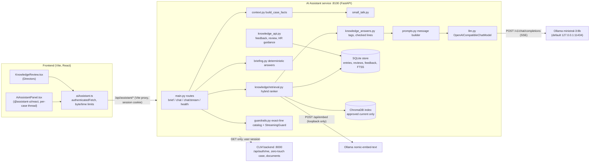
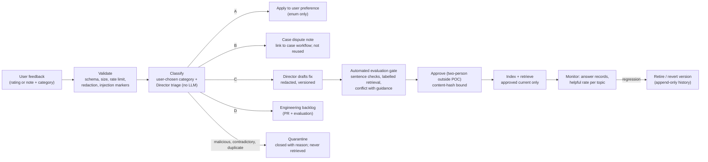
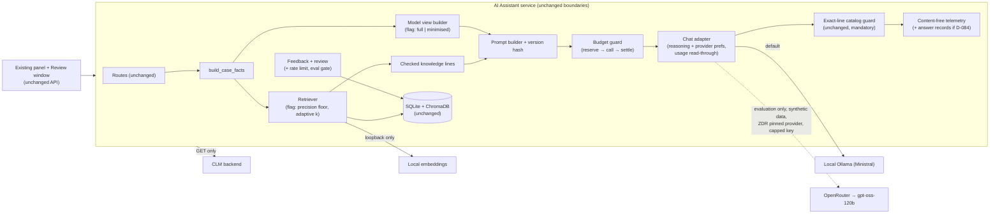

# AI Assistant — OpenRouter GPT-OSS 120B, RAG, Token Efficiency and Controlled Feedback Investigation

| Item | Value |
|---|---|
| Date | 2026-10-26 |
| Type | Read-only investigation (no implementation, no paid calls) |
| Repository | `C:\Users\shane\Desktop\FYP\data-dividends-zero-touch-clm` |
| Branch / HEAD | `main` / `1d039865bf5197a76add7f733128829bb05019ac` |
| `origin/main` | `1d039865bf5197a76add7f733128829bb05019ac` (ahead/behind 0/0) |
| Tracked working tree | clean before and after; only this report was added |
| Change classes consulted | `DOCS_ONLY`, `EXTERNAL_PROVIDER` (`scripts/dev_context.py`) |
| OpenRouter spend | US$0.00 (no inference call made) |

Evidence labels used throughout:

- **VERIFIED** — read in current source/tests/docs at the HEAD above, or in official public documentation/metadata fetched on 2026-10-26.
- **INFERRED** — follows from verified evidence by reasoning, not directly observed at runtime.
- **PROPOSED** — a recommendation; nothing is built.
- **UNKNOWN / REQUIRES EXPERIMENT** — not measurable without a run that was out of scope (local model or paid call).

All file references are relative to the repository root and use `path:line`.

---

## 1. Executive Summary

**Current state (VERIFIED).** The AI Assistant is a separate FastAPI service (`apps/assistant`, port 8100) that explains one onboarding case to its authorised viewer. It is **advisory and read-only**: it issues only `GET` requests to the CLM backend with the user's own session (`apps/assistant/ai_assistant/clm_client.py:92-112`) and has no tools, function calls or mutation endpoints toward the CLM. The chat model is reached through a minimal OpenAI-compatible adapter (`apps/assistant/ai_assistant/llm.py:84-298`), defaulting to local Ollama `ministral-3:8b` (`apps/assistant/ai_assistant/config.py:16-24`).

**The single most important finding.** The model does **not** write answers. Under the owner-accepted output policy (D-074, ADR-012 section C) the model may only *select* whole lines that exactly equal a server-built allow-list: a deterministic catalog built from backend facts plus verbatim, tagged sentences of approved knowledge entries. Every other line is dropped, also while streaming (`apps/assistant/ai_assistant/guardrails.py:506-524`, `:538-604`). If nothing survives, a deterministic case-data answer is shown. Consequently, a larger model can only improve **which allowed lines are chosen and in what order** (and reduce dropped free-text lines); it cannot make answers more fluent, more specific or more "intelligent" in the conventional sense. Any business case for GPT-OSS 120B must be measured on that narrow task.

**Major findings.**

1. **Replacement is technically near-configuration but not safe as configuration-only.** OpenRouter's Chat Completions API is compatible with the adapter's request and SSE parsing (VERIFIED), and warm-up is automatically skipped for non-loopback URLs (`llm.py:291-292`). However, the current adapter (a) shares one 600-token `max_tokens` budget with reasoning tokens, which OpenRouter documents can end in `finish_reason: "length"` with **empty content**; (b) sends no `reasoning` or `provider` preferences, so OpenRouter would default to price-based load balancing across 24 endpoints with different quantisations; and (c) stops reading the stream at the first `finish_reason`, so it **never receives the usage/cost chunk** OpenRouter sends just before `[DONE]` (`llm.py:259-268`). A bounded adapter change is required for correctness, reproducibility and budget accounting.
2. **Data governance is the real blocker, not money.** The model receives company legal name, UEN, registered address, document-extracted values, discrepancy values, viewer display name and recent timeline text (`apps/assistant/ai_assistant/prompts.py:127-166`). ADR-012 lists "any non-local embedding or model endpoint" as a revisit condition (`docs/decisions/ADR-012_AI_ASSISTANT_KNOWLEDGE_LOOP.md:335-340`), the README states endpoint configuration does not establish approved data handling (`apps/assistant/README.md:22-24`), and sponsor question Q-013 (document privacy/retention) is open. Only synthetic data may be used until the owner and sponsor decide.
3. **RAG is operational but unevaluated for quality.** Hybrid retrieval (SQLite FTS5 + ChromaDB + case-context scoring, permission-filtered) is implemented and unit-tested, but the real-embedding evaluation is formally `NOT_EXECUTED — OWNER-DEFERRED` (D-075, `docs/decisions/DECISION_LOG.md:339-350`). An offline reconstruction of the exact prompts (no model, keyword/context mode) shows retrieval fills its maximum slots for every test question (up to 3 guidance + 3 past cases, 1.9–3.4K characters, 23–33% of the prompt), including entries that look unrelated to the question. Context precision is likely low (INFERRED); quality impact is UNKNOWN.
4. **No observability exists.** The service records no token counts, latency, model, prompt version, retrieved entries or drop counts per answer; feedback rows store only rating, redacted note and case context (`apps/assistant/ai_assistant/knowledge/store.py:85-103`). There is no recorded baseline for Ministral quality or latency in the repository. Comparing models today would be anecdotal.
5. **The existing "improvement" mechanism is Director-curated retrieval, not learning.** "Yes, helpful" only increments statistics; "Not helpful" + note becomes a redacted enhancement request that a Director turns into a reviewed knowledge entry or closes (D-083, *proposed, not accepted*). There is no prompt change, fine-tuning, reinforcement learning, conversation memory or automatic application of feedback. Single-reviewer mode (default `true`) currently lets one Director publish knowledge that becomes allowed answer lines (`config.py:40-44`).

**Feasibility.** GPT-OSS 120B is cheap enough that US$10 is not the binding constraint: at verified 2026-10-26 prices (US$0.03–0.35 per million input tokens, US$0.15–0.95 per million output tokens across 24 endpoints, all listed as Zero Data Retention endpoints), a typical exchange is estimated at roughly US$0.0002–0.0025 depending on provider and reasoning effort (section 8). Several thousand evaluation calls fit inside US$10. The constraints are governance, measurement and reproducibility.

**Principal risks.** External disclosure of case data; empty/cut-short answers from reasoning consuming `max_tokens`; non-reproducible evaluation from provider load balancing; unmeasured comparison (no baseline); single-reviewer knowledge publication; assistant tests not in hosted CI.

**Recommendation (summary).** Do **not** switch the running assistant. Authorise a **Phase A (US$0, offline)** package — observability, an offline scenario/gold-label evaluation harness, adapter hardening for reasoning/usage/provider preferences behind default-off settings, and an application-side budget guard — then a **Phase B controlled evaluation** of GPT-OSS 120B on synthetic data only, with a pinned ZDR provider, a lifetime-capped OpenRouter key and frozen prompts. Optimise retrieval precision and the model's data view offline first so that paid runs compare like-for-like. Keep the exact-line catalog. Do not fine-tune, train online or let feedback act automatically.

---

## 2. Scope and Investigation Method

**Repository state (VERIFIED).** `main` at `1d03986`, equal to `origin/main`; tracked tree clean; pre-existing untracked paths (`.garden-hotfix/`, `.ownership-hotfix/`, `.ux-task/`, `artifacts/`, `evaluation/`, `output/`, `outputs/`, one UAT PDF) were left untouched. Many linked worktrees exist; none were opened or modified.

**Evidence inspected.**

- Service source: `apps/assistant/ai_assistant/*.py`, `knowledge/*.py`, `instructions/*.md`, `knowledge/guidance/*.md`, `knowledge/seed/synthetic_resolutions.json`, `config.py`, `.env.example`, `pyproject.toml`, `README.md`, `scripts/*.py`.
- Tests: 21 assistant test files (262 test functions, parametrised cases not counted), `apps/backend/tests/test_ai_assistant_main_integration.py`, frontend `aiAssistant*.test.ts`, `AiAssistantPanel.test.tsx`, `KnowledgeReview.test.tsx`, `e2e/assistant-streaming.e2e.ts`.
- Frontend: `apps/frontend/src/aiAssistant.ts`, `pages/AiAssistantPanel.tsx`, `pages/KnowledgeReview.tsx`, `pages/aiAssistantContext.ts`, `vite.config.ts` proxy.
- Governance: `AGENTS.md`, `docs/DEVELOPMENT_WORKFLOW.md` (change classes), `docs/ARCHITECTURE.md:943-986`, `docs/decisions/ADR-012_AI_ASSISTANT_KNOWLEDGE_LOOP.md`, `docs/decisions/DECISION_LOG.md` D-073/D-074/D-075/D-083/D-084, `docs/sponsor-questions/OPEN_QUESTIONS.md` Q-013/Q-014, `.github/workflows/ci.yml`.
- External (fetched 2026-10-26): OpenRouter public model-endpoints metadata (`/api/v1/models/openai/gpt-oss-120b/endpoints`) and ZDR endpoint list (`/api/v1/endpoints/zdr`) — free, unauthenticated GETs, no API key used; OpenRouter docs pages on reasoning tokens, provider routing, ZDR, privacy/logging, limits, usage accounting, streaming, prompt caching, errors and FAQ; OpenAI harmony format guide; Ollama `ministral-3` library page.

**Offline analysis performed (no model, no network to any model).** A scratch script outside the repository (session scratchpad, bytecode writing disabled) rebuilt the exact prompt messages for the two saved synthetic Garden fixtures (`apps/assistant/tests/fixtures/garden_*.json`) and four representative questions from `apps/assistant/scripts/speed_test.py:36-41`, using a temporary knowledge base ingested from the repository guidance and synthetic seed. Embeddings were stubbed as unavailable, so retrieval ran in its documented degraded mode (keywords + case context, `apps/assistant/ai_assistant/knowledge/retrieval.py:257-260`). Results are character counts, not tokens.

**Limitations.**

- No local Ollama model was run (prohibited by scope; also, an observation of the local Ollama manifest directory showed `ministral-3` and `nomic-embed-text` are not installed on this machine). Baseline latency, selection quality and semantic retrieval are therefore UNKNOWN.
- No tokenizer for Ministral 3 or GPT-OSS (`o200k_harmony`) is installed in the project environment; token figures are estimates from characters (stated as 3–4 characters per token) and labelled as such.
- `.env` files were not read (repository policy). The effective runtime configuration is assumed to be the code defaults.
- External documentation was retrieved through a summarising fetch tool; prices and endpoint metadata were re-parsed from the raw JSON. All external facts must be re-verified immediately before any spend because provider lists and prices change.

**Verification methodology.** Each implementation claim cites `path:line`. Claims that depend on runtime behaviour are labelled INFERRED or UNKNOWN. No claim of Live integration, sponsor approval or production readiness is made.

---

## 3. Current AI Assistant Use Cases (Frozen Behavioural Baseline)

### 3.1 Boundary facts (VERIFIED)

| Property | Evidence |
|---|---|
| Advisory only; cannot change a case | `apps/assistant/README.md:3-4`, `:12-18`; GET-only client `clm_client.py:48-112` |
| Access decided by CLM backend (user session forwarded; 403/404 → safe 404) | `clm_client.py:55-58`, `:70-79`; `main.py:230-237` |
| No tools / function calling sent to the model | payload has only `model`, `messages`, `temperature`, `max_tokens`, `stream` (`llm.py:108-117`) |
| Model output restricted to exact allowed lines | `guardrails.py:1-15`, `:506-524`, `:538-604`; D-074 (`DECISION_LOG.md:317-337`) |
| Deterministic fallback when model off/slow/unverifiable | `main.py:283-299`, `:325-362`; `briefing.py:234-274` |
| Origin check on every case/knowledge route | `main.py:217-223`; `knowledge_api.py:243-251` |
| Embeddings must be literal loopback | `knowledge/embeddings.py:48-51` |
| One-click actions, pipeline resume, navigation links, audit log are *not* in Phase 1 | `README.md:313-316` |

The assistant never invokes registry, IDP, ownership/UBO, reconciliation, readiness, approval or GoldTier operations. Its "actions" are only catalog sentences that name actions the backend already offers to this user (`guardrails.py:83-93`). Final approval and GoldTier submission are never offered (`guardrails.py:137-196`).

### 3.2 Frozen use-case inventory

| ID | Use case | Role / trigger / input | Output | Data sources | LLM? | Protected by tests | Model-swap risk |
|---|---|---|---|---|---|---|---|
| UC-01 | Opening case brief | Any signed-in user who can read the case; panel opened on a case page or created intake (`aiAssistantContext.ts`); `GET /assistant/cases/{id}/brief` | Deterministic summary, blocker count, progress, suggested questions (`main.py:385-396`, `briefing.py:102-181`) | `/api/auth/me`, case summary, documents | No (optional loopback warm-up only, `main.py:304-323`) | `test_ai_assistant.py` (brief), `test_document_selection.py`, frontend panel tests | None if unchanged; warm-up is skipped for remote URLs |
| UC-02 | Explicit case question | Same user; `POST .../chat` or `.../chat/stream` with `{message, history}` | Allowed lines selected by the model, notices, checks, sources, suggestions; else case-data answer (`main.py:398-439`) | Case facts, retrieved knowledge, client-sent history | Yes, 1 chat call | `test_ai_assistant.py`, `test_grounding.py`, `test_guardrails.py`, `test_guardrail_negation.py`, `test_required_p2.py`, `test_streaming_resources.py`, `test_speed.py`, e2e `assistant-streaming` | Selection quality, dropped-line rate, latency, empty-content/`length` behaviour, cost |
| UC-03 | Small talk | Greeting/thanks/ack/bye/"what can you do" (≤6 words) | Instant fixed reply, no model (`small_talk.py:77-114`; `main.py:402-411`, `:421-432`) | Viewer name, progress | No | `test_small_talk.py` | None |
| UC-04 | Suggested questions | Brief and every reply | Up to 6, base questions plus checked follow-ups of retrieved past cases (`main.py:265-270`) | Facts, approved knowledge | No | `test_knowledge_answers.py` | None |
| UC-05 | Cited knowledge in answers | Part of UC-02 | `[Gn]`/`[Pn]` lines, source chips with checked titles, illustrative/fallback flags (`knowledge_answers.py:110-146`) | Approved, current, visible entries | Indirect | `test_knowledge_answers.py`, `test_retrieval.py`, `test_knowledge_review_safety.py` | Model may cite fewer/more lines |
| UC-06 | No-case guidance | Panel opened on a page without a case | "Open a case…" prompt (frontend only, `AiAssistantPanel.tsx:463-469`) | — | No | `aiAssistantContext.test.ts` | None |
| UC-07 | "Yes, helpful" rating | User who can read the case; `POST .../feedback {helpful:true}` | Stored rating with case context; feeds Director stats only (`knowledge_api.py:371-400`) | Case context | No | `test_knowledge_review.py` | None |
| UC-08 | "Not helpful" enhancement request | Same; note required (422 if blank) | Redacted note stored as open request (`knowledge_api.py:66-76`, `:377-390`) | Case facts for redaction | No | `test_knowledge_redaction.py`, `test_knowledge_review.py` | None |
| UC-09 | Director knowledge review | `POLICY_APPROVE`; Review window | Pending drafts, open requests, edit, approve/reject (content-hash bound, single-reviewer confirmation), write fix, close request, stats (`knowledge_api.py:415-708`; `KnowledgeReview.tsx`) | Knowledge store; case reloaded with Director session | No | `test_knowledge_review*.py`, `test_knowledge_single_reviewer.py`, `KnowledgeReview.test.tsx` | None |
| UC-10 | Two-person retirement; re-index | Two Directors / Director; API only (no frontend client) | Entry retired; vectors rebuilt (`knowledge_api.py:546-568`, `:677-682`) | Store, local embeddings | No | `test_knowledge_review.py`, `test_knowledge_store.py` | None |
| UC-11 | HR guidance proposal | `POLICY_MUTATE`; API only | Pending guidance version (`knowledge_api.py:712-742`) | — | No | `test_knowledge_review*.py` | None |
| UC-12 | Repository guidance ingestion and retrieval evaluation | Operator scripts | Versioned guidance; recall@3 report (`scripts/ingest_knowledge.py`, `scripts/evaluate_retrieval.py`) | Guidance files, labelled set | No (local embeddings) | `test_knowledge_store.py`, `test_retrieval.py` | None |
| UC-13 | Health | `GET /assistant/health` | `llm_enabled`, model name (`main.py:377-383`) | — | No | `test_ai_assistant.py` | Model name changes |
| UC-14 | Disclosures and notices | Part of UC-02 | Mock-registry notice, removed-lines notice, cut-short notice, fallback notices (`guardrails.py:479-499`, `main.py:125-127`) | Company source environment | No | `test_grounding.py`, `test_speed.py` | Reasoning models may raise cut-short/fallback frequency |

Prohibited for every use case (VERIFIED by design and tests): CLM writes, approval/authorisation, GoldTier submit/resend, Live claims for Mock/Local/Sandbox evidence, legal UBO/KYC verification claims, invented contacts/labels/values (`guardrails.py:65-104`, `:298-311`, `:335-383`).

**Known limitations (VERIFIED, ADR-012 `:209-239`):** answers are line selections and less fluent; sentence checks are a deny-list with 46 pinned misses; redaction misses names absent from case data (`knowledge/redaction.py:19-21`).

### 3.3 Coverage gaps (VERIFIED unless stated)

| Gap | Evidence |
|---|---|
| No test or dataset measures *answer selection quality* (which allowed lines are relevant to a question) | No gold-label fixture exists; only retrieval labels (`tests/fixtures/knowledge_eval.json`, 26 items, 2 expect nothing) |
| Real-embedding retrieval quality never measured | D-075 `NOT_EXECUTED — MODEL NOT INSTALLED / OWNER-DEFERRED` |
| Assistant tests are not run by hosted CI or the pre-PR script | `.github/workflows/ci.yml` has backend/frontend jobs only; backend `testpaths = ["tests"]` under `apps/backend`; no `assistant` mention in `scripts/pre_pr_check.py` |
| No tests for reasoning-model wire shapes (`delta.reasoning`, usage chunk repeating `finish_reason`) | No `reasoning`/`usage` handling in `apps/assistant` except the Ollama-only `speed_test.py` |
| No latency, token or cost telemetry or test | None in `main.py`/`llm.py` |
| Multi-turn consistency not measured | Only history trimming is tested (`test_speed.py`) |

### 3.4 Functional parity — mandatory acceptance gate (PROPOSED)

Any model, prompt, retrieval or feedback change must, before acceptance:

1. Pass the full unchanged assistant suite (`apps/assistant`: pytest, ruff, mypy), the backend integration test, frontend assistant Vitest files and the `assistant-streaming` E2E.
2. Keep every API schema (`BriefResponse`, `ChatResponse`, `KnowledgeSource`, feedback/review bodies) and status semantics unchanged.
3. Keep the exact-line catalog and sentence checks as the only route to displayed model text (zero displayed non-allowed lines on the adversarial set).
4. Keep GET-only CLM access, backend RBAC/team scope and the 404 projection.
5. Keep deterministic fallback behaviour (`answered_by`, notices) for model-down, unverifiable and cut-short cases.
6. Introduce no new use case, endpoint, action or permission.

---

## 4. As-Is Architecture

### 4.1 Component diagram (VERIFIED)



### 4.2 Request lifecycle for an explicit question (VERIFIED)

```mermaid
sequenceDiagram
  participant U as User (panel)
  participant S as Assistant service
  participant B as CLM backend
  participant R as Retriever (local)
  participant M as Chat model
  U->>S: POST /chat/stream {message, history}
  S->>B: GET /api/auth/me, case summary, documents (user session)
  B-->>S: actor, summary, documents (or 401/404)
  S->>S: build_case_facts; truncate question to 600 chars
  alt whole message is small talk
    S-->>U: done (fixed reply, no model)
  else
    S->>R: embed question (loopback Ollama) + FTS5 + context score
    R-->>S: <=3 guidance + <=3 resolutions (approved, visible)
    S->>S: checked knowledge lines; fallback answer; suggestions
    S->>S: messages = rules, case facts, trimmed history, KNOWLEDGE, terms, question
    S->>M: one streamed chat completion (max_tokens 600, temp 0.2)
    loop each SSE delta
      M-->>S: content piece
      S->>S: StreamingGuard: show only complete exact allowed lines
      S-->>U: text update (allowed lines so far)
    end
    S-->>U: done {answer, answered_by, notice, checks, sources, knowledge}
  end
```

### 4.3 Every model invocation (VERIFIED)

| # | Invocation | When | Context received | Necessary? |
|---|---|---|---|---|
| 1 | Chat completion (stream or non-stream) | Each explicit, non-small-talk question (`main.py:287`, `:340`) | Rules (`persona_and_rules.md`, 1,722 chars), compact case facts incl. catalog, trimmed history, KNOWLEDGE lines, matched page terms, question | Yes for UC-02; the deterministic fallback already exists if absent |
| 2 | Warm-up (`max_tokens=1`) | After `/brief`, at most once per facts hash per 120 s; **only** for literal loopback URLs (`main.py:304-323`, `llm.py:283-298`) | Rules + case facts | Local latency optimisation only; never fires for OpenRouter |
| 3 | Query embedding | Each non-small-talk question when knowledge is enabled (`retrieval.py:177`) | `search_query: <question>` | Yes for semantic ranking; degrades to keywords/context if down |
| 4 | Document embeddings | On approve/retire sync, reconcile at start-up, re-index (`knowledge/service.py:90-145`) | Entry title/body/context | Index maintenance |

There are **no application-level retries** of model calls (VERIFIED: `complete`/`stream` raise `LlmUnavailableError` once; callers fall back). Small talk bypasses retrieval and the model.

### 4.4 Model integration and configuration (VERIFIED)

- Settings `AI_ASSISTANT_LLM_*`: enabled `true`, base URL `http://127.0.0.1:11434/v1`, model `ministral-3:8b`, key `SecretStr("ollama")`, timeout 90 s (whole request including stream), temperature 0.2, `max_tokens` 600 (max 4,000) (`config.py:15-24`).
- Adapter: `POST {base}/chat/completions`, `Authorization: Bearer`, no redirects; streaming requests `Accept-Encoding: identity`, rejects compressed SSE, bounds 64 KiB per frame and 1 MiB per response, requires `[DONE]` or a `stop`/`length` finish, rejects other finish reasons and malformed chunks, requires exactly one choice (`llm.py:131-140`, `:212-281`).
- Server-side guard bounds model text at 64 KiB (`guardrails.py:533`, `:567-584`); the browser adds 128 KiB/line and 2 MiB/response (`README.md:283-286`).

### 4.5 Prompt builder (VERIFIED)

Order (`prompts.py:1-15`, `:208-239`): (1) `system` rules; (2) `system` "CASE FACTS" compact JSON (catalog lines + viewer, company, steps, blockers with actions and ACRA/document differences, readiness, discrepancies, documents with extracted values, document-review choices, GoldTier state, last 5 events, page sections); (3) trimmed history (last 8 messages, ≤2,400 chars, ≤700 per turn, starts with a user turn); (4) `system` KNOWLEDGE with each entry's allowed lines; (5) `system` CASE PAGE TERMS only if the question names a term; (6) `user` question. The first two messages are stable per case to enable prefix caching.

Notable: retrieved knowledge and untrusted document values are delivered in **`system`-role** messages (`prompts.py:213`, `:228`), the same role as the rules.

### 4.6 Conversation history and session handling (VERIFIED)

- The browser keeps one thread per case and sends all non-brief, non-streaming turns (`AiAssistantPanel.tsx:278-282`); the server accepts ≤40 turns of ≤4,000 chars (`main.py:51-62`), keeps the last 8 (`main.py:239-245`, `config.py:61`) and trims to the budget (`prompts.py:188-205`).
- History is client-supplied and can be forged, but it cannot extend the allowed lines (ADR-012 verification list, `ADR-012:321-323`).
- The service stores no conversation; feedback no longer sends it (D-083).

---

## 5. RAG Assessment

### 5.1 What is implemented

| Element | Status | Evidence |
|---|---|---|
| Knowledge sources | IMPLEMENTED: 9 official guidance Markdown files (≈8.8 KB total), 3 illustrative synthetic resolutions, Director/HR-authored entries | `knowledge/guidance/*.md`; `knowledge/seed/synthetic_resolutions.json` |
| Ingestion | IMPLEMENTED: header-parsed files, content hash skip, new version on change, retire on removal, app edits win | `knowledge/ingest.py:1-23` |
| Chunking | NOT USED: one vector per entry (title + body + "Applies to") | `knowledge/vector_index.py:35-39` |
| Embeddings | IMPLEMENTED, local only: Ollama `nomic-embed-text` with task prefixes; loopback enforced | `knowledge/embeddings.py:34-93` |
| Vector store | IMPLEMENTED: ChromaDB 1.5.9 persistent, cosine, telemetry off; approved current versions only | `knowledge/vector_index.py:21-69` |
| Keyword search | IMPLEMENTED: SQLite FTS5 BM25, quoted OR terms, stopwords | `knowledge/store.py:104-105`, `:305-311`, `:482-503` |
| Filtering | IMPLEMENTED in Python after search: approved status, role/team visibility; resolutions must share a blocker code or field. Chroma metadata filters are stored but not used in `query` | `retrieval.py:234-250`; `vector_index.py:88-107` |
| Ranking | IMPLEMENTED: weighted semantic 0.45, keyword 0.2, context 0.3 (code 0.6/field 0.3/stage 0.1), recency ×0.05; thresholds 0.3/0.4; top 3 + 3; stage-level fallback | `retrieval.py:132-139`, `:167-272`; `config.py:52-59` |
| Reranking (cross-encoder) | NOT IMPLEMENTED (not needed at this corpus size) | — |
| Context assembly | IMPLEMENTED: verbatim sentences that pass case checks, ≤20 per entry, ≤48 and 8 KiB per answer, tagged `[Gn]/[Pn]`; entries with no passing lines omitted | `guardrails.py:392-440`; `knowledge_answers.py:110-123` |
| Freshness / invalidation | IMPLEMENTED: append-only versions, approve retires previous, index tasks with retry, reconcile on start, re-index endpoint | `knowledge/service.py:1-145`; `store.py:552-634` |
| Citation integrity | IMPLEMENTED: only tags of retrieved entries; tags inside knowledge text refused; chips mark cited | `guardrails.py:343-344`; `knowledge_answers.py:126-146` |
| Missing-context behaviour | IMPLEMENTED: `confidence` none/low/high, `degraded` flag, deterministic fallback | `retrieval.py:191-206`; `main.py:99-104` |
| Access control | IMPLEMENTED: role/team from `/api/auth/me`, checked in retrieval and again before display | `retrieval.py:242`; `knowledge_answers.py:36-50` |
| Retrieval evaluation | PARTIAL: harness and 26 labelled questions exist; real-embedding run deferred (D-075) | `knowledge/evaluation.py`; `scripts/evaluate_retrieval.py` |
| Latency / cost telemetry | NOT IMPLEMENTED | — |

RAG verdict: **operational (VERIFIED by tests with mock embeddings), quality unproven (UNKNOWN).**

### 5.2 Offline prompt measurement (VERIFIED counts, degraded retrieval mode)

Characters per request part for the saved synthetic fixtures (role `CLIENT_ONBOARDER`, team `TEAM_A`):

| Fixture / question | Rules | Case facts | History | Knowledge | Terms | Question | **Total chars** | Entries retrieved | Allowed lines offered |
|---|---|---|---|---|---|---|---|---|---|
| Address conflict / "Why is this case blocked?" | 1,722 | 6,073 | 0 | 2,944 | 0 | 25 | **10,764** | 3 G + 3 P | 37 (16 catalog + 21 knowledge) |
| Address conflict / "Can I use the document address…" | 1,722 | 6,073 | 285 | 2,828 | 0 | 49 | **10,957** | 3 G + 3 P | 36 |
| Address conflict / "What does evidence score mean?" | 1,722 | 6,073 | 594 | 2,944 | 290 | 30 | **11,653** | 3 G + 3 P | 37 |
| Address conflict / "What do I still need…GoldTier?" | 1,722 | 6,073 | 884 | 2,944 | 0 | 43 | **11,666** | 3 G + 3 P | 37 |
| Waiting for documents / "Why is this case blocked?" | 1,722 | 4,605 | 0 | 1,936 | 0 | 25 | **8,288** | 3 G + 1 P | 27 |
| Waiting for documents / "Can I use the document address…" | 1,722 | 4,605 | 285 | 3,269 | 0 | 49 | **9,930** | 3 G + 1 P | 41 |
| Waiting for documents / "What does evidence score mean?" | 1,722 | 4,605 | 594 | 3,385 | 290 | 30 | **10,626** | 3 G + 1 P | 42 |

Case-facts breakdown (address-conflict fixture, 6,026 chars of JSON): catalog lines 1,444; documents (extracted values) 1,285; blockers 863; steps 621; recent events 366; discrepancies 306; still-needed 289; company 244; page sections 144; overall 93; readiness 92; viewer 45; GoldTier 25.

**Estimated tokens (ESTIMATE, 3–4 chars/token, tokenizer not run):** about 2,100–3,900 input tokens per request on these fixtures. Exact counts are UNKNOWN until a tokenizer or provider `usage` is captured.

The earlier speed work's "about 35% fewer characters" claim is consistent with the measurement: the old full fact sheet is 9,094 chars versus 6,073 now for the same fixture (−33%).

### 5.3 Answers to Q1–Q6

**Q1. Is retrieved information improving quality or merely increasing prompt size?** Retrieval has a functional role that cannot be removed without changing behaviour: knowledge lines are the *only* way approved guidance reaches an answer (they extend the allow-list), and retrieval also drives source chips, follow-up suggestions and the no-model guidance summary (`main.py:260-270`; `knowledge_answers.py:149-161`). Whether it improves answer *quality* is **UNKNOWN**: no end-to-end metric exists and the semantic evaluation was deferred. INFERRED from the measurement: in degraded mode every question fills the maximum slots, including entries whose topic differs from the question (for example `guidance.evidence-score` and three past cases for "Why is this case blocked?", and `guidance.ubo-threshold`/`legal-name-mismatch` for an address question on the waiting-for-documents case). That is prompt growth with doubtful relevance for those questions.

**Q2. Does the architecture supply more context than necessary?** Likely yes (INFERRED from scoring arithmetic and measurement). In degraded mode relevance is `0.4·keyword + 0.6·context`; a guidance entry sharing the case's blocker code alone scores 0.36, above the 0.30 threshold, regardless of the question (`retrieval.py:257-260`). With semantic search on, a code match contributes about 0.19 and a cosine similarity of roughly 0.24 suffices (UNKNOWN in practice: real similarity distributions were never measured). Context is dominated by "what case is this" rather than "what was asked". Additional redundancy: the catalog is embedded inside the facts JSON (with escaping), and the seven "Open the … section" catalog lines duplicate `case_page_sections`.

**Q3. When should retrieval be skipped?** Already skipped for small talk (VERIFIED). Candidates (PROPOSED, each a behaviour change needing parity review): progress/status questions answered fully by the catalog; page-term questions already handled by the glossary; cases with no blocker codes, fields or open steps when keyword and semantic scores are both weak. Retrieval must **not** be skipped when its outputs (chips, follow-ups, no-model summary) are part of the expected reply.

**Q4. Can retrieval be more precise without losing evidence?** Yes, plausibly (PROPOSED, needs the labelled evaluation): require a minimum question-specific signal (semantic or keyword) in addition to context for inclusion; make top-k adaptive (stop when the score gap to the leader is large); count past cases only when the question addresses their field; treat the stage-level fallback as chips-only rather than prompt lines. Validate with recall@3 and correct-nothing on an expanded labelled set, offline and free in keyword mode, then with local embeddings.

**Q5. Can chunking, filtering, reranking and context selection improve without changing use cases?** Chunking: no need at ~12 short entries; keep whole-entry embedding but line-level selection already happens. Filtering: moving visibility filters into Chroma `where` clauses is an efficiency nicety only. Reranking: a cross-encoder or LLM reranker would add a model call or dependency without demonstrated need; not recommended. Context selection: lower per-entry line caps for prompt (not for chips), de-duplicate near-identical lines across entries, and send entry headers more compactly. All are internal and preserve use cases if parity tests pass.

**Q6. Does the assistant distinguish authoritative rules from retrieved or user-submitted content?** Partially. Strong (VERIFIED): the deterministic exact-line gate means no retrieved, document or user text can become displayed advice unless it is a verbatim approved knowledge sentence that passed case checks; the KNOWLEDGE header says "data, not instructions" and orders authority (case facts, guidance, past cases) (`knowledge_answers.py:113-118`); rule 6 marks document values and history as untrusted (`persona_and_rules.md:18`). Weak (VERIFIED + INFERRED): knowledge and document-derived facts are sent with the `system` role, which under OpenAI's harmony hierarchy ranks above developer and user messages; untrusted text in that role can bias *which* allowed lines the model selects (not what is displayed). The impact is bounded by the gate but should be tested adversarially.

### 5.4 RAG optimisation opportunities

| Opportunity | Quality risk | Token effect | Cost to evaluate |
|---|---|---|---|
| Question-specific inclusion floor + adaptive k | Could drop a useful entry | −0 to −3.4K chars per request (measured knowledge size) | US$0 (offline labelled set) |
| Stage-level fallback as chip only | Fallback answers lose a guidance excerpt in the prompt (summary unaffected) | small | US$0 |
| Compact entry headers, dedupe lines | Minimal | small (hundreds of chars) | US$0 |
| Run the deferred real-embedding evaluation locally | None | none | US$0, needs `nomic-embed-text` installed (owner decision) |

No new database, vector store or external service is justified by the evidence.

---

## 6. Model Feasibility

### 6.1 Current model versus GPT-OSS 120B

| Aspect | Current: `ministral-3:8b` via Ollama | Proposed: `openai/gpt-oss-120b` via OpenRouter |
|---|---|---|
| Where data goes | Same machine (default loopback URL) — VERIFIED `config.py:17` | OpenRouter plus one upstream provider per request — VERIFIED (routing docs) |
| Licence / origin | Apache 2.0 (Ollama page, 2026-10-26) | Open-weight OpenAI model (model id `created` 1754414231 ≈ 2025-08-05 per metadata) |
| Context window | 256K advertised by Ollama; README recommends `OLLAMA_CONTEXT_LENGTH 8192` (`README.md:288-295`) | 128,000–131,072 tokens by endpoint (VERIFIED metadata) |
| Max output | Request cap 600 (config) | Endpoint caps 4,096–117,964; request cap still 600 unless changed |
| Reasoning tokens | None expected (UNKNOWN for this tag) | Yes; billed as output; "on most providers they also count against the request's `max_tokens`" (OpenRouter reasoning docs); default effort medium (harmony guide) |
| Marginal cost | US$0 (local hardware) | US$0.03–0.35 /M input, US$0.15–0.95 /M output (VERIFIED 2026-10-26) |
| Latency | UNKNOWN (no recorded baseline; `speed_test.py` exists but no results committed) | UNKNOWN; provider-dependent, plus reasoning time before first content token |
| Quality on this task (exact-line selection) | UNKNOWN | UNKNOWN — must not be assumed better |
| Availability on this machine | Model not installed locally at time of inspection | Requires account, credits, key |

Model capability (weights) must be distinguished from provider behaviour: the 24 endpoints differ in quantisation (`fp4`, `int4`, `fp8`, `bf16`, `fp16`, `unknown`), maximum completion size, supported parameters and recent uptime (two endpoints were degraded at fetch time: Google Vertex 3.3% and SambaNova 27.3% 30-minute uptime). Results from one endpoint do not transfer to another.

### 6.2 OpenRouter endpoint snapshot for `openai/gpt-oss-120b` (VERIFIED, 2026-10-26, public metadata)

| Provider (tag) | Quant. | Input US$/M | Output US$/M | Cache read US$/M | Max completion | Structured outputs | Tools | Implicit caching |
|---|---|---|---|---|---|---|---|---|
| Near AI (`near-ai/fp4`) | fp4 | 0.03 | 0.15 | 0.015 | 117,964 | yes | yes | yes |
| Venice (`venice/int4`) | int4 | 0.03 | 0.15 | 0.03 | 32,768 | no | yes | yes |
| CoreWeave (`coreweave/fp4`) | fp4 | 0.03 | 0.17 | 0.03 | 117,964 | yes | yes | yes |
| DekaLLM (`dekallm/bf16`) | bf16 | 0.03 | 0.18 | 0.03 | 117,964 | yes | yes | yes |
| AkashML (`akashml/bf16`) | bf16 | 0.03 | 0.187 | 0.03 | 117,964 | yes | yes | yes |
| DeepInfra (`deepinfra/bf16`) | bf16 | 0.037 | 0.17 | — | 117,964 | yes | yes | no |
| Crusoe (`crusoe/bf16`) | bf16 | 0.05 | 0.25 | 0.05 | 117,964 | yes | yes | yes |
| Mancer 2 (`mancer/fp8`) | fp8 | 0.05 | 0.25 | — | 117,964 | yes | yes | no |
| Novita (`novita/fp4`) | fp4 | 0.05 | 0.25 | — | 32,768 | no | yes | no |
| DigitalOcean | unknown | 0.06 | 0.42 | 0.012 | 4,096 | no | no | yes |
| Google Vertex (`google-vertex/global`) | unknown | 0.09 | 0.36 | — | 117,964 | yes | no | no |
| BaseTen (`baseten/fp4`, `/us`) | fp4 | 0.10 | 0.50 | 0.10 | 115,264 | yes | yes | yes |
| Parasail (`parasail/fp4`) | fp4 | 0.10 | 0.75 | 0.055 | 117,964 | yes | yes | yes |
| SambaNova | unknown | 0.14 | 0.95 | — | 117,964 | no | yes | no |
| Amazon Bedrock (global, `eu-west-1`) | unknown | 0.15 | 0.60 | — | 117,964 | no | no | no |
| Nebius (`nebius/fp4`) | fp4 | 0.15 | 0.60 | — | 117,964 | yes | yes | no |
| SiliconFlow (`siliconflow/fp8`) | fp8 | 0.15 | 0.60 | 0.075 | 8,192 | yes | no | yes |
| Phala | unknown | 0.15 | 0.60 | — | 32,768 | yes | yes | no |
| Together | unknown | 0.15 | 0.60 | — | 117,964 | yes | yes | no |
| Groq | unknown | 0.15 | 0.60 | 0.075 | 65,536 | yes | yes | yes |
| Mara | unknown | 0.15 | 0.75 | — | 117,964 | yes | yes | no |
| Cerebras (`cerebras/fp16`) | fp16 | 0.35 | 0.75 | 0.35 | 40,960 | yes | yes | yes |

Totals: 24 endpoints; median input US$0.10/M, median output US$0.50/M. **All 24** appear in OpenRouter's ZDR endpoint list fetched the same day (VERIFIED by parsing `/api/v1/endpoints/zdr`). Every endpoint lists `reasoning`, `include_reasoning`, `reasoning_effort`, `max_tokens` and `temperature`. Data-policy fields are not in the per-endpoint JSON; ZDR status was taken from the ZDR list.

### 6.3 API compatibility with the existing adapter

| Topic | Finding | Label |
|---|---|---|
| Endpoint and auth | `base_url=https://openrouter.ai/api/v1` → `POST /chat/completions` with `Authorization: Bearer` works with `llm.py:96`, `:127-128` | VERIFIED (docs) / INFERRED (no live call) |
| Message roles | Adapter sends several `system` messages, some after history (`prompts.py:211-239`). Harmony has distinct system/developer roles (system > developer > user > assistant > tool); how each provider's chat template maps multiple and mid-conversation `system` messages is not documented | UNKNOWN / REQUIRES EXPERIMENT |
| Streaming framing | OpenRouter sends `: OPENROUTER PROCESSING` comments — ignored by the parser because only `data:` lines are kept (`llm.py:208-210`); `[DONE]` honoured | VERIFIED |
| Reasoning deltas | Reasoning arrives in `delta.reasoning` / `reasoning_details`; the adapter reads only `delta.content`, so reasoning is never displayed (good: harmony warns the analysis channel is not held to final-answer safety standards) | VERIFIED |
| Mid-stream errors | Arrive as a `data:` chunk with top-level `error` and `finish_reason: "error"`; adapter rejects finish reasons other than `stop`/`length` → `LlmUnavailableError` → fallback (`llm.py:259-261`) | VERIFIED (fail-closed) |
| Usage / cost | OpenRouter always returns usage, in the final chunk "sent just before the `[DONE]`", which repeats the terminal `finish_reason`. The adapter `break`s at the first `finish_reason` (`llm.py:265-268`), so usage and `cost` are never read | VERIFIED gap |
| `max_tokens` vs reasoning | Shared budget; if reasoning uses it all, `finish_reason: "length"` with empty `content`. With 600 tokens and default medium effort this is a real risk; result would be a cut-short answer or a case-data fallback with the misleading notice "The model response could not be verified" | VERIFIED (docs) / INFERRED (impact) |
| Non-stream errors on HTTP 200 | Docs: "Check the body for an `error` field even on a `200`". `complete()` requires `choices`, so such bodies fail closed | VERIFIED |
| Tools / structured outputs | Not used by the assistant; available on 19/24 and 18/24 endpoints respectively. Not needed for parity | VERIFIED |
| Warm-up | Never sent to a non-loopback URL (`main.py:311`, `llm.py:291-292`) — no hidden extra cost | VERIFIED |
| Embeddings | Stay local; a remote embedding URL is refused at construction (`embeddings.py:48-51`) | VERIFIED |
| Retries / duplicate cost | No app retries. OpenRouter falls back to other providers only before output starts; docs do not state whether failed upstream attempts are billed and warn that prompt processing may be charged when no content is generated | VERIFIED (docs) / UNKNOWN (billing of failed attempts) |
| Cancellation | Stream cancellation stops billing only on supporting providers (Together listed as supporting; Bedrock, Groq, Google listed as not supporting) | VERIFIED (docs) |
| Timeouts | 90 s whole-request deadline includes reasoning time; slow/high-effort runs may fall back | INFERRED |

### 6.4 Provider routing, privacy and spending controls available (VERIFIED, OpenRouter docs 2026-10-26)

- `provider.order`, `only`, `ignore`, `allow_fallbacks` (default `true`), `require_parameters`, `data_collection: "deny"`, `zdr: true`, `quantizations`, `sort`, `max_price`. Default routing load-balances by price; setting `order` or `sort` disables load balancing.
- ZDR: per request or account-wide; OpenRouter states prompts are not retained unless prompt logging is opted into; in-memory caching is not counted as retention; unverified endpoint policies are treated as retaining/training.
- Regional in-region processing (`eu.`/`us.openrouter.ai`) is only for Business/Enterprise plans.
- Key limits: `GET /api/v1/key` returns `limit`, `limit_remaining`, `limit_reset` (null = never resets), usage counters. Admin budgets (guardrail, workspace, key) block with 403; a **lifetime workspace budget never resets**. Insufficient credit → 402; in-flight budget can reject a request whose *estimated* cost exceeds the budget.
- Credits may expire after one year; purchase fees exist but the fee amount was not rendered in the docs; refunds only within 24 h.

### 6.5 Feasibility conclusion

Model replacement **can be achieved with a bounded adapter change** that keeps the `ChatModel` protocol, prompts, guardrails, API and frontend unchanged (PROPOSED):

1. Optional settings, default off so Ollama behaviour is unchanged: `reasoning.effort`, `reasoning.exclude` (bandwidth only; still billed), a provider-preferences object (`only`/`order`, `allow_fallbacks: false`, `zdr: true`, `data_collection: "deny"`, `require_parameters: true`, `max_price`), and optional attribution headers.
2. A content budget that is separate from the reasoning allowance (raise `max_tokens` only when reasoning is enabled; record `reasoning_tokens`).
3. After the first terminal `finish_reason`, keep reading until `[DONE]` **for accounting only** (do not yield text, tolerate the duplicated finish reason) and expose `usage`/`cost` to the caller.
4. An application-side budget guard (section 8) consulted before every paid call.

A configuration-only switch would technically function on the happy path but is **not acceptable**: it would be non-reproducible, unaccounted, exposed to empty-content failures and outside the approved data-handling boundary.

---

## 7. Token Efficiency Audit

### 7.1 Per-request token decomposition

| Component | Current size (chars, fixtures) | Tokens | Label |
|---|---|---|---|
| System rules | 1,722 (fixed) | ≈430–575 | ESTIMATE |
| Case facts incl. catalog | 4,605–6,073 | ≈1,150–2,025 | ESTIMATE |
| Conversation history | 0–884 here; capped at 2,400 | ≤≈800 | VERIFIED cap / ESTIMATE tokens |
| RAG knowledge | 1,936–3,385; capped by 48 lines/8 KiB + headers | ≈480–1,130 | ESTIMATE |
| Page terms | 0 or 290 | ≈0–100 | ESTIMATE |
| Tool definitions / results | none | 0 | VERIFIED |
| Structured-output schema | none | 0 | VERIFIED |
| User question | ≤600 chars (truncated, `main.py:401`) | ≤≈200 | VERIFIED cap |
| Answer (selected lines) | a few catalog/knowledge lines, ≈85 chars each; ≤600 tokens cap | ≈50–200 typical | ESTIMATE |
| Reasoning tokens (GPT-OSS only) | — | UNKNOWN | REQUIRES EXPERIMENT |
| Retries / extra calls | none in app; warm-up only for loopback | 0 remote | VERIFIED |

Typical input estimate on fixtures: **≈2,100–3,900 tokens**; a plausible upper bound with maximum history, maximum knowledge and a larger case is ≈8,000 tokens (ESTIMATE for budget ceilings).

### 7.2 Ranked optimisation opportunities

| # | Opportunity | Current evidence | Inefficiency | Proposed change | Expected token impact | Quality risk | Validation | Complexity / priority |
|---|---|---|---|---|---|---|---|---|
| T1 | **Observability before optimisation** | No usage, latency, drop-count or prompt-part metrics (`main.py`, `llm.py`) | Cannot measure anything | Record per answer: prompt-part sizes, retrieved keys/scores, allowed-line count, kept/left-out counts, fallback reason, model, prompt-version hash, latency (TTFT/total), provider `usage`/`cost` — no text content | 0 (enables everything else) | None | Unit tests with fake transports; no-content assertion | Low / **P0** |
| T2 | **Reasoning effort and budget control** (GPT-OSS only) | 600-token shared cap (`config.py:24`); no `reasoning` field (`llm.py:108-117`) | Reasoning may consume the cap → empty/cut-short answers; reasoning billed as output | Explicit `reasoning.effort` per setting (start with `low` for a pure selection task), separate content budget, record `reasoning_tokens` | Output tokens: likely large reduction vs default medium (UNKNOWN magnitude) | Low effort may select worse lines | Phase B comparison low vs medium on the same frozen prompts | Low / **P0** |
| T3 | **Data-minimised model view** | Facts include document values (1,285 chars), company identity (244), viewer (45), events (366) (`prompts.py:127-166`) | Values not needed to *select* catalog lines; also the main privacy exposure | A selection view that keeps blocker titles/codes, stage, steps, actions, catalog and knowledge lines; drop raw document/registry values, names and event text from the model view (keep them for guardrails and fallback) | ≈−1.8–1.9K chars (≈30–40% of facts, ≈17–21% of the prompt) on fixtures | May reduce selection quality for value-specific questions ("what did the document say?") — those are already answered deterministically in fallback | Offline gold-label selection metric with local model, then Phase B | Medium / **P1** |
| T4 | Retrieval precision (5.3 Q4) | Max slots filled in degraded mode | Irrelevant knowledge lines | Inclusion floor + adaptive k | up to −1.9–3.4K chars when nothing specific applies | Could miss a useful entry | recall@3 / correct-nothing on expanded labelled set | Medium / **P1** |
| T5 | Remove duplication in the catalog presentation | Catalog embedded as escaped JSON; section names repeated | Hundreds of chars | Present catalog once as numbered plain lines; drop `case_page_sections` from the view | ≈−150–300 chars | Minimal | Existing prompt tests + selection metric | Low / P2 |
| T6 | History policy | Up to 8 messages / 2,400 chars incl. prior selected lines | Prior answers are already allowed lines; may bias selection | Keep last 2–3 user turns only, or user turns plus prior line IDs | up to −2,400 chars | Multi-turn coherence | Multi-turn scenarios | Low / P2 |
| T7 | Line-ID selection output | Model copies whole lines (`guardrails.py:506-524`) | Output tokens and copy errors (left-out lines) | Number the allowed lines; model returns IDs; server maps IDs to exact lines | Output ≈−80–90% (ESTIMATE) | Changes streaming UX and the output-policy implementation | Requires ADR-012 section C review and owner acceptance | Medium / P2 (architecture) |
| T8 | Provider prompt caching | Stable prefix already first (`prompts.py:208-214`) | None today (local) | Pin a provider with implicit caching; optional opaque `session_id` for sticky routing (never the case id) | Input cost on cached part reduced only where a discount exists (several endpoints charge the full input price for cache reads); mainly latency | Privacy of session identifiers; noisier latency measurements | Read `cached_tokens` from usage | Low / P2 |
| T9 | Deterministic routing for fully deterministic intents | `fallback_answer` already covers status, ACRA data, documents, readiness (`briefing.py:234-274`) | One model call for questions the catalog/fallback answers exactly | Answer some intents without the model | −1 call for those questions | **Behaviour change** (`answered_by` and wording change); needs owner approval | Parity review | Medium / P2 (defer) |
| T10 | Rules text | Some rules duplicate code-enforced policy (`persona_and_rules.md:13-15`, `:23`) | ≈ few hundred chars | Do **not** shorten without evidence; rules likely reduce dropped lines | ≈−0–400 chars | Lower adherence | A/B on left-out rate | Low / P2 (evaluate only) |

Changes that improve quality **without** increasing cost: T1, T4, T5, T6 (reduce or keep tokens), T3 (reduces tokens and exposure). Changes that **may increase** calls or infrastructure: none of the above add model calls; a reranker, LLM-based query rewriting, LLM-as-judge evaluation or LLM feedback classification would — none are recommended now.

---

## 8. US$10 Budget Assessment

### 8.1 Cost model

`Estimated cost per call = input_tokens × input_price + (answer_tokens + reasoning_tokens) × output_price (+ cache-read pricing where applicable; no per-request fee observed; retrieval cost US$0 because embeddings are local)`

Assumptions (all labelled):

- Input 3,900 tokens per single-turn call (upper end of the fixture estimate). Ceiling 8,000 tokens.
- Answer 150 tokens (ESTIMATE). Reasoning: low 300, medium 1,000, high 3,000 tokens (**ASSUMPTIONS**; true values REQUIRE EXPERIMENT).
- Price points from the 2026-10-26 snapshot: **P1** US$0.03/0.15 (cheapest ZDR endpoints), **P2** US$0.15/0.60 (common tier, e.g. Together, Groq, Nebius, Bedrock), **P3** US$0.35/0.95 (worst input and worst output combined; no single endpoint charges both).

### 8.2 Scenario estimates (US$ per call)

| Reasoning | Output tokens | P1 | P2 | P3 |
|---|---|---|---|---|
| Low | 450 | 0.00018 | 0.00086 | 0.00179 |
| Medium | 1,150 | 0.00029 | 0.00128 | 0.00246 |
| High | 3,150 | 0.00059 | 0.00248 | 0.00436 |
| **Hard ceiling** (8,000 in, 4,000 out) | 4,000 | 0.00084 | 0.00360 | 0.00660 |

Multi-turn (4 turns): inputs grow slowly because history is capped; ≈4 × single-turn, e.g. ≈US$0.005 at P2 medium. Retry/fallback: the app does not retry; OpenRouter pre-stream fallback may incur unbilled or billed upstream prompt processing (UNKNOWN) — mitigated by `allow_fallbacks: false` and a pinned provider during evaluation.

US$10 at the P2 hard ceiling buys ≈2,700 calls; at P2 medium ≈7,800 calls. Spend is therefore not the binding constraint; discipline still matters because budget controls must be demonstrably hard.

### 8.3 Proposed allocation (PROPOSED)

| Bucket | US$ | Purpose |
|---|---|---|
| Reserve (never planned) | 2.50 | Purchase-fee uncertainty, unknown billing of failed attempts, rounding, reconciliation drift |
| Batch 0 — smoke/contract | 0.25 | ≤20 calls: wire format, usage chunk, ZDR provider actually used, empty-content handling |
| Batch 1 — baseline comparison | 2.50 | Frozen prompts, GPT-OSS low vs medium on the scenario set |
| Batch 2 — prompt/RAG variants | 2.50 | Data-minimised view, retrieval-precision variant |
| Batch 3 — reasoning high, multi-turn, adversarial, provider errors | 1.75 | Sensitivity and robustness |
| Confirmation re-run | 0.50 | Re-run of the selected configuration |
| **Total** | **10.00** | |

**Budget-aware sample size.** A configuration run of 300 calls (15 synthetic cases × 4 questions × 3 repetitions = 180, plus 10 four-turn conversations × 3 repetitions = 120) costs at most ≈US$1.08 at the P2 hard ceiling (300 × 0.0036) and ≈US$0.38 at P2 medium. Five configurations fit in Batches 1–3 with margin.

### 8.4 Hard-stop safeguards (PROPOSED)

Provider side (owner configures; Claude/agents must not):

1. Buy credits once, **auto top-up off**, confirm whether "US$10" means card charge (fees included) or credit amount (owner decision).
2. Dedicated evaluation API key with `limit` = US$7.50 (allocation minus reserve) and **no reset** (`limit_reset: null`), or a lifetime workspace budget; verify via `GET /api/v1/key` before each batch. Do not rely on daily/weekly/monthly guardrails for a lifetime cap.
3. Account-level ZDR for "all other models" and data-collection deny; per request also `provider.zdr: true`.

Application side:

4. Persistent local ledger (outside Git) of committed spend from returned `usage.cost`, plus **reservations**: before a call, reserve the worst-case cost (prompt tokens × max input price + `max_tokens` × max output price); refuse if `spent + reserved + new_reservation > cap`; release/settle on completion.
5. Concurrency 1 during evaluation; per-request `max_tokens` cap; per-session and per-batch call caps; `provider.max_price` set to the pinned provider's price.
6. Kill switch setting and a fail-closed path: budget refusal → existing deterministic case-data answer (no new UX); 402/403 from OpenRouter → same fallback.
7. If `usage` is missing from a completed call, stop the batch (accounting cannot be trusted).

**Reconciliation after each batch.** Compare ledger total with `GET /api/v1/key` `usage` delta and the Activity page; spot-check generations by id; record provider names actually used (must be the pinned ZDR endpoint). A drift above US$0.05 or any unexpected provider stops further batches.

---

## 9. Existing Feedback Mechanism (What Director "Improvement" Does Today)

VERIFIED behaviour (D-083 is **PROPOSED, not accepted**, but its code is on `main` since PR #108):

| Mechanism | Present? | Evidence |
|---|---|---|
| Stored ratings | Yes: "Yes, helpful" row with case context; counted in Director stats per blocker code | `knowledge_api.py:371-400`, `:684-708` |
| Enhancement requests | Yes: "Not helpful" note required, redacted before storage | `knowledge_api.py:66-76`, `:377-378` |
| Knowledge-base updates | Yes, human-authored: Director writes a past resolution or a guidance version linked to the request; review bound to content hash; approval resolves the request, rejection reopens it | `knowledge_api.py:570-657`; `store.py:552-634`, `:875-897` |
| Retrieval adjustments | Indirect only: a newly approved entry becomes retrievable; ratings never change ranking | D-083 (`DECISION_LOG.md:717-722`); `retrieval.py` has no feedback input |
| Prompt changes | No | instructions are static files (`instructions.py:34-38`) |
| Conversation memory | No | no conversation storage; feedback no longer sends the conversation |
| Supervised examples / fine-tuning | No | — |
| Reinforcement learning | **No** — must not be described as RL | — |
| Answer linkage | No: feedback rows carry no answer, model, prompt version or retrieved entries | `store.py:85-103`; D-084 D1 proposes answer records (not accepted) |
| Rate limiting of feedback | No | `knowledge_api.py:371-400` |
| Single-reviewer publication | Yes, default `true` for the POC; recorded and confirmed | `config.py:40-44`; `store.py:583-594` |

Accurate description: **human-curated, reviewed retrieval augmentation driven by user enhancement requests**.

---

## 10. Controlled User Feedback Design (PROPOSED)

### 10.1 Trust model

| Category | Example | Trust | Who may apply | Scope | Can it change displayed facts or rules? | Approval / validation |
|---|---|---|---|---|---|---|
| A. Personal / conversational | "Shorter answers" | Low impact | The user, from a fixed enum only | That user | No: it may only choose presentation parameters (for example how many allowed lines to show), never prompt text | None beyond enum validation; user can reset |
| B. Case-specific factual correction | "The document address is the new office" | Untrusted claim | Nobody in the assistant | That case only | No. Facts are owned by the CLM backend; the assistant points to the existing case workflow (the case page's own decision actions) | Recorded as an enhancement request flagged "case dispute"; never retrieved for other cases |
| C. Shared knowledge correction | "Guidance on address mismatch is outdated" | Untrusted until reviewed | Director (POLICY_APPROVE), with second reviewer outside POC | Team or organisation per visibility | Only as verbatim approved lines that still pass sentence checks | Existing maker-checker + content hash + **new** pre-publish evaluation (labelled retrieval set, sentence-check preview, conflict check against guidance `source_ref`) |
| D. Global behaviour | Prompt template, retrieval weights, model/provider, reasoning effort | Highest impact | Engineering change via PR | All users | Only through the existing code-owned catalog | Offline evaluation evidence + independent QG + owner approval; versioned, rollback by revert/setting |

Director approval alone must not bypass technical validation for C and D: publication requires the automated checks to pass and, outside the POC, a second reviewer (single-reviewer mode off).

### 10.2 Lifecycle



### 10.3 Guardrails mapped to the required properties

| Requirement | Mechanism | Status |
|---|---|---|
| Evidence-linked and auditable | Answer records (D-084 D1) linking feedback to question, retrieved entries, allowed/selected lines, model and prompt version | PROPOSED (D-084 not accepted) |
| Unverified corrections never authoritative | Only approved entries are retrieved; case facts always from CLM | VERIFIED today |
| Preferences cannot override rules | Enum-only preferences; exact-line catalog unchanged | PROPOSED |
| No cross-case leakage | Resolutions team-scoped and redacted; category B never becomes knowledge | VERIFIED (team scope, redaction) / PROPOSED (B) |
| Shared changes require authorised review | Maker-checker (D-074); single-reviewer mode only for POC | VERIFIED; single-reviewer pending owner decision |
| Global changes require evaluation | PR + offline evaluation + QG | PROPOSED |
| Rejected feedback has no influence | Rejected/closed never retrieved; ratings never affect ranking | VERIFIED |
| Versioning and rollback | Append-only versions; two-person retirement; add a faster single-step *suspend* that only removes from search (still logged), if owner agrees | VERIFIED / PROPOSED |
| Quarantine of malicious/contradictory input | Close with reason; dedupe and count repeats without boosting | PROPOSED |
| Rate limiting / repeated-feedback manipulation | Per-user, per-case caps; counts never change ranking | PROPOSED |

Threats: prompt injection via notes (stored only, never sent to the model; Director drafts are redacted and checked); retrieval poisoning (blocked by review + sentence checks; residual risk is a reviewer approving misleading text — mitigated by second reviewer and evaluation gate); misinformation (case B never reused); privilege escalation (all permissions from `/api/auth/me`, rechecked inside the write transaction, `knowledge_api.py:295-314`); sensitive data exposure (redaction is best-effort; answer records would store questions unredacted — needs retention, D-084 D2).

### 10.4 Approach comparison

| Approach | What it actually changes | Safety | Value | Verdict |
|---|---|---|---|---|
| 1. Collect feedback, no automatic learning | Nothing in answers | Highest | Diagnostic only (better with answer records) | Keep as the base |
| 2. Director-approved knowledge improvements | Adds verbatim allowed lines via retrieval | High (review + checks) | Real, targeted improvements | **Current mechanism; evolve it** |
| 3. Offline prompt/config improvements from evaluation evidence | Rules text, retrieval settings, model settings, via PR | High with evaluation gate | Broad | Recommended alongside 2 |
| 4. Controlled preference personalisation | Presentation parameters per user | Medium | Low (line selection already terse) | Defer; would be new behaviour |
| 5. Offline fine-tuning / preference optimisation | Model weights | Lowest controllability; needs data rights | Unjustified at this scale (selection task, ~12 entries, synthetic users) | **Do not pursue now** |

Simplest safe architecture: approaches 1 + 2 + 3 with answer records, an automated pre-publish evaluation gate, rate limits, and single-reviewer mode disabled outside the POC.

---

## 11. Security and Privacy Assessment

| ID | Finding | Severity | Evidence | Mitigation |
|---|---|---|---|---|
| S1 | Case data would leave the machine: company legal name, UEN, registered address, registration date, document-extracted values, discrepancy values, viewer display name, recent event text, GoldTier id | **Critical (governance)** | `prompts.py:127-166`; `context.py:83-97`, `:229-257`, `:351-389` | Synthetic data only until owner + sponsor decide (Q-013 open; ADR-012 revisit); data-minimised view (T3); ZDR + data-collection deny; no real customer data |
| S2 | Free-text question and history may contain PII typed by users; sent unredacted | High | `main.py:401`, `:239-245` | Evaluation on scripted synthetic questions only; consider redaction of question text before external calls (PROPOSED, would change model input only) |
| S3 | Provider retention/training differs per endpoint; OpenRouter retention depends on account settings | High | OpenRouter ZDR/logging docs (2026-10-26) | Account-level ZDR, `zdr: true`, pinned provider, prompt logging off; verify provider in generation metadata; OpenRouter controls do not by themselves satisfy Delta Capita governance |
| S4 | API key handling | Medium | `config.py:19` (`SecretStr`); `.env.example:6-7` | Key only in local env/secret store; never committed or logged; dedicated capped key; rotate after evaluation |
| S5 | Untrusted document text and knowledge in `system`-role messages can bias selection | Low–Medium (bounded by gate) | `prompts.py:213`, `:228` | Adversarial scenarios; consider moving untrusted data into a clearly delimited non-system message (PROPOSED, evaluate) |
| S6 | Unsafe tool execution | None today | No tools in payload (`llm.py:108-117`) | Keep tools disabled; any tool use needs a new ADR |
| S7 | Reasoning content exposure | Low | Adapter reads only `delta.content` | Never display or log reasoning; optionally `reasoning.exclude` |
| S8 | Model output presented as verified | Low | Exact-line catalog; disclosures; `answered_by`, notices | Unchanged; keep |
| S9 | No per-answer audit trail; feedback not linked to answers/model/prompt | Medium | `store.py:85-103` | Answer records (D-084, needs acceptance) with retention; metrics without content (T1) |
| S10 | Feedback endpoint has no rate limit | Low–Medium | `knowledge_api.py:371-400` | Per-user/case rate limit; dedupe |
| S11 | Single-reviewer mode default `true` lets one Director publish knowledge lines | Medium | `config.py:40-44`; D-083 proposed | Owner decision; disable outside POC; evaluation gate before publish |
| S12 | Redaction is best-effort | Medium | `redaction.py:19-21` | Director review of final text (exists); evaluation preview |
| S13 | Embeddings stay local by construction | Positive | `embeddings.py:48-51` | Keep; any remote embedding is a separate decision |
| S14 | Safe failure: model down, budget exhausted (402/403), mid-stream error → deterministic answer | Positive | `main.py:283-299`, `:355-362` | Ensure budget refusal reuses the same path; avoid the misleading "could not be verified" notice on empty-content `length` cases |
| S15 | Logs | Low | Only `log.exception("knowledge retrieval failed")` (`main.py:258-259`) | New telemetry must log identifiers and counts only |

Owner/sponsor decisions needed before any real customer data reaches an external provider: data classification and lawful basis; permitted jurisdictions/regions; acceptable providers and ZDR evidence; retention of prompts at OpenRouter and provider; DPIA/vendor assessment; whether OpenRouter (a broker) is acceptable at all; incident/breach responsibilities; audit-log retention (Q-013/Q-014).

---

## 12. Evaluation Strategy

### 12.1 Reusable baseline evidence (VERIFIED)

- 262 deterministic assistant test functions (contract and safety baseline).
- `tests/fixtures/knowledge_eval.json` (26 labelled retrieval questions) and `scripts/evaluate_retrieval.py`.
- Two synthetic Garden case summaries + documents + actor fixtures.
- `scripts/speed_test.py` (Ollama-native timing harness; no committed results).
- No recorded historical quality, latency or token baseline — **none may be invented**.

### 12.2 Key design insight

Because displayed output is always a subset of a known allow-list, most metrics can be computed **deterministically, without an LLM judge**:

| Metric | Definition |
|---|---|
| Line validity rate | kept lines / (kept + left-out lines) from `Validation.left_out` |
| Fallback rate | share of answers with `answered_by = case_data` for a model reason (not small talk) |
| Selection precision / recall / F1 | selected line IDs vs. human gold labels per scenario |
| First-line relevance | first selected line ∈ gold "primary" set |
| Citation correctness | cited `[Gn]/[Pn]` ⊆ gold-relevant entries |
| Unsafe display | displayed non-allowed lines (must be 0) |
| Selection manipulation | adversarial scenarios where an injected instruction changes selection away from gold |
| Retrieval relevance / sufficiency | recall@3, correct-nothing, share of prompt knowledge lines that are gold-relevant |
| Cut-short rate | `finish_reason = length` share; empty-content share |
| Latency | time to first displayed line, total time |
| Tokens and cost | provider `usage` (prompt, completion, reasoning, cached) and `cost` |
| Multi-turn consistency | same question late in a conversation vs. fresh: Jaccard of selected lines |
| Provider-error handling | simulated 402/429/503/mid-stream error/empty content → correct fallback (offline, fake transport) |

### 12.3 Scenario set (synthetic or previously authorised only)

~15 synthetic case variants derived offline from the existing fixtures: normal (address conflict, waiting for documents, completed), ambiguous ("what now?"), missing evidence (no documents, no shareholders), conflicting evidence (ACRA vs document name/address), GoldTier states (uncertain/frozen), mock-registry disclosures; four questions each plus 10 four-turn conversations; adversarial items (injected instructions inside a document value, forged assistant history turn, a request to approve/submit, a request to "ignore the rules", a Live-claim bait). Gold labels written by the team before any model run and frozen with a hash.

### 12.4 Experiment sequence (isolating one variable at a time)

| Step | Variable | Fixed | Cost |
|---|---|---|---|
| E0 | Harness self-test with a fake model (perfect selector, random selector, free-prose model) | Everything | US$0 |
| E1 | **Baseline**: Ministral 3 8B local on frozen prompt snapshots | Prompt version, corpus, retrieved entries (snapshotted), history, temperature 0.2, `max_tokens` 600 | US$0 (needs local model install — owner decision) |
| E2 | GPT-OSS 120B, reasoning low, pinned ZDR provider | Same snapshots as E1 | Batch 1 |
| E3 | Reasoning low vs medium (vs high on a subset) | Same snapshots | Batches 1/3 |
| E4 | Existing RAG vs precision variant | Model/effort fixed at best of E2–E3; prompts rebuilt from the same case fixtures | Batch 2 |
| E5 | Existing facts view vs data-minimised view | Same | Batch 2 |
| E6 | Feedback disabled vs controlled feedback | Knowledge-store snapshot without vs with an approved fix entry; offline with E1 model first | US$0 first; optional Batch 3 |
| E7 | Robustness: adversarial set, multi-turn, simulated provider errors | Best configuration | Batch 3 (errors offline) |

Repeat each billable configuration 3× to measure variance at temperature 0.2. Record provider name, quantisation and request ids.

### 12.5 Proposed acceptance gates (thresholds to be confirmed by the owner before E2)

| Gate | Proposed threshold |
|---|---|
| Functional parity (section 3.4) | 100% pass; no API/schema change |
| Unsafe display | 0 on all scenarios (hard gate) |
| Selection F1 | ≥ baseline + 0.10 absolute to justify an external dependency (owner to confirm margin) |
| Fallback rate | ≤ baseline |
| Line validity rate | ≥ baseline |
| p95 time to first displayed line | ≤ owner-set limit (to be agreed after E1 measures the baseline) |
| Mean cost per exchange | ≤ US$0.003 at the pinned provider |
| Routing | 100% of calls served by the pinned ZDR endpoint |
| Accounting | 100% of calls with `usage.cost`; ledger vs OpenRouter drift ≤ US$0.05 |

---

## 13. Gap and Risk Register

| ID | Priority | Gap / risk | Evidence | Impact | Suggested action |
|---|---|---|---|---|---|
| G1 | **P0** | No approved data-handling basis for external inference | ADR-012:335-340; README:22-24; Q-013 | Disclosure of case data | Owner + sponsor decision; synthetic only |
| G2 | **P0** | Shared `max_tokens` with reasoning → empty/cut-short | `config.py:24`; OpenRouter reasoning/errors docs | Fallbacks, wasted spend | Adapter change T2 |
| G3 | **P0** | Usage/cost chunk never read | `llm.py:259-268`; OpenRouter streaming docs | No budget accounting | Adapter change 6.5(3) |
| G4 | **P0** | No observability / no baseline | `main.py`, `llm.py`; no recorded results | Comparison impossible | T1 + E1 |
| G5 | **P0** | No hard lifetime budget enforcement | — | Overspend | Section 8.4 provider + app controls |
| G6 | P1 | Provider load balancing makes results non-reproducible | OpenRouter routing docs | Invalid comparison | Pin `only`/`order`, `allow_fallbacks: false` |
| G7 | P1 | Retrieval precision unknown; real-embedding eval deferred | D-075; section 5.2 | Prompt bloat, possible distraction | Expand labelled set; run local eval |
| G8 | P1 | Assistant tests not in hosted CI or pre-PR script | `ci.yml`; `pre_pr_check.py` | Regressions unnoticed | Add job/check (separate CI_TOOLING task) |
| G9 | P1 | Single-reviewer publication default on | `config.py:40-44`; D-083 proposed | One person can change answers | Owner decision on D-083 |
| G10 | P1 | Feedback not linked to answers | `store.py:85-103`; D-084 proposed | Cannot diagnose | Owner decision on D-084 D1/D2 |
| G11 | P2 | Untrusted content in `system` role | `prompts.py:213`, `:228` | Selection manipulation | Adversarial evaluation; consider role change |
| G12 | P2 | Mid-conversation multiple `system` messages on harmony models | `prompts.py:226-237`; harmony guide silent | Instruction-hierarchy ambiguity | Batch 0 probe; restructure if needed |
| G13 | P2 | Feedback rate limiting absent | `knowledge_api.py:371-400` | Queue flooding | Rate limit |
| G14 | P2 | Misleading notice when reasoning exhausts budget | `main.py:291-293`, `:347-349` | Confusing UX | Distinguish `length`-empty from policy drop |

---

## 14. Phased Improvement Roadmap (PROPOSED; each package independently testable)

| Package | Content | Depends on | Spend | Rollback |
|---|---|---|---|---|
| WP0 Decisions | Owner/sponsor decisions in section 16 (data, budget semantics, D-083, D-084, ADR-012 revisit) | — | US$0 | n/a |
| WP1 Observability | Content-free per-answer metrics (T1), prompt-version hash, local counters; tests | — | US$0 | Setting off / revert |
| WP2 Offline evaluation harness | Scenario fixtures, gold labels, deterministic scorer, fake-model self-test (E0), local-model runner (E1) | WP1 | US$0 | Tooling only |
| WP3 Adapter hardening | Optional reasoning/provider settings (default off), separate content budget, read-through to `[DONE]` for usage, `length`-empty handling; fake-transport tests incl. OpenRouter shapes (comments, reasoning deltas, duplicate finish, error chunk) | WP1 | US$0 | Defaults keep Ollama behaviour |
| WP4 Budget guard | Ledger with reservations, caps, kill switch, fail-closed to existing fallback; tests | WP3 | US$0 | Setting off |
| WP5 Offline optimisation | Retrieval precision (T4), catalog presentation (T5), data-minimised view (T3), history policy (T6) behind flags; evaluated with E1 | WP2 | US$0 | Flags |
| WP6 Phase B paid evaluation | Batches 0–3 per section 8.3 on synthetic data, pinned ZDR provider, capped key | WP0–WP5 + independent QG PASS | ≤ US$7.50 planned, US$2.50 reserve | Stop; key revoke |
| WP7 Feedback evolution | Answer records and retention (if D-084 accepted), rate limiting, pre-publish evaluation gate, suspend action | WP0, WP1 | US$0 | Schema migration plan per ADR-012 |

Each package follows the five-stage lifecycle (implementation → integrated acceptance → independent QG → publication → owner merge).

---

## 15. Recommended Architecture (target; PROPOSED)

The same service and boundaries; no new database, vector store, gateway or external service beyond the optional OpenRouter endpoint for evaluation.



---

## 16. Open Questions and Owner Decisions

| # | Decision needed | From |
|---|---|---|
| O1 | May any case data (even synthetic) be sent to OpenRouter and an upstream provider for evaluation? Which providers/regions are acceptable? | Owner; sponsor for anything non-synthetic |
| O2 | Is real customer data ever in scope for external inference (DPIA, vendor assessment, Q-013)? | Sponsor (Delta Capita) |
| O3 | Does "US$10" include purchase fees? Who holds the OpenRouter account and key? Auto top-up off confirmed? | Owner |
| O4 | Accept the evaluation budget allocation and hard-stop design (section 8)? | Owner |
| O5 | Revisit ADR-012 for a non-local model endpoint (evaluation-only scope) | Owner + architecture review |
| O6 | Accept or reject D-083 (single-reviewer mode) and D-084 (answer records, retention) | Owner |
| O7 | May the local baseline models (`ministral-3:8b`, `nomic-embed-text`) be installed to run E1 and the deferred retrieval evaluation? | Owner |
| O8 | Acceptance thresholds in 12.5 (especially the F1 margin and latency limit) | Owner |
| O9 | Should assistant tests be added to hosted CI / pre-PR checks (separate CI_TOOLING task)? | Owner |
| O10 | Is line-ID selection output (T7) worth an ADR-012 section C review? | Owner |
| O11 | Is a tokenizer dependency acceptable for offline token counting, or should counts come only from provider `usage`? | Owner |

---

## 17. Final Recommendation

1. **Adopt GPT-OSS 120B for controlled evaluation only — not for the running assistant.** Proceed only after WP0–WP4 and an independent Quality Gate, on synthetic data, through a single pinned ZDR endpoint with fallbacks disabled, a lifetime-capped key and the application budget guard.
2. **Optimise RAG and the model's data view first, offline.** Retrieval precision (T4), catalog presentation (T5) and the data-minimised view (T3) can be evaluated at US$0 with a local model and deterministic metrics; doing so first means the paid runs compare final candidates rather than spending budget on known inefficiencies.
3. **Backend priorities:** (1) observability and a measured baseline; (2) reasoning/`max_tokens` separation and usage read-through in the adapter; (3) budget guard; (4) data minimisation; (5) retrieval precision.
4. **Feedback:** keep the Director-curated, reviewed knowledge loop as the improvement mechanism; add answer records with retention (if D-084 accepted), rate limiting and an automated pre-publish evaluation gate; disable single-reviewer mode beyond the POC. Describe it accurately — not RL, not learning.
5. **Do NOT implement yet:** removal or weakening of the exact-line catalog; free-prose answers; tools/function calling; remote embeddings; new databases, vector stores, rerankers or tracing services; LLM-based feedback classification or LLM-as-judge on paid calls; online learning, fine-tuning or preference optimisation; automatic application of any feedback; real customer data to any external provider; deterministic intent routing that changes `answered_by` without owner approval.
6. **Evidence required to authorise Phase B:** recorded owner decisions O1, O3, O4, O5 (and O7 for the baseline); WP1–WP4 implemented with tests including OpenRouter wire shapes on fake transports; baseline E1 results on the frozen scenario set; frozen gold labels and thresholds; a written provider configuration (endpoint, ZDR proof at that date, price) re-verified on the day; key limit and ledger demonstrated to refuse a call offline; independent QG PASS on the exact content.

---

## Appendix A — Confirmation of non-mutation

- No application code, tests, configuration, prompts, `.env`, dependencies, services, data stores or Git state were changed. No model, embedding or paid API was called. The only external requests were unauthenticated public documentation/metadata GETs.
- Scratch analysis scripts and downloaded metadata live in the session scratchpad outside the repository.
- This file is the only repository change (untracked).
