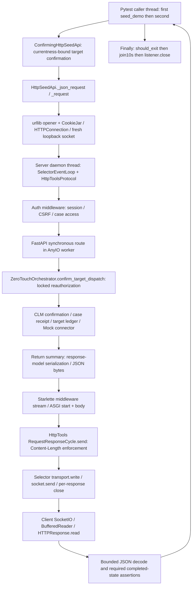

# PR81 HTTP seeder execution map and bounded non-ETW plan

First substantive deliverable; read-only mapping completed before source edits or diagnostic execution. Owner assignment: ce355c4a-ca47-4817-a8a1-f1bc7f6676aa/Pasted text.txt. Two correction rounds maximum; no privileged/ETW work, socket-option changes, uncertain confirmation replay or unchanged-test sampling. The prior failed window remains immutable. No new stability window begins without independent eligibility and a pinned protocol.

Worktree C:/Users/shane/.codex-clean2/worktrees/blocker-resolution-idp-ux/data-dividends-zero-touch-clm; feature branch feat/blocker-resolution-idp-ux-optimization; HEAD dd8c36c8a911f4b5f3b80e7441d049f1aa976599; cached main/base e799d74063678bb0eccbea445d5ab3c8628dd2c0. Starting product-source25 ba47966ed4cd5a4a9c084cc9450bc5250b46b61d85c8a3cc1185448ffa691490 and all1,204 preservation hashes verified. New owner authority allows evidence-supported corrective source changes; this identity is a checkpoint, not an editing prohibition.

## Actual execution path

All server/client code belongs to one pytest process. The caller uses synchronous urllib; Uvicorn owns a dedicated daemon thread/event loop; FastAPI synchronous route/service work runs through AnyIO workers. New isolated memory/Mock composition and an ephemeral127.0.0.1 listener belong to this fixture. No external provider or protected database is involved.

| Boundary | Exact owner / inspected source | Relevant contract |
|---|---|---|
| Sequence and fixture | apps/backend/tests/test_phase13_demo_scripts.py:440-475 | Fresh application/auth/listener; server.started readiness10s; first created10 then second created0/reused10; finally join10 and worker-not-alive assertion |
| Confirmation adapter | same file:347-385 | POST current automation/CLM/case-event versions; require COMPLETED and MOCK_GOLDTIER_SUBMITTED |
| HTTP client | scripts/seed_phase13_demo.py:139-181 | JSON request, CSRF on unsafe methods, opener timeout15, bounded read1048577 and max1048576 response |
| Connection ownership | installed C:/Python312/Lib/urllib/request.py:1303 | HTTPConnection per request; forces Connection: close; closes connection owner's socket reference but response file retains it; no persistent connection reuse |
| Response reader | installed http/client.py:463 | Bounded read clips to remaining Content-Length; reads required bytes, not unnecessary EOF. Partial delivery while peer remains open can time out; bounded earlyEOF read may return short data |
| Auth and route | app/api_auth.py:213-277; app/main.py:2301-2323 | Auth middleware awaits call_next; synchronous confirmation route returns after owning operation; locked reauthorization retained |
| Domain/target semantics | services/zero_touch_orchestration.py:1839-1916; existing CLM/case/target-ledger owners | Target commit may precede HTTP delivery; uncertain client outcome never permits mutation replay |
| Serialization | installed fastapi/routing.py:get_request_handler; starlette/responses.py:55,196; middleware/base.py:96 | Response model and UTF8 JSON determine body length; middleware projects original headers and streamed body |
| Protocol | installed uvicorn/protocols/http/httptools_impl.py:420,463 | Header first, no chunking with Content-Length, exact emitted length enforced, flow.drain only when paused; completion closes non-keepalive transport |
| Transport/close | installed asyncio/selector_events.py:867,908,1055,1136 | Immediate send then queue unsent bytes; close drains queued user bytes before native close. Empty queue/socket send return is not ACK or delivery proof |
| Server shutdown | uvicorn/server.py:76,272 | Own loop/thread; fixture finally begins after client return/error. Protocol shutdown retains in-flight completion; task waiting precedes lifespan shutdown |

Runtime actually inspected: Python3.12.10; Uvicorn0.52.1; FastAPI0.141.1; Starlette1.7.0; AnyIO4.15.1; h11 0.16.0. Auto protocol resolves HttpToolsProtocol. Earlier accepted Selector selection remains unchanged. Installed runtime source, not current defaults assumed from online docs, supplies this mapping.

## Prioritized competing hypotheses

| Hypothesis | Supporting evidence | Contradiction / limit | Unknown | Minimum discriminating check | Owning correction if proven |
|---|---|---|---|---|---|
| Kernel/receive delivery or per-response termination | Historical full65786 accepted vs client65280; noEOF,506 missing | No ACK/FIN capture; cannot assign Windows/TCP fault from send return | Why accepted bytes/EOF did not arrive | Safe historical ordering plus dummy complete/noEOF versus withheld-tail boundary probe; no arbitrary transport change | Proven native/runtime/fixture owner only; no correction presently justified |
| Client completion/framing behavior | Timeout inside HTTPResponse.read/SocketIO; bounded read path differs from unbounded strict read | Content-Length clips request; actual socket receipt was short, so waiting beyond already complete body is excluded for old failure | Exact earlyEOF and held-open behavior of original API | Dummy loopback HTTP responses using unchanged HttpSeedApi: full body held open;506-byte-short earlyEOF;506-byte-short held open | HttpSeedApi only for a proven client contract defect; distinguish general defect from historical attribution |
| Incorrect server Content-Length/body stream | Would produce client waiting for missing bytes | Historical declared/ASGI/native accepted counts and hashes match; normal protocol enforces exact body length | Unobserved errors in other executions | Static actual serialization/protocol path, preserved same-response counters; do not rerun application merely to see green | Existing response/protocol owner if mismatch is actually evidenced |
| Fixture shutdown races with response | Dedicated daemon worker; fixture finally closes listener | Failed response transport close at3.313s precedes timeout18.344s; global cleanup follows client failure; retained target completed | Historical worker scheduling/interruption | Correlate preserved timing/should_exit/connections/tasks; no speculative shutdown sleeps | Fixture lifecycle only if causal overlap is proved |
| Event-loop write-buffer loss / cancellation | Installed _write_send pops before send and catches temporary send exceptions | This failure accepted full bytes,buffer0,no send exception or flow pause; not an explanation for that captured response | Activity during other incident | Existing safe diagnostics and exact installed code; avoid synthetic proof of an excluded unrelated mechanism | Runtime owner, only if implicated by incident evidence |
| Premature client connection close / socket file ownership | urllib closes owner reference before handing response to caller | socket makefile reference preserves underlying handle; observed client socket remained open and timed out rather than immediateEOF | Any actual abnormal refcount/close | Installed socket.makefile/close reference ownership plus complete held-open dummy response | HTTP client/runtime owner if lifetime defect demonstrated |
| Reused connection, consumed body, inter-request framing | Consecutive seeder calls | urllib creates per-request connection and forces close; unique focused connection receipts | None shown for captured response | Static opener/HTTPConnection ownership and correlation counts | Client owner if actual reuse is established |
| Target execution/lock stall | Side effect precedes response, client outcome can be uncertain | Captured target COMPLETED/retained; all ASGI/native send bytes emitted; server no active tasks | Earlier unobserved executions' server outcome | Read-only existing receipts; never repeat confirmation | Existing orchestration/ledger owner only for proven defect |
| Resource contention/isolation | Intermittent passes/failures | No measured resource cause; one fixture has new app/port and sequential seeds | Original host scheduling state | Read-only historical task state and fixture ownership; no arbitrary repeated timing sample | Proven isolation/lifecycle owner; otherwise remains UNKNOWN |

## Small discriminating plan

1. Preserve/read-only compare current code, source hashes, originalsafe failure timing and installed HTTP/socket contracts. Do not run the original selector at this stage.
2. One small synthetic probe, three predeclared cases, each on a fresh task-owned dummy loopback socket and with no credentials/case/provider/database/target. Invoke the original HttpSeedApi._request authenticated=False. Use known dummy JSON plus whitespace with declared65786 bytes; persist only count/hash/type/outcome/relative timing. Cases: completebody with peer held open until client finishes; missing506 then orderlyEOF; missing506 with peer held open through original15s client timeout. Expected to distinguish unnecessaryEOF waiting, incomplete-body handling and genuine missingbytes. Bound cleanup10s, no retries, no options or event-loop changes. A passing dummy case is diagnostic, not originalfixture acceptance.
3. Inspect the outcome before any further probe or remediation. A general client defect must not be promoted to the historical timeout cause. No library/runtime transport workaround is authorized from plausibility.
4. If a defect faithfully explains a relevant owning behavior, present diagnosis and a focused before/after regression before the first source edit; at most two correction rounds. Otherwise request fresh independent non-ETW disposition of evidence and Section10 prospective-route eligibility. No automatic failed-window reset or acceptance execution.
5. Only after independently accepted correction/eligible plan: predeclare a genuinely new original uninstrumented three-process window, stop on first failure, then full backend and complete PR81 matrix/QG/conditional publication. Historical FAILs remain immutable.

No maintained code changed in mapping. No ETW, elevated operation, raw payload capture, fixture execution, confirmation replay or publication. This map/plan is the first substantive deliverable, not causal closure.
