# Architecture

This is the canonical agent-readable architecture map for current development. Source,
tests, contracts, and decisions remain higher authority for their respective facts.
Phase architecture documents provide detail and history; they do not silently override
this current map.

## 1. Purpose and scope

The system is a proof of concept for Singapore corporate new-to-bank onboarding:
registry acquisition, document evidence, ownership/UBO analysis, reconciliation,
readiness, a Mock GoldTier target sequence, exception handling, and an authenticated
case portfolio. It is designed for replaceable providers but currently proves only the
classifications in `docs/PROJECT_STATE.md`.

## 2. Business and technical pipelines

```mermaid
flowchart LR
    A[Authenticated request] --> B[Actor, team and capability]
    B --> C[Immutable case policy snapshot]
    C --> D[Bounded initial identity and jurisdiction resolution]
    D -->|Resolved SG| GS[Early read-only GoldTier Search]
    D -->|Unresolved/conflict/unsupported| R[Controlled review or stop]
    GS -->|No match| E[Registry provider boundary]
    GS -->|Technical failure| E
    E --> F[Canonical entity and registry evidence]
    F --> G[Document intake and extraction]
    GS -->|Exact verified prior target| ES[Hydrated existing target state]
    ES --> G
    GS -->|Ambiguous candidates| R
    G --> H[Reconciliation]
    H --> I[Decimal ownership and UBO analysis]
    I --> IA[Case-bound advisory intelligence]
    IA --> J[Readiness snapshot]
    J --> K[Ledger-owned new or existing GoldTier target sequence]
    K --> L[Portfolio, dashboard and evidence UI]
```



The static dependency direction is:

```text
HTTP routes/UI -> application services -> domain models and ports
connector/persistence adapters ---------> domain models and ports
application composition root ----------> routes, services and adapters
```

Ordinary API route modules validate and project through services; they do not own
business rules, import concrete persistence implementations, or perform persistence
queries. `apps/backend/app/main.py` is also the designated top-level application
composition root. It may import and wire concrete implementations solely to construct
the application and inject dependencies. That exception does not authorize persistence
queries or business behavior inside route handlers. Domain logic never imports provider
payloads. Adapters translate untrusted external/storage shapes into strict port/domain
shapes, and runtime calls dispatch through ports rather than reversing static ownership.

## 3. Bounded-context and canonical-owner map

| Context | Canonical owner files/modules | Responsibilities | Allowed dependencies | Must not own |
|---|---|---|---|---|
| HTTP/API transport | `api_*.py`, `api_models.py`, route-handler portions of `app/main.py` | routes, request validation, safe response projection | services/domain response types | concrete persistence imports or queries, provider mapping, authorization invention |
| Application composition root | application-construction portions of `app/main.py` | construct the FastAPI application and inject configured service/repository dependencies | composition modules and concrete implementations strictly for assembly | persistence queries, business decisions, provider mapping, route-level repository bypass |
| Runtime composition/config | `app/composition.py`, `app/config.py`, `app/persistence/composition.py` | validated mode selection and dependency assembly | connectors, services, repositories | business branching or silent fallback |
| Identity/RBAC/team scope | `domain/access.py`, `services/authentication.py`, `services/authorization.py`, `api_auth.py` | actor/session validation, capability and case scope | profile/team ports | frontend claims, caller-supplied authority |
| Administration | `domain/administration.py`, `services/administration.py`, `services/admin_repository.py`, `persistence/mongo_admin_store.py` | team/profile lifecycle, versions, audits, last-HR invariant | auth domain, repository ports | case ownership or business workflow |
| Policy | `domain/policy.py`, `services/policy_management.py` | typed catalogue and immutable case snapshots | policy repository | retroactive reinterpretation of cases |
| Jurisdiction | `domain/jurisdiction.py` | observations, resolution, closed routing decision | source-neutral values | source precedence or provider HTTP |
| Registry/ACRA | `connectors/registry.py`, `connectors/acra.py`, `mock_acra.py`, `acra_sandbox.py`, `mappers/acra.py` | strict provider acquisition, normalization, canonical mapping | connector DTOs/domain canonical model | target mapping or UBO calculation |
| Registry snapshot cache | `services/registry_acquisition.py`, `services/registry_cache_repository.py`, `persistence/mongo_registry_cache_store.py` | opt-in synthetic Mock exact-key freshness, single-flight acquisition, complete-snapshot persistence and case evidence binding | registry provider port and normalized domain bundles | routing/auth decisions, case state, raw payloads, ownership/reconciliation/target results, sandbox/live reuse |
| Canonical entity/evidence | `domain/models.py`, `services/canonical_validation.py` | source-neutral entity, provenance and evidence integrity | domain only | raw payload retention |
| Documents/IDP | `domain/documents.py`, `services/document_media.py`, `document_processing.py`, `connectors/idp.py`, `local_pdf_idp.py` | intake validation, extraction, provenance, confidence/review records | case port, IDP port | source precedence or canonical overwrite |
| Reconciliation | `domain/reconciliation.py`, `services/reconciliation.py`, reconciliation repository/UoW | compare observations, discrepancies, bounded decisions, resume binding | canonical/document evidence | implicit source winner |
| Ownership/UBO | `domain/ownership.py`, `services/ownership_analysis.py`, `connectors/registry_ownership.py` | the single deterministic Decimal graph/path engine and classifications | source-neutral ownership graph | float math, legal approval, duplicate engine |
| Advisory onboarding intelligence | `domain/onboarding_intelligence.py`, `services/onboarding_intelligence.py`, `services/onboarding_intelligence_repository.py` | explainable entity-candidate linkage, UBO advice over deterministic results, and mock advisory risk | canonical case/document/ownership evidence and immutable case policy | canonical/source mutation, legal UBO, compliance decision, approval, target execution, or direct readiness mutation |
| CLM/readiness | `domain/clm.py`, `services/clm_orchestration.py` | readiness evaluation and immutable target plan | canonical/document/reconciliation/ownership evidence | raw provider payloads or target transport |
| Target execution | `domain/target_submission.py`, `domain/target_safety.py`, `services/target_response_validation.py`, `services/target_execution_repository.py`, `connectors/goldtier*.py`, `mappers/goldtier.py` | ordered search/shell/policy/amend, strict responses, durable intent/outcome/finalization | target port and ledger | replay after uncertain attempt, sponsor approval claim |
| Zero-touch workflow | `domain/zero_touch.py`, `services/zero_touch_orchestration.py`, provider bindings | stage ordering, typed exceptions, call stopping, resume | application services through ports | provider-specific payload logic |
| Case persistence | `persistence/models.py`, `mongo_case_store.py`, `persistence/repositories.py`, service repository protocols | complete envelope, strict decode, CAS, insert/update/delete semantics | domain/service ports | API/UI behavior or provider calls |
| Portfolio/dashboard/activity | `domain/case_management.py`, `domain/dashboard.py`, `services/case_query.py`, `services/dashboard.py` | authorized projections, filtering, ordering, retained automation-event activity and factual metrics | access policy, portfolio repository | analytics/risk/SLA inference, event production, regulatory audit ownership |
| Frontend auth/cache | `frontend/src/auth.tsx`, `queryClient.tsx`, `caseQueries.ts` | session lifecycle, scoped query keys, cancellation/invalidation | backend APIs and server-authored profile | authorization or persistent sensitive cache |
| Frontend navigation | `frontend/src/navigation.tsx`, browser location, router mount in `frontend/src/main.tsx` | route patterns, safe path construction, route matching, active links and generic unavailable presentation | existing auth, view and cache owners | server data, authorization, workflow actions or a second page/case identity |
| Frontend views | `frontend/src/pages/*`, `App.tsx`, `api.ts`, `types.ts` | presentation, input, safe actions | authenticated API/cache owners | business authority or provider selection |

## 4. Canonical data and evidence model

The mandatory flow is:

```text
untrusted source payload -> strict source DTO -> canonical model/evidence -> target mapper
```

Canonical data records source system, environment classification, safe reference and
UTC sourcing time. Raw registry bodies, uploaded bytes, full extracted text, secrets,
authorization material, and private exception details do not become canonical evidence
or ordinary logs. Browser projections expose only required safe evidence.

Source evidence remains evidence; it does not automatically become authority. The
reconciliation context owns disagreement and the policy snapshot owns per-case runtime
thresholds. Target DTOs are constructed only from validated canonical/readiness data.

## 5. Registry and ACRA architecture

`RegistryProviderRouter` is a closed backend-owned route. Resolved Singapore selects
the ACRA adapter. Unknown, conflicting, or recognized-but-unimplemented jurisdictions
fail closed before a provider call. User input cannot select a URL, module, credential,
or adapter.

`MockAcraConnector` is default. `AcraApiMarketplaceMockConnector` is a distinct explicit
opt-in official Mock lane with fixed provider endpoints, an in-memory OAuth token, raw
`token` downstream authentication, and no fallback. `AcraSandboxConnector` remains a
generic sandbox-shaped partial seam. `acra_bizfile_sandbox.py` supplies only the strict
sample decoder reused behind the official connector and is not independently composed.
No active ACRA path is Live.

ACRA source DTOs are freshly reconstructed and validated, request-identifier bound,
normalized, and mapped through `mappers/acra.py`. Direct ACRA-to-GoldTier mapping is
prohibited.

The optional registry snapshot cache is disabled by default and is valid only for the
synthetic Mock ACRA identity. Authorization, jurisdiction, router, and identifier gates
run before its single `RegistryAcquisitionCoordinator`. Exact keys include provider,
environment, acquisition-contract version, synthetic dataset namespace, and normalized
identifier. Only complete normalized bundles are stored. Freshness is evaluated after
the per-key process-local lock at the actual use point, against every relevant UTC
timestamp, using the project-owner-approved fixed 7,776,000-second rule. The original
provider provenance is retained; a separate binding records provider-fetch versus
cache-hit use and is defensively copied into each case.

The authorized case DTO exposes only a nullable seven-field Mock binding projection:
disposition, case binding time, computed expiry, and the fixed freshness policy
ID/version/duration/comparator. Projection fails closed for a non-Mock binding. Cache
IDs, keys, revisions, write/anchor times, fingerprints, repository details, endpoints,
references, and raw payloads remain server-internal. `None` is unknown/unrecorded and
does not prove a miss, disabled cache, provider fetch, freshness, or current validity.

The lock table counts holders and waiters and retires an exact-key lock only after the
last user exits, including failure paths. Case establishment acquires its case lock
before cache acquisition; cache code never acquires a case lock. This provides
single-process same-key suppression only, not a distributed lock or exactly-once
guarantee. The synthetic dataset and bounded identifier syntax constrain inputs, but
there is no globally bounded key count, eviction, TTL, purge, or retention policy.

## 6. Document/IDP architecture

Media validation occurs before provider extraction. The default local provider performs
deterministic bounded extraction for the accepted technical PDF/DOCX/TXT profile. Mock
IDP exists for isolated demo/fault behavior. There is no vendor OCR.

Every current document has provenance, state, field observations, versions and
supersession links. Raw bytes/text remain transient. Low-confidence, conflicting,
missing, invalid or unverifiable evidence follows the defined review/replacement path;
it never silently changes the canonical entity.

## 7. Ownership/UBO architecture

Registry acquisition evidence is adapted to the source-neutral ownership port and fed
to `OwnershipAnalysisService`/`domain/ownership.py`. This is the sole maintained graph
and calculation owner. Percentages and path multiplication use `Decimal`, with bounded
party/relationship/depth/path limits. Cycle and incomplete graphs create non-definitive
review outcomes. Results are provisional ownership candidates, never legal or
compliance decisions.

Do not add a second calculator in a connector, mapper, route, frontend, or provider.
External ownership services, if ever approved, may supply graph evidence only through
the existing port unless an ADR deliberately changes the canonical owner.

The source-neutral onboarding-intelligence owner is separate from the ownership engine.
It emits versioned, safe advisory projections only. Entity resolution applies exact
identifier/country rules before a deterministic weighted probability proxy, never
auto-selects from name or address alone, and routes conflicts/ties to typed review. UBO
advice consumes—not recalculates—the Decimal result and is permanently labelled
`NOT_LEGAL_UBO_DETERMINATION`. Mock risk uses only available case signals, exposes
missing groups as `NOT_ASSESSED`, and is permanently labelled
`NOT_COMPLIANCE_DECISION`. Its case-bound readiness flag defaults false; when explicitly
enabled, the existing zero-touch owner may stop a high result for human review before
target execution. Q-017 remains open.

## 8. Reconciliation architecture

Reconciliation owns comparison of Registry and Document observations. It derives
intrinsic outcomes, preserves both sources, exposes only bounded backend-authorized
actions, binds decisions to current evidence fingerprints/versions, and coordinates
canonical changes through its unit-of-work boundary. It has no implicit Registry-wins,
Document-wins, confidence-wins, or newest-wins rule.

The user-authorized Certificate of Incorporation POC profile treats absent document
address as non-blocking `REGISTRY_ONLY`: reconciliation retains the usable registry
observation and the missing document observation separately. This does not fabricate a
document value or establish source precedence. Supplied address evidence remains
strictly compared, and legacy profiles that require address remain blocking.

## 9. CLM and target execution architecture

Readiness consumes canonical entity, current documents, reconciliation state and
ownership results. It creates an immutable target preparation snapshot. Target execution
then uses one explicitly composed GoldTier dialect. Mock remains the default. The XPI
sandbox dialect is an opt-in `SANDBOX_PARTIAL` adapter with strict source-neutral
mapping, bounded case-scoped preview, backend-only `user_id`, TLS 1.3 certificate-
verified transport, redirects disabled, bounded time/body, and a separate write opt-in.
Both paths preserve search; conditional shell; policy; amend ordering. The XPI path may
reuse one exact identifier/country match through the existing advisory resolver; every
multiple, probable, conflicting, or otherwise non-exact candidate stops at human review
with no mutation.

The retained `GoldTierSubmissionPlan` is the single provider-identity owner for one CLM
submission. Its environment and provider classification are an immutable compatible
pair. A later configuration change may select the default for a new plan, but it may
not reinterpret an existing plan: submission input is derived from that retained plan,
and the mapper and connector must both declare the same mode before any target-ledger
entry or network call. A mismatch fails closed with one typed, sanitized internal
error; Mock is never used as a Sandbox recovery path or vice versa.

The target ledger is the canonical replay/recovery owner. Intent and operation markers
are retained before calls. An uncertain attempted operation is not automatically
replayed; a retained outcome permits finalization-only recovery. No route or remediation
may bypass the ledger. Mutation timeout, transport ambiguity, oversized/malformed
post-acceptance response, or cancellation leaves the attempted execution `IN_PROGRESS`
for human reconciliation. Mock or sandbox target submission is not sponsor approval,
customer approval, or Live interoperability.

The CLM aggregate owns one immutable, safe early-Search checkpoint bound to the bounded
initial legal-name, registration and jurisdiction identity. It runs after fail-closed
Singapore eligibility validation and before optional ACRA bootstrap, document,
reconciliation, or ownership work. Bounded candidates are evaluated only by the
existing entity-resolution owner. An exact match is reusable only when it binds to a
prior same-ID verified case; it retains the GoldTier party ID, hydrates verified target
state, and skips ACRA, Shell and new-policy creation. A no-match checkpoint alone
permits ACRA bootstrap and, after ordinary readiness prerequisites, Shell then Policy.
Both branches may Amend and perform same-ID read-back. Any ambiguous, conflicting,
failed, stale, or uncertain state blocks target mutation. Neither ambiguous nor failed
Search means no-match: both may continue through independent eligible ACRA, document,
reconciliation and ownership evidence while target identity remains unresolved and
every target mutation is blocked. A same-case identity correction invalidates dependent
evidence only when identity changes; every read-only Search recheck retains its own
request and outcome history. Every mutation advances
through the same durable ledger; an attempted operation without a definitive result is
never replayed automatically. No second target ledger, search resolver, or
provider-specific workflow owner is introduced.

## 10. Authentication, RBAC, team and admin architecture

The server session resolves a current repository-backed profile/team on every
authenticated request. `CaseAccessPolicy` and capability checks are authoritative.
Case creation derives/validates team ownership server-side. Inaccessible and absent
cases deliberately share a safe 404 projection.

UI controls may reflect capabilities but never grant them. Caller headers/query/body
fields cannot create role/team authority. Mutations that depend on current access or
version re-authorize within their relevant lock/CAS/repository boundary. Profile
security-version change revokes process-local sessions.

## 11. Policy architecture

The policy catalogue is bounded, typed and repository-owned. Only designated runtime
rules affect new cases. On case creation, version, thresholds, comparator and binding
time are copied into an immutable `CasePolicySnapshot`. Later policy changes never
reinterpret existing cases. Custom showcase rules are non-executable and non-runtime.
Eight GoldTier target-preparation values additionally carry explicit authority labels.
The bounded Singapore POC fixes `registrationType=ACRA`,
`customerExternalSystem=DSD`, `policy=Singapore`, and
`bookingEntity=ANZBGL (Singapore Branch)` with explicit POC/sponsor-document authority.
The corrected standalone GoldTier OpenAPI 1.0.0 owns the exact 17-value KYC Customer
Type and 23-value Client Segment vocabularies. KYC type and segment have no global
default: an authorized operator selects one value per case, the backend validates and
retains it as `USER_AUTHORIZED_POC`, and the snapshot becomes immutable before target
dispatch. The collection sends `accountEntityType` and `productType` as explicit empty
strings, so those fields are optional for this bounded XPI sandbox request only.
The HR-only provider console may construct ephemeral `SANDBOX_TEST_ONLY` previews, but
it cannot mutate the global catalogue or bypass the case-bound target ledger.
Sandbox success additionally requires a ledger-owned post-Amend Search by retained
`goldTierID`; only one exact candidate with that same ID is accepted as verified.

## 12. Persistence and concurrency architecture

Memory and Mongo implement service repository protocols. They are separate explicit
modes and never silently fall back to one another. Mongo owns one strict case envelope
with schema version and revision. `_id`, envelope case ID and nested identities must
agree.

Case-envelope schema v5 adds an optional case-bound advisory-intelligence projection.
It strictly reads schema v1-v4 envelopes in memory; v4 preserves `intelligence = null`
and is never reinterpreted or rewritten with current policy. Schema v4 introduced the
optional immutable registry evidence binding, with older absent bindings remaining
unknown historical metadata. Reads do not infer cache disposition. The separate registry-cache
schema v1 uses canonical lossless UTC ISO-8601 strings in memory and Mongo, an exact-key
digest identity, insert-only creation, and expected-revision replacement. Cache and case
repositories remain separate; no cross-collection transaction is claimed. A successful
cache write can survive a later case-persistence failure, while an incomplete/failed
refresh can never replace a complete entry.

The schema-v5 envelope uses additive optional fields for GoldTier provider mode,
authority-labelled target policy, and request-plan preview. Existing schema-v5 records
without those fields read as Mock/no-target-enrichment and are not rewritten. No second
case schema or persistence owner is introduced. When a schema-v5 CLM submission
snapshot exists, its provider mode and any matching target-ledger input must agree with
the retained plan. Contradictory persisted combinations are invalid and a plan without a
submission snapshot remains valid.

The early Search checkpoint and incremental attempted/completed operation evidence are
also additive schema-v5 fields. Historical terminal ledger rows infer completion only
from their retained terminal outcome; historical in-progress rows never infer success.
Automation has its own persisted stage-order version inside the envelope. Records without
that field are the pre-Search v1 order; newly authored records use v2. Decode preserves
the v1 facts without adding Search. On the next safe non-terminal continuation, the
automation repository uses one CAS mutation to rebase to the earliest unproved v2 stage
and then performs Search before re-evaluating later deterministic stages. Historical
terminal records are not retroactively relabelled. Restart recovery treats attempted-but-
not-completed mutations as uncertain, does not upgrade that state, and preserves the
existing no-replay stop.

Schema v7 is the current case envelope. Schema v6 added bounded initial-customer identity and
GoldTier-first Search evidence, verified existing-target provenance, separate definitive
and lifecycle-resolved operation markers, and an explicit provider-verified recovery
fact. Schema v7 adds bounded identity-correction/Search-recheck attempts, policy-rebind
history, manual-ownership-review evidence and prior terminal analysis history, immutable
blocker-decision metadata, and exact target-dispatch confirmation. Exact schema-v1
through schema-v6 readers remain supported without rewrite. The
target ledger remains the sole mutation/replay owner: recovery can resolve an uncertain
Shell only after exact case/provider identity validation and records that the original
outcome was uncertain and no replay occurred. A recovered ID is never represented as a
Shell response. Mongo persists the recovery fact and recovered ID before downstream
Policy or Amend can proceed.

Case bootstrap begins with a backend-owned legal-name, registration-number and country
identity. Eligible Singapore identity is searched against GoldTier before ACRA. Exact
match is accepted only when one provider candidate binds to a prior durable same-ID
post-Amend read-back; that case hydrates verified canonical target state, skips ACRA and
Shell, then continues document reconciliation against the same target ID. No-match uses
the ordinary ACRA bootstrap path. Ambiguous and failed Search retain their true typed
dispositions and may continue independent eligible ACRA and case-evidence collection,
but cannot call Shell, Policy, Amend, or any other target mutation.

Bounded repair actions remain inside existing owners and the case lock/CAS boundary.
D-056 policy rebind preserves case-selected KYC/segment and retains the superseded
snapshot. Reviewed local economic-interest evidence uses the one Decimal ownership
engine, remains explicitly non-ACRA, and retains the prior terminal analysis. Blocker
decision metadata explains classification, inputs, actions, dependencies, and resume
conditions but cannot authorize or advance workflow. Unknown decisions fail closed.
Meaning-preserving normalized document equivalence may retain an auto-resolved note
only after the document owner proves it; a warning record may only reflect an existing
readiness-authorized warning.

The current server-authored target projection must be explicitly confirmed before any
business mutation. The schema-v7 confirmation binds actor/time, event and CLM versions,
destination, warnings, provider classification, and a digest of the reviewed projection.
The exact mapper preview and immutable dispatch snapshot share the stable case-acceptance
timestamp for target `sourceContext.acceptedAt`; the digest includes every transmitted
preview field rather than excluding time-varying data.
The final review includes legal form and owning team and routes identity,
classification, and document edits to their existing backend-validated owners. An
ownership edit is exposed only when the server's typed recovery projection authorizes
`MANUAL_OWNERSHIP_EVIDENCE`; otherwise the review states that ownership is review-only.
A pre-confirmation identity edit cancels stale confirmation state, reruns only read-only
Search, and invalidates dependent evidence; edit controls are absent once the projection
is frozen.
Confirmation forces one bounded read-only Search recheck; a material result change
retains the refreshed unconfirmed summary and dispatches nothing. Relevant evidence or
policy change invalidates it. Every Shell, Policy, and Amend path,
including direct submission, reauthorizes and checks that binding inside the owning lock
before the target ledger may dispatch.

The HR ACRA diagnostic surface uses the same composed connector under the existing
provider-test capability. It exposes bounded safe status and read-only lookup evidence,
has no case access, and cannot mutate a case or provider.

Create is insert-only, updates are update-only, and mutations use expected revision/CAS.
Case deletion re-authorizes inside the canonical case lock, physically deletes the
aggregate, then releases transients. A stale update cannot recreate a deleted case.
Global administration records remain outside case envelopes.

These are single-process POC guarantees. They are not distributed transactions,
multi-instance locks, regulatory retention, or production audit guarantees.

## 13. Portfolio and dashboard architecture

The backend applies actor/team authorization before filters, ordering, projection and
aggregation. A lightweight repository projection avoids complete-envelope N+1 reads.
Dashboard metrics are factual POC counts/trends, not risk, SLA, compliance, or staff
performance metrics. `team_filter` is part of backend scope and frontend cache identity.

The Cases portfolio page composes current status, priority filter/order, team, correlated
OPEN exception type, exact jurisdiction, and trimmed literal search over registration
ID, legal name, and canonical UUID. Memory and Mongo share one engine-independent
pattern: ASCII letters become explicit paired classes and every other code point remains
literal. This supplies deterministic ASCII case-insensitivity without locale or Unicode
folding divergence. It orders prioritised rows before unset rows, applies
the selected numeric direction, and breaks equal-priority/unset ties by `updated_at`
descending then canonical UUID string descending. Memory and Mongo apply all predicates
before live offset paging and `limit + 1` lookahead. Mongo performs one scoped,
strictly-validated, read-only aggregation. It captures optional source-container type
validity before projection and projects only portfolio fields; it does
not decode whole envelopes or fan out into detail reads. The page has no total and no
constant-scan-cost or snapshot-isolation claim. The compatible array endpoint remains.

The Phase 19 candidate keeps factual timing in the existing case-management/query owner.
One server clock read is taken after each portfolio repository page read and used for all
rows; `observed_at` appears once at page level. The existing Mongo aggregation projects
only retained `started_at` and total-duration scalars in addition to Phase 18 fields, so
the one-operation-per-page boundary and no-detail-fan-out guarantee remain. Case Detail
uses the same deterministic projection helper and its own single backend observation.
The legacy case-array DTO remains unchanged. Invalid UTC/chronology/duration facts fail
closed rather than being clamped or repaired. The browser only formats returned integer
milliseconds and never owns time, polling, status age, SLA, deadline, health, risk, or
escalation semantics. Recorded stage durations mean completed automated processing
attempts, not full stage residence or human wait.

The Case Activity Explorer reads only retained `ZeroTouchAutomationRecord.events` through
the same authorized case-query and portfolio-repository boundary. Memory and Mongo apply
visibility before event inspection and share the ordering `(timestamp descending,
canonical case UUID ascending, source-local sequence descending)`. Mongo uses one bounded
read-only aggregation per page with a scoped invalid-data signal and `limit + 1`
lookahead; it does not decode full envelopes, repair data, add an event store, or fall
back to memory. Selected-case access remains a safe 404. Current priority and client
scope are contextual projections, not event-time facts.

This activity view is a live, offset-paged view of currently retained automation events.
It is not a complete compliance audit, actor ledger, immutable archive, cross-page
snapshot, or causal order across cases. Case deletion removes the available activity.
The `.csv` projection reuses the same authorized query, exports only the requested
bounded page (maximum 100), uses fixed safe fields and UTC, hardens spreadsheet-formula
prefixes, and sends no-cache/no-sniff headers. It is not a retention or regulatory
export. Successful advisory evaluation emits one safe system-originated workflow event
with model-bundle and case policy-catalogue version context; actor attribution for
historical events remains unavailable.

## 14. Frontend and React Query architecture

The frontend is a typed React/Vite client. `AuthProvider` owns the authenticated session
lifecycle. One in-memory QueryClient serves that lifecycle. Query keys begin with user
identity; dashboard/list keys include Director team filters and presentation inputs
that affect server results. GETs use AbortSignal.

Logout, 401, identity replacement and successful new login cancel and clear incompatible
cached data. Mutations use explicit effects; global mutation retry is disabled. Case
deletion cancels in-flight list/dashboard/detail/supporting requests before removing
the deleted case, preventing stale response resurrection. No case data is persisted to
localStorage, sessionStorage, IndexedDB or a service worker.

Activity query keys additionally include case, team, action, stage, outcome, UTC window,
offset and limit. Filter changes do not reuse a previous key as current data. Activity
reads preserve `AbortSignal`; relevant mutations invalidate the user-scoped activity
family, while deletion cancels and removes it before a late response can republish a
deleted row.

Intelligence detail keys include authenticated user and case identity. Reads preserve
`AbortSignal`; supporting mutations invalidate the exact case key, and deletion cancels
then removes it so stale advisory data cannot reappear across case or session boundaries.

Portfolio page keys share the canonical authenticated case-list family and add status,
priority filter/order, team, attention type, jurisdiction, normalized search, offset,
and limit. Search uses a 300 ms debounce without displaying a previous key under a new
label. Relevant mutations invalidate all page/filter variants. Deletion cancels before
removing the row from every cached page envelope and invalidating active pages, so a late
response cannot resurrect the deleted case and a short page can refill.

Browser location is the sole page and case-navigation identity. Declarative
`BrowserRouter` routing is mounted once outside `AuthProvider`; route elements reuse the
existing App, page, authenticated transport and QueryClient owners. Transient tab,
selected-case, selected-client and audit-case navigation state is retired rather than
synchronized with the URL. Routes contain only opaque validated case IDs, never
credentials, auth material, UENs, names, filenames, evidence or document content.

Mounting, refreshing, or traversing a route does not create a case, upload/retry a
document, complete intake, resume a workflow, resolve review, refresh a registry,
submit to a target, update priority, delete, or perform an admin/policy mutation.
Existing GET/poll behavior remains with its page/query owner. A live intake keeps its
case and selected `File` objects only in the current tab; after an ordinary refresh the
retained intake route reads backend case/document state and does not reconstruct or
replay the package.

The case evidence workbench is a presentation layer over those same authorized query
owners. It renders the minimized registry projection, selects only retained
backend-authored ownership candidates/paths, and explains typed workflow/readiness/
exception/target state. Ownership selection is local and remounts across actor, case,
or analysis identity; it performs no arithmetic, graph reconstruction, provider/cache
read, API lookup, target replay, mutation, or browser persistence. Evidence-focus
controls use fixed stage/code-to-section mappings rather than matching names,
timestamps, or timeline prose. Unknown typed values and missing evidence remain visibly
uncertain. The path visual is deliberately bounded and never claims a complete
hierarchy or legal UBO determination.

`BrowserRouter` requires an operational history fallback. Deployment must route
`/api/**` before any SPA rule, serve existing static assets normally, return a real 404
for missing `/assets/**` and file requests, and fall back to `index.html` only for
same-origin application `GET`/`HEAD` requests accepting HTML. Unsafe methods must never
be rewritten. Local Vite behavior is development evidence only; no production hosting
surface is currently verified by this repository.

## 15. Security boundaries

- Never track or expose credentials, tokens, hashes, private keys/certificates, sponsor
  secrets, raw confidential artefacts, raw provider bodies, or KYC/PII logs.
- External data, uploads, filenames, response objects and HTTP errors are untrusted.
- External HTTP requires HTTPS, verified certificates, bounded timeouts and safe errors.
  The GoldTier XPI sandbox transport enforces TLS 1.3, verified certificates, no
  redirects, bounded response retention, and safe fixed errors.
- Browser Origin/Referer, session and CSRF checks remain centralized and fail closed.
- Errors crossing API/browser boundaries use stable sanitized codes/messages.
- Mock/Local/Sandbox/Dormant/Live labels remain explicit and evidence-based.

## 16. Provider/integration matrix

| Provider | Runtime owner | Current composition | Allowed next change boundary |
|---|---|---|---|
| ACRA | registry/ACRA connectors and mapper | synthetic Mock default; official API Marketplace Mock opt-in; generic sandbox partial | existing connector interface plus external-provider skill |
| BizFile | dormant connector module | not composed | explicit contract/security/architecture change only |
| IDP | document service and IDP port | local deterministic default; Mock fault path | adapter replacement, no business-rule leak |
| Ownership | ownership service/domain | local Decimal engine | evidence provider through existing port |
| GoldTier | target connector/mapper/ledger | Mock default; XPI sandbox partial opt-in | sponsor-confirmed field authority and separate PingFed/production phase |
| Mongo | persistence adapters | optional explicit mode | repository/schema skill, never routes |
| Camunda | none | not implemented | new bounded phase and ADR if introduced |
| Identity provider | authentication service | local POC | production security/authority phase |

## 17. Architecture invariants

1. Source payload -> canonical model/evidence -> target mapping.
2. Business rules never depend directly on raw external payload structure.
3. Every external boundary has a controlled interface and safe adapter.
4. Unsupported provider/contract/jurisdiction behavior fails closed.
5. Evidence lineage is preserved and raw sensitive input is minimized.
6. Ownership math remains deterministic and Decimal-based in one owner.
7. Target order, call stopping and no-replay recovery remain ledger-owned.
8. Backend capability/RBAC is authoritative; frontend visibility is not authorization.
9. Safe 404 prevents inaccessible-case disclosure.
10. Sensitive mutations re-authorize inside the relevant lock/CAS boundary.
11. Memory and Mongo never silently fall back between modes.
12. Mongo preserves strict schema identity and CAS/revision semantics.
13. Create is insert-only and update is update-only where required.
14. Case deletion cannot be followed by stale resurrection.
15. React Query keys are user/session scoped; Director team scope participates in identity.
16. Logout/session change/401 clear incompatible cached data.
17. Browser location is the sole frontend page and case-navigation identity.
18. Route entry, refresh and history traversal do not initiate business mutations.
19. URLs contain opaque case IDs only and never sensitive/auth/evidence values.
20. SPA history fallback never absorbs API, static/file, or unsafe-method requests.
21. `clm_poc` is never a physical test database or cleanup target.

## Phase 15A evidence and future-boundary constraints (provisional)

The conceptual evidence lens is **Value + Source + Evidence + Date + Confidence +
Status**. It is descriptive only: not every source or attribute necessarily has every
property. Presence or acquisition is not verification (**PRESENT != VERIFIED**), and
the POC preserves observations and current reconciliation semantics without an implicit
global source-precedence rule.

For Singapore, UEN is the current routing and returned-registry identity evidence;
legal name remains reconciliation evidence. Fuzzy name matching is not authoritative
identity. Synthetic Mock ACRA cache-first reuse is now an optional project-approved POC
path with a fixed 7,776,000-second freshness interval. It is disabled by default and is
not an ACRA rule, production sharing/retention decision, calendar-month interpretation,
or sponsor-confirmed policy. The POC has no general ageing/SLA, OCDD, periodic refresh,
forced refresh, or perpetual-KYC engine.

The current external Zero-Touch -> Mock GoldTier arrangement is prototype architecture,
not a confirmed production deployment or handoff boundary. Production placement,
handoff, and transferred-state authority remain open. Camunda has no runtime role in
this architecture.

## 18. Explicit non-goals and prohibited assumptions

Do not assume Live ACRA/GoldTier, production OCR/SSO, Camunda, sponsor-approved UBO or
review policy, Ready-for-Approval, related-party writes, hierarchy creation, distributed
exactly-once behavior, production retention, or compliance approval. Do not add direct
Mongo access to ordinary routes or persistence operations inside `main.py` route
handlers. The composition-root import exception is assembly-only. Do not add frontend
authorization, direct ACRA-to-GoldTier mapping, a second ownership engine, a second
authorization owner, or parallel persistence model.

## 19. Known hotspots and debt

`main.py`, `App.tsx`, shared API/types, configuration/composition, persistence models,
CI, README and lockfiles are deliberate-change hotspots. Prefer focused owner modules
and existing ports. The generic ACRA sandbox is partial, BizFile is dormant, ownership
mode naming carries legacy ambiguity, and Mongo/admin guarantees remain single-process.
Do not solve these incidentally.

## 20. Rules for changing architecture

1. Classify the change using `docs/DEVELOPMENT_WORKFLOW.md`.
2. Read `architecture-change-review` before creating/replacing an owner, boundary,
   framework, dependency direction, persistence owner, or compatibility surface.
3. Prove an existing canonical owner cannot safely hold the responsibility.
4. Identify invariants, consumers, migration/compatibility and retirement path.
5. Create an ADR when the workflow criteria apply; never fabricate past rationale.
6. Use the specialized provider, persistence, cache or security skill when triggered.
7. Update this document and `PROJECT_STATE.md` only for accepted truth, using the
   closeout context-refresh procedure.
8. Obtain focused, broad affected and independent quality-gate evidence before PR
   readiness. Human owners merge.

`scripts/check_architecture.py` enforces only narrow syntax-level subsets of these
rules. It is not the architecture authority and cannot prove semantic ownership,
route-handler behavior, runtime call direction, or absence of every possible bypass;
those remain documentation and independent-review responsibilities.
