# Architecture

This is the canonical agent-readable architecture map for current development. Source,
tests, contracts, and decisions remain higher authority for their respective facts.
Phase architecture documents provide detail and history; they do not silently override
this current map.

This task independently verified origin/main as merged PR80
`e799d74063678bb0eccbea445d5ab3c8628dd2c0` with successful post-merge
push37954652603 on2026-10-10. The grouped-review candidate remains uncommitted
and requires its fresh independent gate. The historical PR77 checkpoint follows.

The earlier inspected main baseline was merged PR #77 at
`8fb5a43c26efd5ef9f513b37fd9478e555cb4eb4` (2026-10-08), with successful post-merge
main CI run [37742194816](https://github.com/shaneqwaszx/data-dividends-zero-touch-clm/actions/runs/37742194816).
PR #77 extends existing recovery owners; it introduces no new owner, dependency,
schema owner, provider, mapping owner or capability owner. No ADR is required.
Earlier closeout provenance follows. PR #70 merged the completed
Phase25/26 documentation and evidence; the PR #69-to-#70 diff contains no product
source change. Historical gates and execution receipts retain their own identities,
including the prior combined FAIL and subsequent narrow P2 remediation PASS.
Sessions1–3 are merged source behavior. Phase25 retained-data compatibility and
Phase26 demo evidence remain bound to their original tested/reviewed content.
Phase27A refreshed metadata and recorded agent UI UAT. Two bounded frontend
presentation fixes consume the existing backend ownership-upload action and remove
the shared body width floor; no owner, dependency or trust boundary changed. Phase27A has fresh independent exact PASS after bounded encoding repair. The
owner-assigned Phase27B documentation sync explains the current application-owned
orchestration, C4 views and recovery decisions in
[Final POC Architecture](architecture/FINAL_POC_ARCHITECTURE.md). These are views
of existing owners, not an architecture replacement. Phase27 checkpoint statements
retain their original attribution; the current assignment baseline is PR #80 above.

## 1. Purpose and scope

The [reliability/recovery UX](integration/GOLDTIER_RELIABILITY_RECOVERY_UX.md), originally
assigned 2026-10-07 and merged through PR #77 on 2026-10-08, extends existing
CLM/onboarding/zero-touch and frontend query/view owners. Search-only
retained intents revalidate current evidence before first dispatch; lost confirmation
responses use bounded GET observation; the submission package exposes Director Shell
and Requested Policy recovery with expected submission UUID and backend-owned identity.
Recovery retains the original confirmation/intent and never replays resolved writes.
No new owner, dependency, schema, provider, mapping or capability grant is introduced.
Unsupported uncertainty remains blocked/escalated; customer Search never proves Policy
success. Independent acceptance retains its exact content identity in the
[task gate](../.ai-pipeline/reports/GOLDTIER_RELIABILITY_RECOVERY_UX_QUALITY_GATE.md)
and [final Round 2 gate](../.ai-pipeline/reports/PR77_E2E_ISOLATION_ROUND2_QUALITY_GATE.md).

The system is a proof of concept for Singapore corporate new-to-bank onboarding:
registry acquisition, document evidence, ownership/UBO analysis, reconciliation,
readiness, a Mock or explicitly enabled Sandbox GoldTier target sequence, exception handling, and an authenticated
case portfolio. It is designed for replaceable providers but currently proves only the
classifications in `docs/PROJECT_STATE.md`.

## 2. Business and technical pipelines

```mermaid
flowchart LR
    A[Authenticated request] --> B[Actor, team and capability]
    B --> C[Immutable case policy snapshot]
    C --> D[Bounded initial identity and jurisdiction resolution]
    D -->|Resolved SG| GS[Early read-only GoldTier Search]
    D -->|Unresolved/conflict/unsupported| R[Controlled review or stop]
    GS -->|No match| E[Registry provider boundary]
    GS -->|Technical failure| E
    E --> F[Canonical entity and registry evidence]
    F --> G[Document intake and extraction]
    GS -->|Exact verified prior target| ES[Hydrated existing target state]
    ES --> E
    GS -->|Ambiguous candidates; target blocked| E
    G --> H[Reconciliation]
    H --> I[Decimal ownership and UBO analysis]
    I --> IA[Case-bound advisory intelligence]
    IA --> J[Readiness snapshot]
    J --> FR[Final review and send confirmation]
    FR --> K[Ledger-owned new or existing GoldTier target sequence]
    K --> L[Portfolio, dashboard and evidence UI]
```



The static dependency direction is:

```text
HTTP routes/UI -> application services -> domain models and ports
connector/persistence adapters ---------> domain models and ports
application composition root ----------> routes, services and adapters
```

Ordinary API route modules validate and project through services; they do not own
business rules, import concrete persistence implementations, or perform persistence
queries. `apps/backend/app/main.py` is also the designated top-level application
composition root. It may import and wire concrete implementations solely to construct
the application and inject dependencies. That exception does not authorize persistence
queries or business behavior inside route handlers. Domain logic never imports provider
payloads. Adapters translate untrusted external/storage shapes into strict port/domain
shapes, and runtime calls dispatch through ports rather than reversing static ownership.

## 3. Bounded-context and canonical-owner map

| Context | Canonical owner files/modules | Responsibilities | Allowed dependencies | Must not own |
|---|---|---|---|---|
| HTTP/API transport | `api_*.py`, `api_models.py`, route-handler portions of `app/main.py` | routes, request validation, safe response projection | services/domain response types | concrete persistence imports or queries, provider mapping, authorization invention |
| Application composition root | application-construction portions of `app/main.py` | construct the FastAPI application and inject configured service/repository dependencies | composition modules and concrete implementations strictly for assembly | persistence queries, business decisions, provider mapping, route-level repository bypass |
| Runtime composition/config | `app/composition.py`, `app/config.py`, `app/persistence/composition.py` | validated mode selection and dependency assembly | connectors, services, repositories | business branching or silent fallback |
| Identity/RBAC/team scope | `domain/access.py`, `services/authentication.py`, `services/authorization.py`, `api_auth.py` | actor/session validation, capability and case scope | profile/team ports | frontend claims, caller-supplied authority |
| Administration | `domain/administration.py`, `services/administration.py`, `services/admin_repository.py`, `persistence/mongo_admin_store.py` | team/profile lifecycle, versions, audits, last-HR invariant | auth domain, repository ports | case ownership or business workflow |
| Policy | `domain/policy.py`, `services/policy_management.py` | typed ACTIVE/proposal/superseded catalogue, HR proposal/Director decision and frozen case snapshots | existing capability owner and policy repository | retroactive reinterpretation of cases |
| Jurisdiction | `domain/jurisdiction.py` | observations, resolution, closed routing decision | source-neutral values | source precedence or provider HTTP |
| Registry/ACRA | `connectors/registry.py`, `connectors/acra.py`, `mock_acra.py`, `acra_sandbox.py`, `mappers/acra.py` | strict provider acquisition, normalization, canonical mapping | connector DTOs/domain canonical model | target mapping or UBO calculation |
| Registry snapshot cache | `services/registry_acquisition.py`, `services/registry_cache_repository.py`, `persistence/mongo_registry_cache_store.py` | ordinary non-production synthetic/official Mock exact-key frozen-policy freshness, bounded single-flight, normalized successful-prefix/definitive-negative persistence and COMPLETE-only case binding | registry provider port and normalized domain bundles | routing/auth decisions, case state, raw payloads, ownership/reconciliation/target results, sandbox/live reuse |
| Canonical entity/evidence | `domain/models.py`, `services/canonical_validation.py` | source-neutral entity, provenance and evidence integrity | domain only | raw payload retention |
| Documents/IDP | `domain/documents.py`, `services/document_media.py`, `document_processing.py`, `connectors/idp.py`, `local_pdf_idp.py`, `local_ocr.py`, isolated media worker | bounded native-first/local OCR, proposed observations, provenance and evidence-score/review records | case port, IDP port | source precedence, percentage arithmetic or canonical overwrite |
| Reconciliation | `domain/reconciliation.py`, `services/reconciliation.py`, reconciliation repository/UoW | compare observations, discrepancies, bounded decisions, resume binding | canonical/document evidence | implicit source winner |
| Ownership/UBO | `domain/ownership.py`, `services/ownership_analysis.py`, `connectors/registry_ownership.py` | the single deterministic Decimal graph/path engine and classifications | source-neutral ownership graph | float math, legal approval, duplicate engine |
| Advisory onboarding intelligence | `domain/onboarding_intelligence.py`, `services/onboarding_intelligence.py`, `services/onboarding_intelligence_repository.py` | explainable entity-candidate linkage, UBO advice over deterministic results, and mock advisory risk | canonical case/document/ownership evidence and immutable case policy | canonical/source mutation, legal UBO, compliance decision, approval, target execution, or direct readiness mutation |
| CLM/readiness | `domain/clm.py`, `services/clm_orchestration.py` | readiness evaluation and immutable target plan | canonical/document/reconciliation/ownership evidence | raw provider payloads or target transport |
| Target execution | `domain/target_submission.py`, `domain/target_safety.py`, `services/target_response_validation.py`, `services/target_execution_repository.py`, `connectors/goldtier*.py`, `mappers/goldtier.py` | ordered search/shell/policy/amend, strict responses, durable intent/outcome/finalization | target port and ledger | replay after uncertain attempt, sponsor approval claim |
| Zero-touch workflow | `domain/zero_touch.py`, `services/zero_touch_orchestration.py`, provider bindings | stage ordering, typed exceptions, call stopping, resume | application services through ports | provider-specific payload logic |
| Case persistence | `persistence/models.py`, `mongo_case_store.py`, `persistence/repositories.py`, service repository protocols | complete envelope, strict decode, CAS, insert/update/delete semantics | domain/service ports | API/UI behavior or provider calls |
| Portfolio/dashboard/activity | `domain/case_management.py`, `domain/dashboard.py`, `services/case_query.py`, `services/dashboard.py` | authorized projections, filtering, ordering, retained automation-event activity and factual metrics | access policy, portfolio repository | analytics/risk/SLA inference, event production, regulatory audit ownership |
| Frontend auth/cache | `frontend/src/auth.tsx`, `queryClient.tsx`, `caseQueries.ts` | session lifecycle, scoped query keys, cancellation/invalidation | backend APIs and server-authored profile | authorization or persistent sensitive cache |
| Frontend navigation | `frontend/src/navigation.tsx`, browser location, router mount in `frontend/src/main.tsx` | route patterns, safe path construction, route matching, active links and generic unavailable presentation | existing auth, view and cache owners | server data, authorization, workflow actions or a second page/case identity |
| Frontend views | `frontend/src/pages/*`, `App.tsx`, `api.ts`, `types.ts` | presentation, input, safe actions | authenticated API/cache owners | business authority or provider selection |

## 4. Canonical data and evidence model

The mandatory flow is:

```text
untrusted source payload -> strict source DTO -> canonical model/evidence -> target mapper
```

Canonical data records source system, environment classification, safe reference and
UTC sourcing time. Raw registry bodies, uploaded bytes, full extracted text, secrets,
authorization material, and private exception details do not become canonical evidence
or ordinary logs. Browser projections expose only required safe evidence.

Source evidence remains evidence; it does not automatically become authority. The
reconciliation context owns disagreement and the policy snapshot owns per-case runtime
thresholds. Target DTOs are constructed only from validated canonical/readiness data.

The local zero-touch remediation keeps document auto-confirmation in
`DocumentProcessingService`, current source-bound reconciliation in
`ReconciliationService`, and bounded progression in `ZeroTouchOrchestrator`.
`ManualOwnershipEvidenceProvider` can read an exact current resolved reconciliation
checkpoint without rewriting document evidence. Browser completion/classes/history are
explicit projections; they do not own workflow decisions. The centralized query owner
guards automation, case, CLM, document-event, reconciliation and supporting-record revisions.

## 5. Registry and ACRA architecture

`RegistryProviderRouter` is a closed backend-owned route. Resolved Singapore selects
the ACRA adapter. Unknown, conflicting, or recognized-but-unimplemented jurisdictions
fail closed before a provider call. User input cannot select a URL, module, credential,
or adapter.

`MockAcraConnector` is default. `AcraApiMarketplaceMockConnector` is a distinct explicit
opt-in official Mock lane with fixed provider endpoints, an in-memory OAuth token, raw
`token` downstream authentication, and no fallback. `AcraSandboxConnector` remains a
generic sandbox-shaped partial seam. `acra_bizfile_sandbox.py` supplies only the strict
sample decoder reused behind the official connector and is not independently composed.
No active ACRA path is Live.

ACRA source DTOs are freshly reconstructed and validated, request-identifier bound,
normalized, and mapped through `mappers/acra.py`. Direct ACRA-to-GoldTier mapping is
prohibited.

The registry snapshot cache uses the ordinary non-production `auto` default and permits synthetic and
explicit official API Marketplace Mock identities with distinct dataset namespaces.
Authorization, jurisdiction, router and identifier gates run before its single
RegistryAcquisitionCoordinator. Keys bind provider, environment, acquisition contract,
dataset and normalized identifier. Schema1 reads complete bundles; schema2 writes
normalized successful prefixes or definitive NOT_FOUND. Fresh complete evidence alone
binds to a case. Frozen ACTIVE policy controls elapsed freshness (default90days) and
negative TTL (default600seconds), with historical absent parameters retaining legacy
values. Freshness is exclusive at expiry and checked at actual binding after fetch.

The authorized DTO exposes the existing minimized nullable seven-field Mock binding:
disposition, case binding time, expiry and freshness policy ID/version/duration/comparator.
Keys/revisions/write times/references/fingerprints/endpoints/raw payloads stay internal.
None means unknown/unrecorded, not a claim about cache use or evidence validity.

Process-local single-flight allows at most256 active keys,64 registered users per key,
and45seconds waiter deadline. Locks retire after their last caller, including failures
and cancellation. Case establishment acquires its case lock before cache acquisition;
cache code never acquires a case lock. Complete hits suppress all provider operations;
partial reuse calls only missing required operations. No distributed exactly-once,
TTL deletion, eviction, retained-keyspace bound or retention policy is claimed.

## 6. Document/IDP architecture

Media validation occurs before provider extraction. Merged S2 extends the same
local provider with native-first PDF/DOCX/TXT and bounded local Tesseract OCR for scanned
PDF pages and PNG/JPEG/TIFF. Pillow/PDFium decode/render in a process with generated
temporary paths and deadlines. Mock IDP remains for isolated demo/fault behavior. No
vendor or external OCR is composed. Absent Tesseract explicitly blocks required OCR.

Every current document has provenance, state, field observations, versions and
supersession links. Raw bytes/text remain transient. Low-evidence, conflicting,
missing, invalid or unverifiable evidence follows the defined review/replacement path;
it never silently changes the canonical entity.

## 7. Ownership/UBO architecture

Phase 24 is accepted on inspected main through PR #67: the registry normalizer retains
bounded original unit/role evidence in `domain/ownership_evidence.py`; the single
`OwnershipEvidenceTagger` labels it using versioned deterministic semantic rules.
It cannot calculate percentages, establish legal control, authorize a workflow action,
or invoke a model. `ML_RUNTIME_NOT_AVAILABLE` is explicit. The experimental model
protocol is unwired. [ADR-008](decisions/ADR-008_OWNERSHIP_EVIDENCE_TAGGING.md) records
the proposed boundary. Compatible authoritative same-UEN denominator calculation
remains inside `OwnershipAnalysisService`; unquantified evidence stays separate from
graph edges. Existing pure graph validation remains strict.

Scalar percentages retain each relationship's actual owned entity and unique edge
reference, including repeated parties at different graph levels. Unknown owned-entity
bindings remain null and unquantified. Scalar review issues augment graph diagnostics
before candidate classification; affected candidates remain indeterminate.
Unresolved group, unknown, control, membership/economic-interest and unmatched owner
roles require review even beside a valid graph. Unknown/withdrawn activity cannot be
hidden by a matching numeric edge. Director/officer observations alone do not change
an otherwise supported ownership result.

The existing Onboarding/ZeroTouch owners verify registry UEN corrections and bind
entered/document/other choices before read-only Search and downstream recomputation.
Document choices retain document ID/event version. Registry-derived ownership binds
the canonical UEN and correction generation; its repository preserves bounded prior
analysis history under expected-version CAS. Mongo also checks current parent identity
and generation inside its envelope lock. Historical missing bindings mean unknown.
Completed/submitted/confirmed cases remain frozen.
Identity recheck capacity is checked before registry/Search or mutation: both bounded
histories retain at most 16 entries. Case repositories and the durable codec validate
reconstructed model values before writes, retaining existing private binding fields.
Independent evidence cannot reappear after an intervening different/unknown identity.
The existing ownership repository owns a shared currentness predicate used by both
service validation and Mongo writes under the parent envelope lock. Same-UEN independent
evidence may continue across a correction; registry evidence requires the current
generation. Expected revision and deleted-case protections remain in that boundary.
CaseDetail owns seven ordered disclosures, stage-local interventions and final
Review & Send; the existing query
publication owner still controls authoritative mutation results and stale responses.
Registry correction advances the CaseDetail action generation and cancels/resets
documents, ownership and intelligence through `caseQueries` before publishing the
new summary. A null or lower-version new analysis cannot retain the old identity's
monotonic cache baseline; late old actions/responses cannot replace the new evidence.
Disclosure buttons keep readable normal, hover and keyboard-focus colors. Visual and
accessible progress use the same POC percentage; POC completion is 100%. Under D-062,
Review & Send is the final local human approval for the reviewed submission.
GoldTier-internal approval and regulatory approval remain outside this application.

Registry acquisition evidence is adapted to the source-neutral ownership port and fed
to `OwnershipAnalysisService`/`domain/ownership.py`. This is the sole maintained graph
and calculation owner. Percentages and path multiplication use `Decimal`, with bounded
party/relationship/depth/path limits. Cycle and incomplete graphs create non-definitive
review outcomes. Results are provisional ownership candidates, never legal or
compliance decisions.

Do not add a second calculator in a connector, mapper, route, frontend, or provider.
External ownership services, if ever approved, may supply graph evidence only through
the existing port unless an ADR deliberately changes the canonical owner.

The source-neutral onboarding-intelligence owner is separate from the ownership engine.
It emits versioned, safe advisory projections only. Entity resolution applies exact
identifier/country rules before a deterministic weighted probability proxy, never
auto-selects from name or address alone, and routes conflicts/ties to typed review. UBO
advice consumes—not recalculates—the Decimal result and is permanently labelled
`NOT_LEGAL_UBO_DETERMINATION`. Mock risk uses only available case signals, exposes
missing groups as `NOT_ASSESSED`, and is permanently labelled
`NOT_COMPLIANCE_DECISION`. Its case-bound readiness flag defaults false; when explicitly
enabled, the existing zero-touch owner may stop a high result for human review before
target execution. Q-017 remains open.

## 8. Reconciliation architecture

Reconciliation owns comparison of Registry and Document observations. It derives
intrinsic outcomes, preserves both sources, exposes only bounded backend-authorized
actions, binds decisions to current evidence fingerprints/versions, and coordinates
canonical changes through its unit-of-work boundary. It has no implicit Registry-wins,
Document-wins, confidence-wins, or newest-wins rule.

The user-authorized Certificate of Incorporation POC profile treats absent document
address as non-blocking `REGISTRY_ONLY`: reconciliation retains the usable registry
observation and the missing document observation separately. This does not fabricate a
document value or establish source precedence. Supplied address evidence remains
strictly compared, and legacy profiles that require address remain blocking.

## 9. CLM and target execution architecture

Post-closeout 2026-10-05 delta: the existing CLM Search aggregate owns a bounded
creator-confirmation receipt for one incomplete Sandbox candidate; zero-touch owns
independent document review and the earliest remaining blocker. CONFIRMED_EXISTING is
human evidence, distinct from provider EXACT_MATCH. Both reuse the existing target
ledger's existing-party branch. Current XPI transport is unchanged; EDS replacement is
a future explicitly assigned provider-family delta. See
[the current reconciliation](integration/GOLDTIER_EXISTING_CUSTOMER_RESOLUTION.md).
Historical prior-local-case wording below is superseded only for sufficient Sandbox
UEN/country equality and this bounded confirmation; Mock proof remains required.

Readiness consumes canonical entity, current documents, reconciliation state and
ownership results. It creates an immutable target preparation snapshot. Target execution
then uses one explicitly composed GoldTier dialect. Mock remains the default. The XPI
sandbox dialect is an opt-in `SANDBOX_PARTIAL` adapter with strict source-neutral
mapping, bounded case-scoped preview, backend-only `user_id`, TLS 1.3 certificate-
verified transport, redirects disabled, bounded time/body, and a separate write opt-in.
Both paths preserve search; conditional shell; policy; amend ordering. The XPI path may
reuse one exact identifier/country match through the existing advisory resolver; every
multiple, probable, conflicting, or otherwise non-exact candidate stops at human review
with no mutation.

The accepted Slice-D D2 implementation in PR #68 retains bounded synthetic customer identity and
technical Policy/Amend facts inside the existing process-local Mock connector. Exact
registration Search reads those facts; Shell does not derive registration from case
identity. Successful Policy establishes the accepted external-key binding. Mock Amend
remains required, followed by the same ledger-owned identity readback as the existing
Sandbox path. No provider workflow, task, approval, audit, retry or persistence owner is
added. A fresh connector loses runtime customers; missing provider facts fail closed.
Retained durable outcomes still support finalization without reconstructing provider
state. Mock reuse additionally requires a prior same-identity/same-ID case and finalized
successful same-ID READBACK ledger proof, read through the existing memory/Mongo ledger
repositories. Constructor matches never create that proof. This is PROJECT_OWNED /
LOCAL / IN_PROCESS / NO_HTTP / NO_AUTH / PROCESS_LOCAL, not Sandbox interoperability.

The retained `GoldTierSubmissionPlan` is the single provider-identity owner for one CLM
submission. Its environment and provider classification are an immutable compatible
pair. A later configuration change may select the default for a new plan, but it may
not reinterpret an existing plan: submission input is derived from that retained plan,
and the mapper and connector must both declare the same mode before any target-ledger
entry or network call. A mismatch fails closed with one typed, sanitized internal
error; Mock is never used as a Sandbox recovery path or vice versa.

The target ledger is the canonical replay/recovery owner. Intent and operation markers
are retained before calls. An uncertain attempted operation is not automatically
replayed; a retained outcome permits finalization-only recovery. No route or remediation
may bypass the ledger. Review & Send supplies the final local human approval and
retained dispatch confirmation before mutation; no second local approval stage follows.
Mutation timeout, transport ambiguity, oversized/malformed
post-acceptance response, or cancellation leaves the attempted execution `IN_PROGRESS`
for human reconciliation. Mock or sandbox target submission is not regulatory approval,
GoldTier-internal approval, or Live interoperability.

The CLM aggregate owns one immutable, safe early-Search checkpoint bound to the bounded
initial legal-name, registration and jurisdiction identity. It runs after fail-closed
Singapore eligibility validation and before optional ACRA bootstrap, document,
reconciliation, or ownership work. Bounded candidates are evaluated only by the
existing entity-resolution owner. An exact match is reusable only when it binds to a
prior same-ID verified case; it retains the GoldTier party ID, hydrates verified target
state and skips Shell and new-policy creation. Required current registry evidence is acquired
through the existing registry/cache coordinator before ownership; fresh COMPLETE cache evidence
adds zero ACRA calls. Current registry identity must match the identity that Search actually
verified. No-match permits Shell then Policy only after ordinary readiness and confirmation.
Both branches may Amend and perform same-ID read-back. Any ambiguous, conflicting,
failed, stale, or uncertain state blocks target mutation. Neither ambiguous nor failed
Search means no-match: both may continue through independent eligible ACRA, document,
reconciliation and ownership evidence while target identity remains unresolved and
every target mutation is blocked. A same-case identity correction invalidates dependent
evidence only when identity changes; every read-only Search recheck retains its own
request and outcome history. Every mutation advances
through the same durable ledger; an attempted operation without a definitive result is
never replayed automatically. No second target ledger, search resolver, or
provider-specific workflow owner is introduced.

## 10. Authentication, RBAC, team and admin architecture

The server session resolves a current repository-backed profile/team on every
authenticated request. `CaseAccessPolicy` and capability checks are authoritative.
Case creation derives/validates team ownership server-side. Inaccessible and absent
cases deliberately share a safe 404 projection.

UI controls may reflect capabilities but never grant them. Caller headers/query/body
fields cannot create role/team authority. Mutations that depend on current access or
version re-authorize within their relevant lock/CAS/repository boundary. Profile
security-version change revokes process-local sessions.

## 11. Policy architecture

The policy catalogue is bounded, typed and repository-owned. Only designated runtime
rules affect new cases. On case creation, version, thresholds, comparator and binding
time are copied into an immutable `CasePolicySnapshot`. Later policy changes never
reinterpret existing cases. Custom showcase rules are non-executable and non-runtime.
Eight GoldTier target-preparation values additionally carry explicit authority labels.
The bounded Singapore POC fixes `registrationType=ACRA`,
`customerExternalSystem=DSD`, `policy=Singapore`, and
`bookingEntity=ANZBGL (Singapore Branch)` with explicit POC/sponsor-document authority.
The corrected standalone GoldTier OpenAPI 1.0.0 owns the exact 17-value KYC Customer
Type and 23-value Client Segment vocabularies. KYC type and segment have no global
default: an authorized operator selects one value per case, the backend validates and
retains it as `USER_AUTHORIZED_POC`, and the snapshot becomes immutable before target
dispatch. The collection sends `accountEntityType` and `productType` as explicit empty
strings, so those fields are optional for this bounded XPI sandbox request only.
The HR-only provider console may construct ephemeral `SANDBOX_TEST_ONLY` previews, but
it cannot mutate the global catalogue or bypass the case-bound target ledger.
Sandbox success additionally requires ledger-owned same-ID Search/readback after all
required operations. D-063 permits `AMEND_NOT_REQUIRED` only for the labelled XPI lane;
D2 Mock requires Amend. Only one exact candidate with the retained `goldTierID` is
accepted as verified.

## 12. Persistence and concurrency architecture

Memory and Mongo implement service repository protocols. They are separate explicit
modes and never silently fall back to one another. Mongo owns one strict case envelope
with schema version and revision. `_id`, envelope case ID and nested identities must
agree.

Case-envelope schema v5 adds an optional case-bound advisory-intelligence projection.
It strictly reads schema v1-v4 envelopes in memory; v4 preserves `intelligence = null`
and is never reinterpreted or rewritten with current policy. Schema v4 introduced the
optional immutable registry evidence binding, with older absent bindings remaining
unknown historical metadata. Reads do not infer cache disposition. The separate registry-cache
schema v1 uses canonical lossless UTC ISO-8601 strings in memory and Mongo, an exact-key
digest identity, insert-only creation, and expected-revision replacement. Cache and case
repositories remain separate; no cross-collection transaction is claimed. A successful
cache write can survive a later case-persistence failure, while a schema2 failed/partial refresh retains only validated successful operations
and can never provide a COMPLETE case binding.

The schema-v5 envelope uses additive optional fields for GoldTier provider mode,
authority-labelled target policy, and request-plan preview. Existing schema-v5 records
without those fields read as Mock/no-target-enrichment and are not rewritten. No second
case schema or persistence owner is introduced. When a schema-v5 CLM submission
snapshot exists, its provider mode and any matching target-ledger input must agree with
the retained plan. Contradictory persisted combinations are invalid and a plan without a
submission snapshot remains valid.

The early Search checkpoint and incremental attempted/completed operation evidence are
also additive schema-v5 fields. Historical terminal ledger rows infer completion only
from their retained terminal outcome; historical in-progress rows never infer success.
Automation has its own persisted stage-order version inside the envelope. Records without
that field are the pre-Search v1 order; newly authored records use v2. Decode preserves
the v1 facts without adding Search. On the next safe non-terminal continuation, the
automation repository uses one CAS mutation to rebase to the earliest unproved v2 stage
and then performs Search before re-evaluating later deterministic stages. Historical
terminal records are not retroactively relabelled. Restart recovery treats attempted-but-
not-completed mutations as uncertain, does not upgrade that state, and preserves the
existing no-replay stop.

Current main uses schema v10, retaining Phase24 extensions plus strict creator/OCR/
ownership source bindings. Strict schema-v1 through schema-v9 readers decode valid
historical facts into the current form in memory, without a version-only read rewrite.
Semantic interrupted-state startup recovery remains separate and can save a changed
snapshot through the existing revision/CAS path.
Schema v6 added bounded initial-customer identity and
GoldTier-first Search evidence, verified existing-target provenance, separate definitive
and lifecycle-resolved operation markers, and an explicit provider-verified recovery
fact. Schema v7 adds bounded identity-correction/Search-recheck attempts, policy-rebind
history, manual-ownership-review evidence and prior terminal analysis history, immutable
blocker-decision metadata, and exact target-dispatch confirmation. Exact schema-v1
through schema-v6 readers remain supported without rewrite. The
target ledger remains the sole mutation/replay owner: recovery can resolve an uncertain
Shell only after exact case/provider identity validation and records that the original
outcome was uncertain and no replay occurred. A recovered ID is never represented as a
Shell response. Mongo persists the recovery fact and recovered ID before downstream
Policy or Amend can proceed.

Case bootstrap begins with a backend-owned legal-name, registration-number and country
identity. Eligible Singapore identity is searched against GoldTier before ACRA. Exact
match is accepted only when one provider candidate binds to a prior durable same-ID
same-ID read-back; that case hydrates verified target state, skips Shell/new Policy, and
acquires required current registry/cache evidence before document reconciliation and ownership.
Identity conflict invalidates exact-target binding; a failed required source operation retains
technical-failure precedence. No-match uses the ordinary ACRA acquisition path. Ambiguous and failed Search retain their true typed
dispositions and may continue independent eligible ACRA and case-evidence collection,
but cannot call Shell, Policy, Amend, or any other target mutation.

Bounded repair actions remain inside existing owners and the case lock/CAS boundary.
D-056 policy rebind preserves case-selected KYC/segment and retains the superseded
snapshot. Reviewed local economic-interest evidence uses the one Decimal ownership
engine, remains explicitly non-ACRA, and retains the prior terminal analysis. Blocker
decision metadata explains classification, inputs, actions, dependencies, and resume
conditions but cannot authorize or advance workflow. Unknown decisions fail closed.
Meaning-preserving normalized document equivalence may retain an auto-resolved note
only after the document owner proves it; a warning record may only reflect an existing
readiness-authorized warning.

The current server-authored target projection must be explicitly confirmed before any
business mutation. The schema-v7 confirmation binds actor/time, event and CLM versions,
destination, warnings, provider classification, and a digest of the reviewed projection.
The exact mapper preview and immutable dispatch snapshot share the stable case-acceptance
timestamp for target `sourceContext.acceptedAt`; the digest includes every transmitted
preview field rather than excluding time-varying data.
The final review includes legal form and owning team and routes identity,
classification, and document edits to their existing backend-validated owners. An
ownership edit is exposed only when the server's typed recovery projection authorizes
`MANUAL_OWNERSHIP_EVIDENCE`; otherwise the review states that ownership is review-only.
A pre-confirmation identity edit cancels stale confirmation state, reruns only read-only
Search, and invalidates dependent evidence; edit controls are absent once the projection
is frozen.
Confirmation forces one bounded read-only Search recheck; a material result change
retains the refreshed unconfirmed summary and dispatches nothing. Relevant evidence or
policy change invalidates it. Every Shell, Policy, and Amend path,
including direct submission, reauthorizes and checks that binding inside the owning lock
before the target ledger may dispatch.

The HR ACRA diagnostic surface uses the same composed connector under the existing
provider-test capability. It exposes bounded safe status and read-only lookup evidence,
has no case access, and cannot mutate a case or provider.

Create is insert-only, updates are update-only, and mutations use expected revision/CAS.
Case deletion re-authorizes inside the canonical case lock, physically deletes the
aggregate, then releases transients. A stale update cannot recreate a deleted case.
Global administration records remain outside case envelopes.

These are single-process POC guarantees. They are not distributed transactions,
multi-instance locks, regulatory retention, or production audit guarantees.

## 13. Portfolio and dashboard architecture

PR95's unmerged Dashboard v2 candidate extends the same DashboardService and portfolio
owners. The current metric/cohort/API compatibility contract is in
`contracts/CASE_ACCESS_AND_PRIORITY_PROFILE.md#dashboard-contract`. It consumes retained
automation through an opaque request-local batch: authorized IDs precede raw capture,
then one final observation selects the date cohort before strict selected-envelope
decoding. Mongo fully captures one authorized-ID query before yielding; excluded-date
raw envelopes remain inside the existing store and are never fully decoded. Memory
captures defensive copies under its existing lock. The one-shot handle closes on every
exit, cannot expand its captured ID set, and performs no post-observation database read.
Missing pre-capture records remain absent; later deletion does not alter that request's
captured snapshot or authorize any write. Existing startup validation, schemas and CAS
are unchanged. Creator load and recorded resolver activity remain separate projections. Mongo validates creator identity in its
bounded projections and intersects activity creator predicates with authorized scope.
Frontend query identity adds view/date range and activity creator. Existing auth,
QueryClient, cancellation, deletion and target owners remain unchanged. No new owner,
schema, dependency, provider or sponsor-policy authority is introduced.


The backend applies actor/team authorization before filters, ordering, projection and
aggregation. A lightweight repository projection avoids complete-envelope N+1 reads.
Dashboard metrics are factual POC counts/trends, not risk, SLA, compliance, or staff
performance metrics. `team_filter` is part of backend scope and frontend cache identity.

The Cases portfolio page composes current status, priority filter/order, team, correlated
OPEN exception type, exact jurisdiction, and trimmed literal search over registration
ID, legal name, and canonical UUID. Memory and Mongo share one engine-independent
pattern: ASCII letters become explicit paired classes and every other code point remains
literal. This supplies deterministic ASCII case-insensitivity without locale or Unicode
folding divergence. It orders prioritised rows before unset rows, applies
the selected numeric direction, and breaks equal-priority/unset ties by `updated_at`
descending then canonical UUID string descending. Memory and Mongo apply all predicates
before live offset paging and `limit + 1` lookahead. Mongo performs one scoped,
strictly-validated, read-only aggregation. It captures optional source-container type
validity before projection and projects only portfolio fields; it does
not decode whole envelopes or fan out into detail reads. The page has no total and no
constant-scan-cost or snapshot-isolation claim. The compatible array endpoint remains.

Accepted Phase 19 keeps factual timing in the existing case-management/query owner.
One server clock read is taken after each portfolio repository page read and used for all
rows; `observed_at` appears once at page level. The existing Mongo aggregation projects
only retained `started_at` and total-duration scalars in addition to Phase 18 fields, so
the one-operation-per-page boundary and no-detail-fan-out guarantee remain. Case Detail
uses the same deterministic projection helper and its own single backend observation.
The legacy case-array DTO remains unchanged. Invalid UTC/chronology/duration facts fail
closed rather than being clamped or repaired. The browser only formats returned integer
milliseconds and never owns time, polling, status age, SLA, deadline, health, risk, or
escalation semantics. Recorded stage durations mean completed automated processing
attempts, not full stage residence or human wait.

The Case Activity Explorer reads only retained `ZeroTouchAutomationRecord.events` through
the same authorized case-query and portfolio-repository boundary. Memory and Mongo apply
visibility before event inspection and share the ordering `(timestamp descending,
canonical case UUID ascending, source-local sequence descending)`. Mongo uses one bounded
read-only aggregation per page with a scoped invalid-data signal and `limit + 1`
lookahead; it does not decode full envelopes, repair data, add an event store, or fall
back to memory. Selected-case access remains a safe 404. Current priority and client
scope are contextual projections, not event-time facts.

This activity view is a live, offset-paged view of currently retained automation events.
It is not a complete compliance audit, actor ledger, immutable archive, cross-page
snapshot, or causal order across cases. Case deletion removes the available activity.
The `.csv` projection reuses the same authorized query, exports only the requested
bounded page (maximum 100), uses fixed safe fields and UTC, hardens spreadsheet-formula
prefixes, and sends no-cache/no-sniff headers. It is not a retention or regulatory
export. Successful advisory evaluation emits one safe system-originated workflow event
with model-bundle and case policy-catalogue version context; actor attribution for
historical events remains unavailable.

## 14. Frontend and React Query architecture

The frontend is a typed React/Vite client. `AuthProvider` owns the authenticated session
lifecycle. One in-memory QueryClient serves that lifecycle. Query keys begin with user
identity; dashboard/list keys include Director team filters and presentation inputs
that affect server results. GETs use AbortSignal.

Logout, 401, identity replacement and successful new login cancel and clear incompatible
cached data. Mutations use explicit effects; global mutation retry is disabled. Case
deletion cancels in-flight list/dashboard/detail/supporting requests before removing
the deleted case, preventing stale response resurrection. No case data is persisted to
localStorage, sessionStorage, IndexedDB or a service worker.

Activity query keys additionally include case, team, action, stage, outcome, UTC window,
offset and limit. Filter changes do not reuse a previous key as current data. Activity
reads preserve `AbortSignal`; relevant mutations invalidate the user-scoped activity
family, while deletion cancels and removes it before a late response can republish a
deleted row.

Intelligence detail keys include authenticated user and case identity. Reads preserve
`AbortSignal`; supporting mutations invalidate the exact case key, and deletion cancels
then removes it so stale advisory data cannot reappear across case or session boundaries.

Portfolio page keys share the canonical authenticated case-list family and add status,
priority filter/order, team, attention type, jurisdiction, normalized search, offset,
and limit. Search uses a 300 ms debounce without displaying a previous key under a new
label. Relevant mutations invalidate all page/filter variants. Deletion cancels before
removing the row from every cached page envelope and invalidating active pages, so a late
response cannot resurrect the deleted case and a short page can refill.

Browser location is the sole page and case-navigation identity. Declarative
`BrowserRouter` routing is mounted once outside `AuthProvider`; route elements reuse the
existing App, page, authenticated transport and QueryClient owners. Transient tab,
selected-case, selected-client and audit-case navigation state is retired rather than
synchronized with the URL. Routes contain only opaque validated case IDs, never
credentials, auth material, UENs, names, filenames, evidence or document content.

Mounting, refreshing, or traversing a route does not create a case, upload/retry a
document, complete intake, resume a workflow, resolve review, refresh a registry,
submit to a target, update priority, delete, or perform an admin/policy mutation.
Existing GET/poll behavior remains with its page/query owner. A live intake keeps its
case and selected `File` objects only in the current tab; after an ordinary refresh the
retained intake route reads backend case/document state and does not reconstruct or
replay the package.

The case evidence workbench is a presentation layer over those same authorized query
owners. It renders the minimized registry projection, selects only retained
backend-authored ownership candidates/paths, and explains typed workflow/readiness/
exception/target state. Ownership selection is local and remounts across actor, case,
or analysis identity. The bounded hierarchy arranges retained relationships, preserves
repeated-holder paths, stops cycles and labels unlinked/limited evidence. It uses only
backend-retained percentages/classifications; uncalculated intermediate values remain
explicitly unavailable. The same read-only provisional candidate summary is rendered
in Ownership and Final Review. Selection performs no arithmetic, inferred relationships, provider/cache
read, API lookup, target replay, mutation, or browser persistence. Evidence-focus
controls use fixed stage/code-to-section mappings rather than matching names,
timestamps, or timeline prose. Unknown typed values and missing evidence remain visibly
uncertain. The path visual is deliberately bounded and never claims a complete
hierarchy or legal UBO determination.

`BrowserRouter` requires an operational history fallback. Deployment must route
`/api/**` before any SPA rule, serve existing static assets normally, return a real 404
for missing `/assets/**` and file requests, and fall back to `index.html` only for
same-origin application `GET`/`HEAD` requests accepting HTML. Unsafe methods must never
be rewritten. Local Vite behavior is development evidence only; no production hosting
surface is currently verified by this repository.

## 15. Security boundaries

- Never track or expose credentials, tokens, hashes, private keys/certificates, sponsor
  secrets, raw confidential artefacts, raw provider bodies, or KYC/PII logs.
- External data, uploads, filenames, response objects and HTTP errors are untrusted.
- External HTTP requires HTTPS, verified certificates, bounded timeouts and safe errors.
  The GoldTier XPI sandbox transport enforces TLS 1.3, verified certificates, no
  redirects, bounded response retention, and safe fixed errors.
- Browser Origin/Referer, session and CSRF checks remain centralized and fail closed.
- Errors crossing API/browser boundaries use stable sanitized codes/messages.
- Mock/Local/Sandbox/Dormant/Live labels remain explicit and evidence-based.

## 16. Provider/integration matrix

| Provider | Runtime owner | Current composition | Allowed next change boundary |
|---|---|---|---|
| ACRA | registry/ACRA connectors and mapper | synthetic Mock default; official API Marketplace Mock opt-in; generic sandbox partial | existing connector interface plus external-provider skill |
| BizFile | dormant connector module | not composed | explicit contract/security/architecture change only |
| IDP | document service and IDP port | local deterministic default; Mock fault path | adapter replacement, no business-rule leak |
| Ownership | ownership service/domain | local Decimal engine | evidence provider through existing port |
| GoldTier | target connector/mapper/ledger | Mock default; XPI sandbox partial opt-in | sponsor-confirmed field authority and separate PingFed/production phase |
| Mongo | persistence adapters | optional explicit mode | repository/schema skill, never routes |
| Camunda | none | not implemented | new bounded phase and ADR if introduced |
| Identity provider | authentication service | local POC | production security/authority phase |

## 17. Architecture invariants

1. Source payload -> canonical model/evidence -> target mapping.
2. Business rules never depend directly on raw external payload structure.
3. Every external boundary has a controlled interface and safe adapter.
4. Unsupported provider/contract/jurisdiction behavior fails closed.
5. Evidence lineage is preserved and raw sensitive input is minimized.
6. Ownership math remains deterministic and Decimal-based in one owner.
7. Target order, call stopping and no-replay recovery remain ledger-owned.
8. Backend capability/RBAC is authoritative; frontend visibility is not authorization.
9. Safe 404 prevents inaccessible-case disclosure.
10. Sensitive mutations re-authorize inside the relevant lock/CAS boundary.
11. Memory and Mongo never silently fall back between modes.
12. Mongo preserves strict schema identity and CAS/revision semantics.
13. Create is insert-only and update is update-only where required.
14. Case deletion cannot be followed by stale resurrection.
15. React Query keys are user/session scoped; Director team scope participates in identity.
16. Logout/session change/401 clear incompatible cached data.
17. Browser location is the sole frontend page and case-navigation identity.
18. Route entry, refresh and history traversal do not initiate business mutations.
19. URLs contain opaque case IDs only and never sensitive/auth/evidence values.
20. SPA history fallback never absorbs API, static/file, or unsafe-method requests.
21. `clm_poc` is never a physical test database or cleanup target.

## Phase 15A evidence and future-boundary constraints (provisional)

The conceptual evidence lens is **Value + Source + Evidence + Date + Confidence +
Status**. It is descriptive only: not every source or attribute necessarily has every
property. Presence or acquisition is not verification (**PRESENT != VERIFIED**), and
the POC preserves observations and current reconciliation semantics without an implicit
global source-precedence rule.

For Singapore, UEN is the current routing and returned-registry identity evidence;
legal name remains reconciliation evidence. Fuzzy name matching is not authoritative
identity. Exact-key Mock operation reuse is an optional owner-authorized POC
path with frozen ACTIVE freshness parameters (default7,776,000seconds). Originally
opt-in, current `auto` mode enables it only for non-production Mock lanes under D-069 /
ADR-010; explicit disabled mode remains available. It is not an ACRA rule, production sharing/retention decision, calendar-month interpretation,
or sponsor-confirmed policy. The POC has no general ageing/SLA, OCDD, periodic refresh,
forced refresh, or perpetual-KYC engine.

The current external Zero-Touch -> Mock GoldTier arrangement is prototype architecture,
not a confirmed production deployment or handoff boundary. Production placement,
handoff, and transferred-state authority remain open. Camunda has no runtime role in
this architecture.

## 18. Explicit non-goals and prohibited assumptions

Do not assume Live ACRA/GoldTier, production OCR/SSO, Camunda, sponsor-approved UBO or
review policy, Ready-for-Approval, related-party writes, hierarchy creation, distributed
exactly-once behavior, production retention, or compliance approval. Do not add direct
Mongo access to ordinary routes or persistence operations inside `main.py` route
handlers. The composition-root import exception is assembly-only. Do not add frontend
authorization, direct ACRA-to-GoldTier mapping, a second ownership engine, a second
authorization owner, or parallel persistence model.

## 19. Known hotspots and debt

`main.py`, `App.tsx`, shared API/types, configuration/composition, persistence models,
CI, README and lockfiles are deliberate-change hotspots. Prefer focused owner modules
and existing ports. The generic ACRA sandbox is partial, BizFile is dormant, ownership
mode naming carries legacy ambiguity, and Mongo/admin guarantees remain single-process.
Do not solve these incidentally.

## 20. Rules for changing architecture

1. Classify the change using `docs/DEVELOPMENT_WORKFLOW.md`.
2. Read `architecture-change-review` before creating/replacing an owner, boundary,
   framework, dependency direction, persistence owner, or compatibility surface.
3. Prove an existing canonical owner cannot safely hold the responsibility.
4. Identify invariants, consumers, migration/compatibility and retirement path.
5. Create an ADR when the workflow criteria apply; never fabricate past rationale.
6. Use the specialized provider, persistence, cache or security skill when triggered.
7. Update this document and `PROJECT_STATE.md` only for accepted truth, using the
   closeout context-refresh procedure.
8. Obtain focused, broad affected and independent quality-gate evidence before PR
   readiness. Human owners merge.

`scripts/check_architecture.py` enforces only narrow syntax-level subsets of these
rules. It is not the architecture authority and cannot prove semantic ownership,
route-handler behavior, runtime call direction, or absence of every possible bypass;
those remain documentation and independent-review responsibilities.

## Phase24C owner delta — 2026-10-02

D-064 and current policy/cache/persistence contract amendments supersede earlier fixed
cache and direct policy-edit descriptions. PolicyManagementService owns proposal/activation
under one lock and repository CAS; existing capability owner grants HR proposal and
Director decision. Cases freeze ACTIVE identity/values. RegistryAcquisitionCoordinator
owns schema2 operation reuse/definitive negatives and bounded process-local single-flight;
Phase24C introduced case schema8; current schema10 remains the sole case envelope. OwnershipEvidenceTagger owns parameterized
deterministic semantic classification/14-example synthetic metrics; the single Decimal
ownership engine keeps arithmetic authority. PolicyRules renders the five categories,
proposal/reset/decision and synthetic before-after impact. No new state, auth, policy,
persistence, target execution, provider or frontend query-client owner is introduced.
Phase24C is accepted through PR #67. The subsequent A–G package received exact independent
PASS and is included in inspected main through PR #68; its historical receipts remain
bound to the originally reviewed/tested content.

## Slice E policy impact owner extension — 2026-10-03

PolicyManagementService.proposal_impact remains the public policy comparison owner.
PolicyImpactAdvisor is a pure owner-local evaluation helper; policy_impact_fixtures
defines only controlled synthetic inputs and policy_impact defines bounded ephemeral
API models. It consumes document_semantic_assessment, registry-owner exclusive expiry
predicates, existing Decimal graph/path/aggregate/candidate functions and
OwnershipEvidenceTagger.tag/benchmark. The previous inline ownership/document Boolean
comparison is retired. Benchmark input construction is exposed by the existing tagger,
without a second classifier or arithmetic implementation. No new persistence, runtime
composition, approval, cache, scheduler or provider owner exists.

The current impact endpoint projects this typed comparison; PolicyImpactComparison
renders server explanations and never calculates policy outcomes. ProposalReview aborts
requests and rejects incompatible proposal/catalogue revisions, with actor/role/team/
capability scoped component state. Existing global auth/query-client lifecycle remains
authoritative. Retained base comparison is prospective and read-only; stale submission/
decision CAS and frozen case policy remain unchanged. See POLICY_ACTIVATION_CONTRACT
for explicit zero-threshold NOT_ASSESSED/type-widening limitation and evaluation bounds.
Slice E received exact independent PASS on the feature branch, followed by final cumulative
A–G PASS and the human merge through PR #68. This does not certify later candidate changes.

## Post-merge Session 1 owner extensions — independent PASS, 2026-10-04

The [current program planner](../.ai-pipeline/001_planner/ONBOARDING_INTELLIGENCE_GOLDTIER_SANDBOX_PLAN.md)
records the existing-owner extensions merged through PR #69. Historical session
gates apply to their exact recorded content; the later narrow P2 remediation PASS
closed the two final findings before human integration. No new external evidence is
created by this documentation refresh.

`DocumentProcessingService.refresh_current_comparisons` preserves retained structured
extraction, provenance and human decisions after accepted identity correction. It compares
original observations with current canonical values without a provider call or document
replacement. Existing reconciliation/zero-touch owners recompute dependent state and
advance until the next genuine blocker. Raw upload bytes remain transient; this change
does not add OCR or change replacement-document semantics.

CaseQueryService and CasePortfolioQuery own created-date conversion/validation. Both
Cases and Onboarded use authoritative automation `created_at` and server predicates.
The explicit Singapore UTC+08:00 convention includes each selected calendar day:
`created_from` midnight inclusive, the day after `created_to` midnight exclusive.
Backend actor/team scope remains authoritative. Memory and Mongo apply the date
predicates before portfolio ordering/offset/limit; Mongo reuses lossless timestamp
normalization inside its existing scoped aggregation. No schema, index or write path changes.
Both date bounds join existing authenticated list query keys and AbortSignal cancellation.

D-062 and the current explicit owner program define Review & Send as this application's
final human approval for submission. The browser projection ends at Final review & send,
with no second unresolved local approval node; submission result comes from retained
ledger/provider facts. Stable internal stage/operation identifiers and historical event
order remain. Risk assessment is labelled bounded POC advisory. Later OCR/intelligence
implementation was added by Session 2 and received fresh independent round1 PASS;
Session 3 completed one owner-authorized synthetic parent-customer Shell/Policy/exact-ID
readback. Historical combined failure and subsequent P2 remediation acceptance
remain separate, as linked from PROJECT_STATE. Camunda remains unimplemented
and outside this program. No new orchestration, document, authorization, persistence,
query-client, ownership or target-ledger owner is introduced.

## 21. Merged S2 local OCR and creator-reviewed ownership — 2026-10-04

[ADR-009](decisions/ADR-009_LOCAL_OCR_AND_REVIEWED_OWNERSHIP.md) records the owner map.
IDP outputs remain untrusted DTOs before document normalization; all constructed/copied
metadata and nested observations are revalidated. Extraction quality/method, raw OCR
confidence, deterministic score, source agreement and human verification stay separate.
Document ownership rows are PROPOSED and the parser performs no ownership arithmetic.
`services/document_ownership.py` compares retained original observations without choosing
source precedence. The existing ownership service and Decimal engine own normalization,
explicit-denominator math, graph paths and inclusive >=25% candidate classification.

The existing access owner enforces server-authored immutable case creator plus current
session/team/capability inside the case lock/CAS for evidence decisions. Legacy creator
is unknown and is never guessed. Calculable current evidence is editable before target
intent/submission through a rationale-bound source decision. Prior graphs, observations,
supplement originals and review receipts survive; downstream readiness/confirmation is
invalidated and existing orchestration resumes. Stale document-bound ownership blockers
are proven obsolete and retained as cancelled history before dependent recomputation.
Any retained target execution freezes ownership editing. Browser booleans disclose
authority; they do not enforce it.

Normal official Marketplace Mock composition automatically enables the existing
bounded Garden fixture; the deprecated compatibility setting cannot disable it.
Only successful compatible Garden `11111999A` official
evidence/cache may combine with the unchanged local known-case share fixture. Official
identity/officer/empty/unsupported facts remain original; local percentages retain
LOCAL_SYNTHETIC_SUPPLEMENT/LOCAL provenance. Nonempty official quantities are not summed
with the supplement, and discrepancies require creator review. There is no provider-error
fallback, generalized equal-share rule, network expansion or second calculator.

S2 introduced case schema9 fields inside the same envelope; current schema10 also
strictly decodes legacy schema9. The historical schema1..8 reads preserve
legacy content with unknown metadata/creator and no write. Extra new fields even null
or empty are rejected in old envelopes. Current/prior observation, document event and
receipt bindings, identity/revision CAS and no-resurrection remain owned by existing
persistence adapters. Optional policy parameters remain case-frozen; safety controls
are not business settings. No new industry-practice default was introduced.

## 22. S3 retained Sandbox submission observations — 2026-10-04

Post-UAT candidate from `ae27654a075f13354364e86ec8fe5a81d24777d4`:
independent upload at GOLDTIER_SEARCH invokes DocumentProcessingService.auto_confirm_document
without advancing Search or target readiness; partial confirmation rejects ambiguous
extraction. Ownership notes become nullable inside the existing schema9 receipt;
structured audit and historical read-without-write compatibility remain.

OnboardingService.verify_completed_target owns a distinct ephemeral completed-Sandbox
exact-ID observation through the existing XPI Search/decoder. The case-scoped endpoint
reauthorizes under the existing lock, accepts only expected submission UUID, derives
the target ID from finalized successful ledger facts, and writes no aggregate/ledger.
Existing session query ownership scopes/cancels user-triggered observations separately
from uncertain-submission checks. Completed details begin with GoldTier ID and retained
customer handling, followed by factual operation/readback status. Verification does not
establish downstream KYC/approval. No new owner, provider family, dependency or calculator.

The existing onboarding service and target ledger own delivery and no-replay. A
volatile activity set inside that service distinguishes an executing call from a
retained unresolved intent; it does not replace durable outcomes. One atomic activity/
ledger snapshot drives browser states. Reopening the application cannot turn an
unresolved mutation into Sending or success. Sandbox confirmation requires required
operations, exact customer readback, retained receipt and application completion.

The additive case-scoped status-check API validates the expected frozen submission,
fresh session/team authorization and provider/current identity under the existing
lock. It uses the existing XPI Search connector once and changes no case, ledger,
Policy, ID binding, recovery state or execution. Customer identity verification is
distinct from Policy/KYC verification. The browser cancels stale checks and retains
one automatic attempt per scoped session; no automatic POST replay or resume follows.

Normal composition accepts an optional implementation of the existing transport port
for deterministic protocol tests. Runtime defaults continue using the existing
transport. The acceptance runner wraps that port with a single-identity operation
budget, reads only authorized backend XPI fields and never supplies a new provider,
mapping, source-precedence, persistence or authorization owner. Shell previews include
every transmitted represented scalar, including optional street2, and canonical values
are labelled CANONICAL_EVIDENCE because approved document reconciliation can contribute.
Related-party child lifecycle and original-file transfer remain unsupported.

The single actual S3 acceptance retained customer `143887`, POLICY_CREATED and a
VERIFIED same-ID readback under a FINALIZED successful ledger. Normal application
restart preserved the document, creator-reviewed ownership and confirmed submission
without further provider calls. Its five bounded XPI calls were Search2, Shell1,
Policy1 and readback1; Amend0. This is synthetic parent-customer Sandbox evidence,
not GoldTier KYC/approval/RFA, RP/file-transfer capability or Live interoperability.

Fully lifecycle-resolved nonempty retained prefixes after restart may project
FINALIZATION_PENDING while existing manual recovery runs the remaining approved
operations. This is presentation of existing ledger evidence, not a new authorization
or execution owner. An unresolved attempted operation takes precedence and remains
read-only; provider Search alone does not resolve it. Final confirmed state still
requires the successful outcome/receipt, required readback and application completion.

## Owner-authorized database-first candidate - 2026-10-05

From baseline771a969, D-069/ADR-010 extend the existing registry coordinator/repository.
Current retained case evidence continues through its case owner; a new acquisition
checks fresh COMPLETE exact-UEN LOCAL_SYNTHETIC_UAT_V1 evidence, then the configured
Mock provider namespace, then provider operations. No seed prefix is mixed into provider
results. Original local seed provenance/times and exact dataset binding remain.
Auto is limited to non-production Mock lanes; explicit disabled/legacy mock remain.
Shared schema1/2 and envelope9, canonical dependencies, one Decimal engine, authorization
and ledger recovery/no-replay are unchanged. No second cache or provider is composed.

## Owner-authorized continuation delta — 2026-10-05

Existing local IDP/document owners retain explicit target classification observations;
existing case classification binder retains source selections in current schema10.
No second IDP/classification/ownership/persistence owner is added. Existing zero-touch
coordinator binds trusted current labels before readiness; CLM validates currentness
and final confirmation; existing ledger alone dispatches target operations. Browser
uses Submission readiness / GoldTier submission settings / submission package, with
source evidence details. Government classification is supported; Government control
ownership is not, so its separate fixture has no invented share graph.

The2026-10-06 classification follow-up extends the same document/case/CLM owners with
typed evidence assessment, a deterministic trusted-evidence fingerprint and explicit
USER review binding. Browser state and current values are backend projections; the
displayed review token is checked under locked reauthorization. The existing bounded
compatibility predicate is shared in the pure selection model, not duplicated. Schema10
retains current selection receipts; no extra classifier, repository, workflow stage,
cache, provider, ownership calculator or dependency direction is introduced.

## Read-only AI Assistant main-integration candidate — 2026-10-06

The owner-authorized integration imports main PR74 at1fc097f into the existing
zero-touch branch without rewriting acceptedccff747/859f218. The separate AI Assistant
service reads existing authenticated CLM APIs through GET only; backend authorization,
case/document/ownership/currentness and target-ledger owners remain authoritative.
It has no case or target mutation endpoint, persistence owner or business-rule engine.
Frontend App supplies only route/intake case context. AI Assistant reuses the existing
api.ts authenticated transport for session-generation-aware401 cleanup; no parallel
auth/cache owner is added. Either current inaccessible-case404 cancels retained
summary/chat requests and clears only that local conversation; aborted replies cannot
restore it. Read-only wording copies backend pending-step labels and uses current
Submission readiness / GoldTier submission package section names.
No new schema/mapping/provider status or Live claim follows from this integration.

## AI Assistant knowledge loop candidate — 2026-10-21 (proposed; output policy accepted)

PR #99 proposes that the AI Assistant service keep its own reviewed knowledge store
(SQLite source of truth plus a rebuildable ChromaDB index under the git-ignored
`apps/assistant/data/`). Towards the CLM backend it remains GET-only, and backend RBAC and
team scope remain authoritative. Knowledge versions are append-only. An edit is a new
version by its editor, nobody in an edit chain may decide it, and decisions are bound to the
reviewed content hash. Review queues and approved resolutions are team-scoped (Directors,
whom the CLM backend scopes globally, review every team's queue). ChromaDB
telemetry is off and embeddings are loopback-only. The panel uses `@assistant-ui/react`
presentation primitives over the existing client. See ADR-012 (proposed, section C
accepted), D-073 and D-074. By the owner's G6 direction the PR89 exact-line catalog stays the
mandatory output gate: model text is shown only as whole allowed lines. Approved, retrieved
knowledge the user may see adds lines only as verbatim, tagged sentences that pass
sentence-level checks against the case facts, with titles and follow-up questions under the
same checks; the owner accepted this extension on 2026-10-21 (D-074). Two-person approval is
the primary control for knowledge content and the checks are a best-effort filter. RM
feedback (D-076, proposed): "Yes, helpful" only records a rating with the case context,
counted per blocker code in the reviewer's stats; "Not helpful" needs a note and becomes an
enhancement request, which a Director handles end to end: writes the fix (a past case or a
guidance change, redacted against the request's case) or closes it with a reason, both
rechecked inside the SQLite write transaction (schema v4). D-076's POC single-reviewer mode
(`AI_ASSISTANT_KNOWLEDGE_SINGLE_REVIEWER`, default true; the synthetic users have one
Director) relaxes D-074's two-person control: a reviewer may publish their own entry after
seeing its final text and confirming, recorded as single-reviewer; it needs the owner's
explicit acceptance before merge. Retirement still takes two reviewers. The
2026-10-06 read-only description above stays current main until PR #99 is accepted and
merged.

## Provider-verified Policy recovery — current main; origin 2026-10-06

Originally assigned from main `529efea`, OnboardingService now supports both definitive
and provider-recovered
Shell prefixes before an unresolved Policy, preserving distinct definitive/lifecycle
evidence. ZeroTouchOrchestrator owns the matching technical-failure reconciliation;
the existing recovery route delegates and reauthorizes under the owning case lock.
Recovery does not dispatch. Existing explicit resume, CLM and target ledger remain
the only continuation/order/no-replay owners. Controlled connector reasons enter
existing safe case events; no new repository, schema, provider, framework or
authorization owner is introduced. PR #77 subsequently merged the Director browser
recovery UI under the same backend TARGET_RECOVERY boundary. Policy recovery retains
verified Requested evidence without provider calls; customer Search does not prove Policy
success. Requested remains distinct from KYC completion.
Manual CLM recovery remains supported without an automation record; the orchestrator
delegates to the same case/ledger owner and reconciles automation only when present.

## Synthetic company pack correction - unmerged candidate, 2026-10-09

The owner clarification supersedes the earlier MockAcraConnector candidate and its
historical PASS. Four new fictional companies extend the existing eight-company
LOCAL_SYNTHETIC_UAT_V1 manual seed owner (ADR-010/D-069). Normal configuration remains
api_marketplace_mock/mongo/auto. Fresh COMPLETE exact-UEN seeds yield CACHE_HIT without
Marketplace token or HTTP requests; missing/stale seeds use the configured provider.
The existing coordinator, repository, Decimal engine and target ledger own the flow.
No new provider, schema, mapping, business rule, authorization, automatic startup seed
or Live capability is introduced. Browser bindings disclose only an allowlisted local
seed namespace while configured-provider and original provenance remain distinct.
Historical reports apply only to their original bytes and requirements. Corrected
verification belongs to SYNTHETIC_COMPANY_PACK_CORRECTION reports.
See [the operator guide](demo/SYNTHETIC_COMPANY_PACK.md).

## Grouped blocker review candidate - 2026-10-10

From verified main e799d74063678bb0eccbea445d5ab3c8628dd2c0, the owner-assigned
blocker-resolution candidate extends the existing document/reconciliation/zero-touch
owners. ADR-011 records whole-group prevalidation, one save per document, the existing
reconciliation UoW, resumable section checkpoints and at-most-once continuation per group.
Case Detail owns ephemeral version-bound drafts and control navigation; backend evidence
continues to own authorization and progression. No durable schema, dependency, provider,
canonical owner, mapper, ownership engine or ledger direction changes. Final acceptance
belongs to BLOCKER_RESOLUTION_FINAL_QUALITY_GATE.md, not this candidate description.

## Final Review and sponsor demo expansion - unmerged candidate, 2026-10-10

D-072 extends pre-submission editing through the existing owners. Case Detail opens
current enabled controls and returns after the authoritative evidence refresh. The
ZeroTouchOrchestrator owns document revision/checkpoint advancement; DocumentProcessing
retains lineage, Onboarding/CLM own classification/currentness/readiness, and the existing
target ledger freezes edits once execution is retained. No new service, repository,
source-precedence rule, ownership engine or target path is introduced. Four separate
native sponsor PDFs use the existing explicit LOCAL seed manager and parser. Their
informational registry annex does not become independently asserted ownership evidence.
Expanded acceptance belongs to SPONSOR_DEMO_FINAL_QUALITY_GATE.md.
