# Architecture

This is the canonical agent-readable architecture map for current development. Source,
tests, contracts, and decisions remain higher authority for their respective facts.
Phase architecture documents provide detail and history; they do not silently override
this current map.

## 1. Purpose and scope

The system is a proof of concept for Singapore corporate new-to-bank onboarding:
registry acquisition, document evidence, ownership/UBO analysis, reconciliation,
readiness, a Mock GoldTier target sequence, exception handling, and an authenticated
case portfolio. It is designed for replaceable providers but currently proves only the
classifications in `docs/PROJECT_STATE.md`.

## 2. Business and technical pipelines

```mermaid
flowchart LR
    A[Authenticated request] --> B[Actor, team and capability]
    B --> C[Immutable case policy snapshot]
    C --> D[Jurisdiction resolution]
    D -->|Resolved SG| E[Registry provider boundary]
    D -->|Unresolved/conflict/unsupported| R[Controlled review or stop]
    E --> F[Canonical entity and registry evidence]
    F --> G[Document intake and extraction]
    G --> H[Reconciliation]
    H --> I[Decimal ownership and UBO analysis]
    I --> J[Readiness snapshot]
    J --> K[Mock GoldTier execution ledger]
    K --> L[Portfolio, dashboard and evidence UI]
```



The static dependency direction is:

```text
HTTP routes/UI -> application services -> domain models and ports
connector/persistence adapters ---------> domain models and ports
application composition root ----------> routes, services and adapters
```

Ordinary API route modules validate and project through services; they do not own
business rules, import concrete persistence implementations, or perform persistence
queries. `apps/backend/app/main.py` is also the designated top-level application
composition root. It may import and wire concrete implementations solely to construct
the application and inject dependencies. That exception does not authorize persistence
queries or business behavior inside route handlers. Domain logic never imports provider
payloads. Adapters translate untrusted external/storage shapes into strict port/domain
shapes, and runtime calls dispatch through ports rather than reversing static ownership.

## 3. Bounded-context and canonical-owner map

| Context | Canonical owner files/modules | Responsibilities | Allowed dependencies | Must not own |
|---|---|---|---|---|
| HTTP/API transport | `api_*.py`, `api_models.py`, route-handler portions of `app/main.py` | routes, request validation, safe response projection | services/domain response types | concrete persistence imports or queries, provider mapping, authorization invention |
| Application composition root | application-construction portions of `app/main.py` | construct the FastAPI application and inject configured service/repository dependencies | composition modules and concrete implementations strictly for assembly | persistence queries, business decisions, provider mapping, route-level repository bypass |
| Runtime composition/config | `app/composition.py`, `app/config.py`, `app/persistence/composition.py` | validated mode selection and dependency assembly | connectors, services, repositories | business branching or silent fallback |
| Identity/RBAC/team scope | `domain/access.py`, `services/authentication.py`, `services/authorization.py`, `api_auth.py` | actor/session validation, capability and case scope | profile/team ports | frontend claims, caller-supplied authority |
| Administration | `domain/administration.py`, `services/administration.py`, `services/admin_repository.py`, `persistence/mongo_admin_store.py` | team/profile lifecycle, versions, audits, last-HR invariant | auth domain, repository ports | case ownership or business workflow |
| Policy | `domain/policy.py`, `services/policy_management.py` | typed catalogue and immutable case snapshots | policy repository | retroactive reinterpretation of cases |
| Jurisdiction | `domain/jurisdiction.py` | observations, resolution, closed routing decision | source-neutral values | source precedence or provider HTTP |
| Registry/ACRA | `connectors/registry.py`, `connectors/acra.py`, `mock_acra.py`, `acra_sandbox.py`, `mappers/acra.py` | strict provider acquisition, normalization, canonical mapping | connector DTOs/domain canonical model | target mapping or UBO calculation |
| Canonical entity/evidence | `domain/models.py`, `services/canonical_validation.py` | source-neutral entity, provenance and evidence integrity | domain only | raw payload retention |
| Documents/IDP | `domain/documents.py`, `services/document_media.py`, `document_processing.py`, `connectors/idp.py`, `local_pdf_idp.py` | intake validation, extraction, provenance, confidence/review records | case port, IDP port | source precedence or canonical overwrite |
| Reconciliation | `domain/reconciliation.py`, `services/reconciliation.py`, reconciliation repository/UoW | compare observations, discrepancies, bounded decisions, resume binding | canonical/document evidence | implicit source winner |
| Ownership/UBO | `domain/ownership.py`, `services/ownership_analysis.py`, `connectors/registry_ownership.py` | the single deterministic Decimal graph/path engine and classifications | source-neutral ownership graph | float math, legal approval, duplicate engine |
| CLM/readiness | `domain/clm.py`, `services/clm_orchestration.py` | readiness evaluation and immutable target plan | canonical/document/reconciliation/ownership evidence | raw provider payloads or target transport |
| Target execution | `domain/target_submission.py`, `domain/target_safety.py`, `services/target_response_validation.py`, `services/target_execution_repository.py`, `connectors/goldtier*.py`, `mappers/goldtier.py` | ordered search/shell/policy/amend, strict responses, durable intent/outcome/finalization | target port and ledger | replay after uncertain attempt, sponsor approval claim |
| Zero-touch workflow | `domain/zero_touch.py`, `services/zero_touch_orchestration.py`, provider bindings | stage ordering, typed exceptions, call stopping, resume | application services through ports | provider-specific payload logic |
| Case persistence | `persistence/models.py`, `mongo_case_store.py`, `persistence/repositories.py`, service repository protocols | complete envelope, strict decode, CAS, insert/update/delete semantics | domain/service ports | API/UI behavior or provider calls |
| Portfolio/dashboard | `domain/case_management.py`, `domain/dashboard.py`, `services/case_query.py`, `services/dashboard.py` | authorized projections, filtering, ordering and factual metrics | access policy, portfolio repository | analytics/risk/SLA inference |
| Frontend auth/cache | `frontend/src/auth.tsx`, `queryClient.tsx`, `caseQueries.ts` | session lifecycle, scoped query keys, cancellation/invalidation | backend APIs and server-authored profile | authorization or persistent sensitive cache |
| Frontend views | `frontend/src/pages/*`, `App.tsx`, `api.ts`, `types.ts` | presentation, input, safe actions | authenticated API/cache owners | business authority or provider selection |

## 4. Canonical data and evidence model

The mandatory flow is:

```text
untrusted source payload -> strict source DTO -> canonical model/evidence -> target mapper
```

Canonical data records source system, environment classification, safe reference and
UTC sourcing time. Raw registry bodies, uploaded bytes, full extracted text, secrets,
authorization material, and private exception details do not become canonical evidence
or ordinary logs. Browser projections expose only required safe evidence.

Source evidence remains evidence; it does not automatically become authority. The
reconciliation context owns disagreement and the policy snapshot owns per-case runtime
thresholds. Target DTOs are constructed only from validated canonical/readiness data.

## 5. Registry and ACRA architecture

`RegistryProviderRouter` is a closed backend-owned route. Resolved Singapore selects
the ACRA adapter. Unknown, conflicting, or recognized-but-unimplemented jurisdictions
fail closed before a provider call. User input cannot select a URL, module, credential,
or adapter.

`MockAcraConnector` is default. `AcraSandboxConnector` is a generic sandbox-shaped
partial seam. `acra_bizfile_sandbox.py` is dormant and must not enter runtime composition
without an explicit external-provider phase, contract reconciliation, security review,
mode/config design, and truthful evidence. No active ACRA path is Live.

ACRA source DTOs are freshly reconstructed and validated, request-identifier bound,
normalized, and mapped through `mappers/acra.py`. Direct ACRA-to-GoldTier mapping is
prohibited.

## 6. Document/IDP architecture

Media validation occurs before provider extraction. The default local provider performs
deterministic bounded extraction for the accepted technical PDF/DOCX/TXT profile. Mock
IDP exists for isolated demo/fault behavior. There is no vendor OCR.

Every current document has provenance, state, field observations, versions and
supersession links. Raw bytes/text remain transient. Low-confidence, conflicting,
missing, invalid or unverifiable evidence follows the defined review/replacement path;
it never silently changes the canonical entity.

## 7. Ownership/UBO architecture

Registry acquisition evidence is adapted to the source-neutral ownership port and fed
to `OwnershipAnalysisService`/`domain/ownership.py`. This is the sole maintained graph
and calculation owner. Percentages and path multiplication use `Decimal`, with bounded
party/relationship/depth/path limits. Cycle and incomplete graphs create non-definitive
review outcomes. Results are provisional ownership candidates, never legal or
compliance decisions.

Do not add a second calculator in a connector, mapper, route, frontend, or provider.
External ownership services, if ever approved, may supply graph evidence only through
the existing port unless an ADR deliberately changes the canonical owner.

## 8. Reconciliation architecture

Reconciliation owns comparison of Registry and Document observations. It derives
intrinsic outcomes, preserves both sources, exposes only bounded backend-authorized
actions, binds decisions to current evidence fingerprints/versions, and coordinates
canonical changes through its unit-of-work boundary. It has no implicit Registry-wins,
Document-wins, confidence-wins, or newest-wins rule.

## 9. CLM and target execution architecture

Readiness consumes canonical entity, current documents, reconciliation state and
ownership results. It creates an immutable target preparation snapshot. Target execution
then uses the Mock GoldTier connector in strict order: search; conditional shell;
policy; amend. Search match and each failure/partial result stop later operations as
defined.

The target ledger is the canonical replay/recovery owner. Intent and operation markers
are retained before calls. An uncertain attempted operation is not automatically
replayed; a retained outcome permits finalization-only recovery. No route or remediation
may bypass the ledger. Mock target submission is not sponsor approval.

## 10. Authentication, RBAC, team and admin architecture

The server session resolves a current repository-backed profile/team on every
authenticated request. `CaseAccessPolicy` and capability checks are authoritative.
Case creation derives/validates team ownership server-side. Inaccessible and absent
cases deliberately share a safe 404 projection.

UI controls may reflect capabilities but never grant them. Caller headers/query/body
fields cannot create role/team authority. Mutations that depend on current access or
version re-authorize within their relevant lock/CAS/repository boundary. Profile
security-version change revokes process-local sessions.

## 11. Policy architecture

The policy catalogue is bounded, typed and repository-owned. Only designated runtime
rules affect new cases. On case creation, version, thresholds, comparator and binding
time are copied into an immutable `CasePolicySnapshot`. Later policy changes never
reinterpret existing cases. Custom showcase rules are non-executable and non-runtime.

## 12. Persistence and concurrency architecture

Memory and Mongo implement service repository protocols. They are separate explicit
modes and never silently fall back to one another. Mongo owns one strict case envelope
with schema version and revision. `_id`, envelope case ID and nested identities must
agree.

Create is insert-only, updates are update-only, and mutations use expected revision/CAS.
Case deletion re-authorizes inside the canonical case lock, physically deletes the
aggregate, then releases transients. A stale update cannot recreate a deleted case.
Global administration records remain outside case envelopes.

These are single-process POC guarantees. They are not distributed transactions,
multi-instance locks, regulatory retention, or production audit guarantees.

## 13. Portfolio and dashboard architecture

The backend applies actor/team authorization before filters, ordering, projection and
aggregation. A lightweight repository projection avoids complete-envelope N+1 reads.
Dashboard metrics are factual POC counts/trends, not risk, SLA, compliance, or staff
performance metrics. `team_filter` is part of backend scope and frontend cache identity.

## 14. Frontend and React Query architecture

The frontend is a typed React/Vite client. `AuthProvider` owns the authenticated session
lifecycle. One in-memory QueryClient serves that lifecycle. Query keys begin with user
identity; dashboard/list keys include Director team filters and presentation inputs
that affect server results. GETs use AbortSignal.

Logout, 401, identity replacement and successful new login cancel and clear incompatible
cached data. Mutations use explicit effects; global mutation retry is disabled. Case
deletion cancels in-flight list/dashboard/detail/supporting requests before removing
the deleted case, preventing stale response resurrection. No case data is persisted to
localStorage, sessionStorage, IndexedDB or a service worker.

## 15. Security boundaries

- Never track or expose credentials, tokens, hashes, private keys/certificates, sponsor
  secrets, raw confidential artefacts, raw provider bodies, or KYC/PII logs.
- External data, uploads, filenames, response objects and HTTP errors are untrusted.
- External HTTP requires HTTPS, verified certificates, bounded timeouts and safe errors.
  GoldTier requires TLS 1.3 when an authorized real connection exists.
- Browser Origin/Referer, session and CSRF checks remain centralized and fail closed.
- Errors crossing API/browser boundaries use stable sanitized codes/messages.
- Mock/Local/Sandbox/Dormant/Live labels remain explicit and evidence-based.

## 16. Provider/integration matrix

| Provider | Runtime owner | Current composition | Allowed next change boundary |
|---|---|---|---|
| ACRA | registry/ACRA connectors and mapper | Mock default; generic sandbox partial | existing connector interface plus external-provider skill |
| BizFile | dormant connector module | not composed | explicit contract/security/architecture change only |
| IDP | document service and IDP port | local deterministic default; Mock fault path | adapter replacement, no business-rule leak |
| Ownership | ownership service/domain | local Decimal engine | evidence provider through existing port |
| GoldTier | target connector/mapper/ledger | Mock only | authoritative contract + PingFed/TLS/security phase |
| Mongo | persistence adapters | optional explicit mode | repository/schema skill, never routes |
| Camunda | none | not implemented | new bounded phase and ADR if introduced |
| Identity provider | authentication service | local POC | production security/authority phase |

## 17. Architecture invariants

1. Source payload -> canonical model/evidence -> target mapping.
2. Business rules never depend directly on raw external payload structure.
3. Every external boundary has a controlled interface and safe adapter.
4. Unsupported provider/contract/jurisdiction behavior fails closed.
5. Evidence lineage is preserved and raw sensitive input is minimized.
6. Ownership math remains deterministic and Decimal-based in one owner.
7. Target order, call stopping and no-replay recovery remain ledger-owned.
8. Backend capability/RBAC is authoritative; frontend visibility is not authorization.
9. Safe 404 prevents inaccessible-case disclosure.
10. Sensitive mutations re-authorize inside the relevant lock/CAS boundary.
11. Memory and Mongo never silently fall back between modes.
12. Mongo preserves strict schema identity and CAS/revision semantics.
13. Create is insert-only and update is update-only where required.
14. Case deletion cannot be followed by stale resurrection.
15. React Query keys are user/session scoped; Director team scope participates in identity.
16. Logout/session change/401 clear incompatible cached data.
17. `clm_poc` is never a physical test database or cleanup target.

## Phase 15A evidence and future-boundary constraints (provisional)

The conceptual evidence lens is **Value + Source + Evidence + Date + Confidence +
Status**. It is descriptive only: not every source or attribute necessarily has every
property. Presence or acquisition is not verification (**PRESENT != VERIFIED**), and
the POC preserves observations and current reconciliation semantics without an implicit
global source-precedence rule.

For Singapore, UEN is the current routing and returned-registry identity evidence;
legal name remains reconciliation evidence. Fuzzy name matching is not authoritative
identity. ACRA cache-first reuse is future architecture only, and a 90-day freshness
period is an example configurable policy rather than a current rule. The POC has no
ageing, SLA, refresh, OCDD, or perpetual-KYC engine.

The current external Zero-Touch -> Mock GoldTier arrangement is prototype architecture,
not a confirmed production deployment or handoff boundary. Production placement,
handoff, and transferred-state authority remain open. Camunda has no runtime role in
this architecture.

## 18. Explicit non-goals and prohibited assumptions

Do not assume Live ACRA/GoldTier, production OCR/SSO, Camunda, sponsor-approved UBO or
review policy, Ready-for-Approval, related-party writes, hierarchy creation, distributed
exactly-once behavior, production retention, or compliance approval. Do not add direct
Mongo access to ordinary routes or persistence operations inside `main.py` route
handlers. The composition-root import exception is assembly-only. Do not add frontend
authorization, direct ACRA-to-GoldTier mapping, a second ownership engine, a second
authorization owner, or parallel persistence model.

## 19. Known hotspots and debt

`main.py`, `App.tsx`, shared API/types, configuration/composition, persistence models,
CI, README and lockfiles are deliberate-change hotspots. Prefer focused owner modules
and existing ports. The generic ACRA sandbox is partial, BizFile is dormant, ownership
mode naming carries legacy ambiguity, and Mongo/admin guarantees remain single-process.
Do not solve these incidentally.

## 20. Rules for changing architecture

1. Classify the change using `docs/DEVELOPMENT_WORKFLOW.md`.
2. Read `architecture-change-review` before creating/replacing an owner, boundary,
   framework, dependency direction, persistence owner, or compatibility surface.
3. Prove an existing canonical owner cannot safely hold the responsibility.
4. Identify invariants, consumers, migration/compatibility and retirement path.
5. Create an ADR when the workflow criteria apply; never fabricate past rationale.
6. Use the specialized provider, persistence, cache or security skill when triggered.
7. Update this document and `PROJECT_STATE.md` only for accepted truth, using the
   closeout context-refresh procedure.
8. Obtain focused, broad affected and independent quality-gate evidence before PR
   readiness. Human owners merge.

`scripts/check_architecture.py` enforces only narrow syntax-level subsets of these
rules. It is not the architecture authority and cannot prove semantic ownership,
route-handler behavior, runtime call direction, or absence of every possible bypass;
those remain documentation and independent-review responsibilities.
