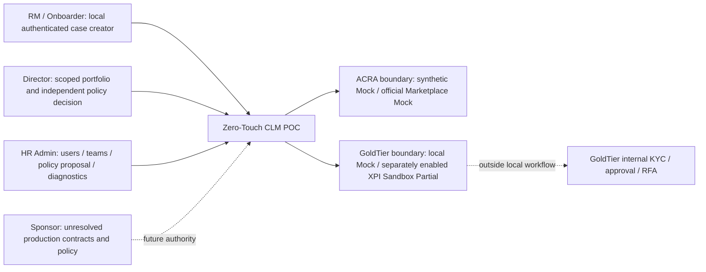
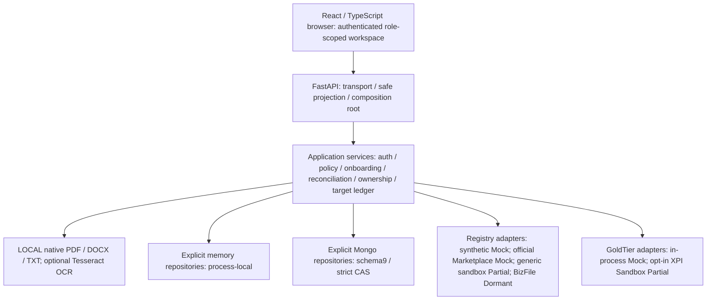
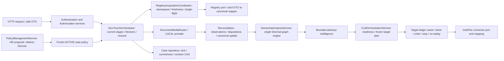
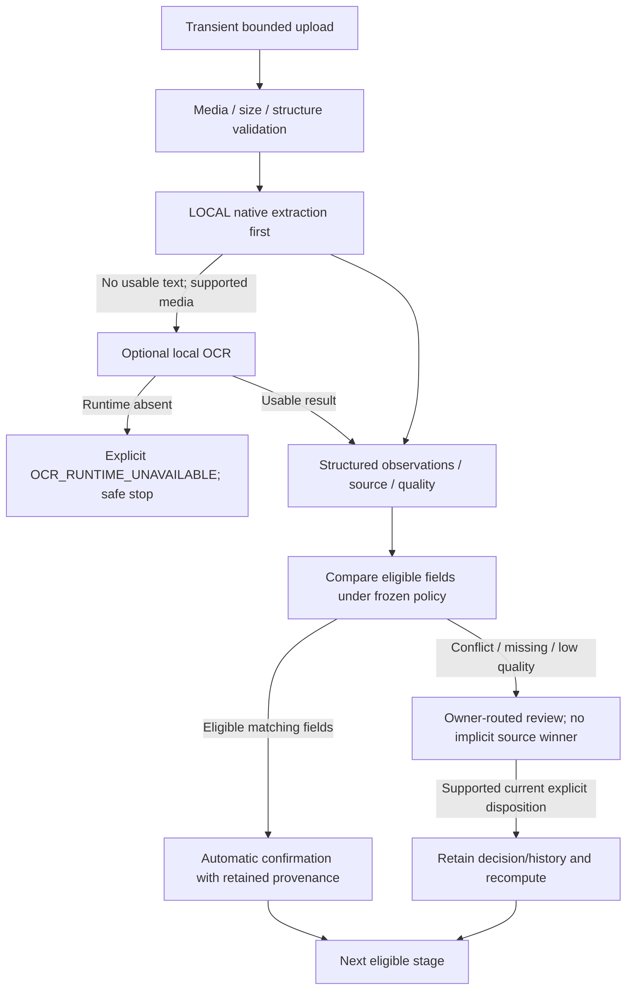
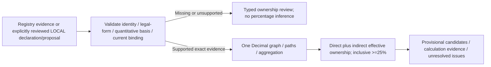
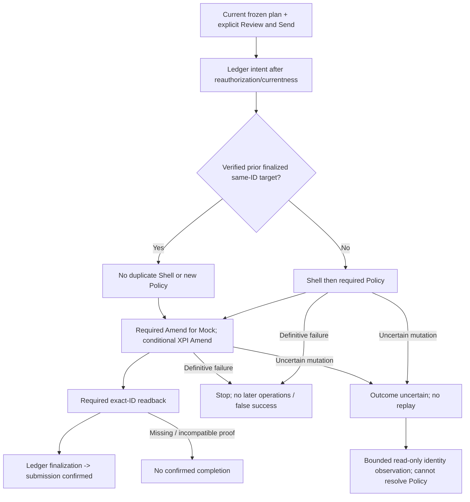

# Final POC Architecture

Inspected main: merged PR #70, `4ee8819d7404d6442e064fd60dcee03ccc84cf11`,
2026-10-05. The Phase27 branch adds two independently accepted UI presentation
fixes; it is unmerged. [ARCHITECTURE](../ARCHITECTURE.md) remains the canonical
owner/dependency map; [PROJECT_STATE](../PROJECT_STATE.md) owns provider/current-main
metadata. The diagrams below are editable Mermaid views of those existing owners.
Earlier phase architecture and receipts retain their tested identities.

## C4 Level 1: system context



No route is Live. External arrows denote provider ports; the default controlled
local demonstration makes no external HTTP calls. Historical official Mock network
observations and historical XPI Sandbox execution are separately attributed.
HR does not gain case access from administration. Review & Send is the final local
approval; no second unresolved human-approval node follows it.

## C4 Level 2: containers and trust



Memory and Mongo are alternative explicit compositions, with no silent fallback.
Mongo is a supported optional local store, not a service used by ordinary routes.
Provider capability does not equal successful case evidence. Production IdP/PingFed,
subscriber ACRA, vendor IDP and distributed deployment are NOT_IMPLEMENTED or OPEN.
Browser controls render backend capabilities; scoped React Query state is cancelled
and cleared on identity/session/team change and401. Raw uploads/provider bodies and
secrets never become browser projections or handoff artefacts.

## C4 Level 3: application components



Static direction remains HTTP -> services -> domain/ports; adapters implement ports.
`main.py` and composition modules wire implementations only. No route-to-Mongo,
direct ACRA-to-GoldTier mapping, second workflow engine, ownership engine or cache
owner exists. The canonical map gives exact files for each component. Registry
Mock cache stores normalized supported successful prefixes/negative results; only
compatible fresh COMPLETE bundles bind to a case. It does not cache target or
ownership decisions. Garden LOCAL supplement is opt-in, visibly separate from
official Mock identity/officers and never a fallback after provider failure.

## Application-owned orchestration without Camunda

An authorized UI input becomes a validated API command. Inside the owning lock the
service rechecks actor/team/capability and current case/evidence/version. The
ZeroTouchOrchestrator selects the next eligible stage from retained facts, stage
status and typed blockers; it calls the owning service/provider port and persists
structured evidence/checkpoints. Current blockers project owner-routed Review,
Resolve issue or View details controls. Unsupported recovery has no invented action.

| Event/input | Decision/provider operation | Retained evidence/blocker | Resume/next stage |
|---|---|---|---|
| Initial legal name/UEN/country + document | Jurisdiction resolves SG; eligible read-only GoldTier Search; required registry acquisition through cache coordinator | Identity/search/registry observations and frozen policy; ambiguous/failed Search blocks target writes but eligible independent evidence continues | Document verification and reconciliation where allowed |
| UEN correction on retained case | In-lock current identity authorization; invalidate only dependent search/registry/comparison/analysis facts, reacquire through existing owners | Same case and original document extraction; superseded history retained | Recompute comparisons, continue to actual current blocker; no automatic target dispatch |
| Field/source review or permitted replacement | Existing document/reconciliation owner validates current binding, confidence and explicit disposition; no implicit global source winner | Original/superseded observations and reviewer decision | Reconciliation -> ownership -> readiness if unresolved blockers clear |
| Current ownership review/edit | Creator capability + current document/analysis/version; proposal source decision before graph replacement; upload only when backend declares OWNERSHIP_UPLOAD | LOCAL declaration/source receipt and immutable proposal/history | One Decimal engine recomputes candidates and prepared plan; no target mutation |
| Review & Send | Reauthorize and validate exact frozen plan/currentness; acquire target intent under ledger owner | Required operation prefix, same target ID, safe outcome/readback/finalization | Confirmed, failed, uncertain or finalization-pending state; no blind retry |
| HR policy proposal / Director decision | Simulate retained revision; distinct Director; base/currentness + lock/CAS | Proposal decision/audit/new ACTIVE catalogue | Only new cases inherit it; older case policy stays frozen |

This is bounded application orchestration, not a general-purpose BPM platform:
there is no Camunda runtime, arbitrary BPMN execution, distributed workflow scheduler
or general compensation engine. API state and safe evidence projections drive the UI.

## Workflow and decision views

The editable [end-to-end onboarding flow](../ARCHITECTURE.md#2-business-and-technical-pipelines)
is reused rather than duplicated. Its twelve user-facing stages are Case created, Initial identity,
Jurisdiction, Existing-customer search, Registry verification, Document verification,
Data reconciliation, Ownership & UBO, Risk assessment, Readiness check, Preparing
GoldTier Submission, and Final review & send. Retained target presentation follows
confirmation. The stage projection's twelve-stage naming is authoritative: target
presentation is retained submission state, not an added approval stage. See the exact
[twelve-stage inventory](../demo/PHASE_27_TRUTH_INVENTORY.md).

### Wrong-UEN recovery

```mermaid
sequenceDiagram
    actor Creator
    participant API
    participant Z as ZeroTouchOrchestrator
    participant R as Registry/cache owner
    participant C as Case repository
    Creator->>API: Edit UEN / Verify and resume (current version)
    API->>Z: Authenticated bounded command
    Z->>C: Lock; reauthorize; validate currentness
    Z->>C: Retain document originals/history; invalidate dependent facts
    Z->>R: Eligible reacquisition with corrected identity
    R-->>Z: Canonical evidence or typed failure
    Z->>C: Persist new comparisons/checkpoint
    Z-->>Creator: Same case; next current stage/blocker
```

### Document/reconciliation decision



Extraction scores describe technical quality, not probability of truth. Original
uploads are transient; wrong-UEN correction preserves structured originals.

### Ownership/UBO calculation



Indirect paths multiply Decimal interests and aggregate supported paths. Officer roles,
share units without a compatible denominator, semantic tags or ML-like confidence
cannot manufacture ownership. D-062 settles the bounded inclusive threshold only;
full legal/control/evidence rules remain OPEN. RP child lifecycle and hierarchy creation
are unsupported; a displayed recursive graph does not imply target hierarchy creation.

### GoldTier submission/no-replay



The ledger owns physical ordering and stopping. A fully resolved prefix with failed
local finalization can permit only its existing no-replay finalization action. Durable
state cannot reconstruct lost process-local Mock provider facts. Historical XPI parent
Search2/Shell1/Policy1/readback1/Amend0 succeeded once; Garden Amend failed. These are
SANDBOX_PARTIAL receipts, not current new external calls or RFA/KYC/approval proof.

### Policy proposal/approval

```mermaid
sequenceDiagram
    actor HR
    participant P as PolicyManagementService
    actor Director
    HR->>P: Draft proposal + reason on retained ACTIVE base
    HR->>P: Simulate prospective synthetic impact
    HR->>P: Submit exact proposal revision
    Director->>P: Independently inspect/simulate same revision
    Director->>P: Approve/activate or reject + reason
    P->>P: Reauthorize; distinct actor; base/revision lock and CAS
    P-->>Director: New ACTIVE or unchanged ACTIVE after rejection
    Note over P: Existing case snapshots remain frozen
```

## Persistence, security and claim boundary

Memory mode is process-local. Explicit Mongo stores structured case schema9 and
supported admin/policy/cache aggregates (policy/cache schema2 separately); strict
valid schemas1..8 decode without read rewrite. Insert-only create, update-only
mutation, revision/identity CAS and no-resurrection after deletion remain mandatory.
Restart recovery reads retained checkpoints/ledger facts and stops unresolved
mutations instead of replaying them. Locks, sessions, single-flight and Mock facts
remain process-local: no distributed exactly-once or regulatory audit guarantee.

Backend owns capability/team scope and safe inaccessible-case404; mutations
reauthorize inside their owning lock/CAS. Frontend permission visibility is not
security. Administration and diagnostics do not grant HR case access.
No auth/schema/provider/owner change accompanies the Phase27 UI fixes.

Phase25 separately decoded three original retained cases read-only and rendered all
three via normal HTTP/frontend against an exact disposable clone, then removed it.
That is historical reader/render compatibility, not Phase27 database execution,
migration or production durability. Phase27 accesses no original clm_poc.
No current path is Live; technical completion is POC submission only. See the
[limitations](../demo/FINAL_POC_LIMITATIONS_AND_NEXT_STEPS.md) and
[Q-001..Q-018](../sponsor-questions/OPEN_QUESTIONS.md).
